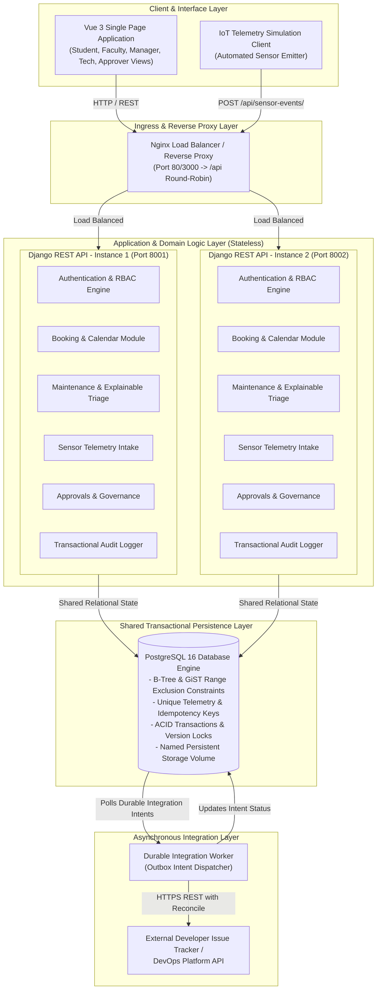

# Integrated Application Component Architecture

## 1. Architectural Style and Topology
The Smart Campus Facility Booking and Maintenance Platform adopts a clean, modular, layered architecture designed for stateless multi-replica horizontal scaling. The system separates user interface concerns, authoritative business and security domain logic, transactional relational persistence, and asynchronous external system integrations.

---

## 2. Component Descriptions

### 2.1 Vue 3 User Interface
- **Role & Responsibilities:** Provides responsive, accessible views for all six user personas. Renders the operations dashboard, availability calendar, maintenance queue, explainable triage details, and inspection modals.
- **Security Boundary:** Untrusted presentation layer. Performs client-side format guidance and form validations to enhance user experience, but relies entirely on backend APIs for security, access enforcement, and state authorization.

### 2.2 Nginx Ingress & Load Balancer
- **Role & Responsibilities:** Acts as the reverse proxy gateway, terminating external HTTP requests and distributing traffic across the two backend instances (`backend-1:8000` and `backend-2:8000`) using round-robin scheduling.
- **Failover Handling:** Configured with active health checks to detect unhealthy backend instances and route traffic exclusively to surviving replicas during maintenance or crashes.

### 2.3 Django REST Framework Backend Service (Stateless Replicas)
- **Role & Responsibilities:** The authoritative security and business logic boundary:
  - Validates authentication tokens/sessions.
  - Enforces RBAC permissions per endpoint and role.
  - Executes the deterministic explainable triage engine.
  - Implements optimistic concurrency checks (`expected_version`).
  - Employs atomic database transactions to ensure state transitions and audit logs commit together.
- **Statelessness:** Stores no session state, in-memory locks, or uncommitted work items in local process RAM, ensuring that any request can be fulfilled by any backend replica.

### 2.4 PostgreSQL Persistence Engine
- **Role & Responsibilities:** The definitive source of truth across all campus data:
  - Enforces relational referential integrity via foreign key cascades.
  - Prevents booking overlaps using generalized search tree (`GiST`) exclusion constraints (`booking_no_active_overlap`).
  - Enforces telemetry uniqueness on `(source_id, event_id)`.
  - Maintains persistent transactional isolation (Read Committed / Serializable where required).

### 2.5 Durable Integration Worker (Outbox Pattern)
- **Role & Responsibilities:** Asynchronously inspects pending `IntegrationIntent` records created during ticket triage or approval workflows, communicating with external developer issue trackers (e.g., GitHub Issues / Jira) via durable correlation keys to prevent duplicate ticket generation across network timeouts.
