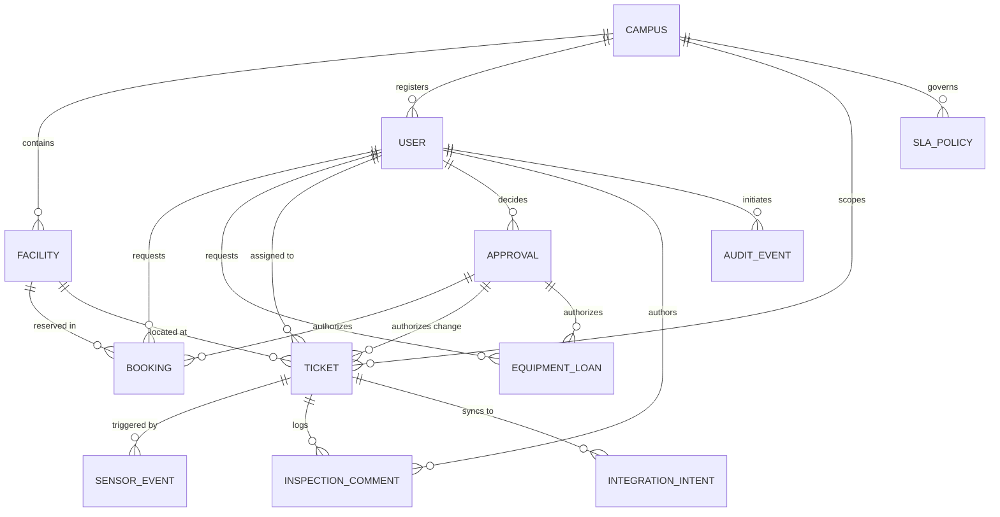

# Relational Data Model Specification

## 1. Entity-Relationship Overview
The Smart Campus platform models 14 core entities to capture operational relationships between campuses, facilities, user roles, reservations, telemetry, maintenance work items, approvals, and audit records.

---

## 2. Detailed Entity Attributes & Constraints

### 1. `Campus`
- `id`: AutoField (Primary Key)
- `code`: CharField(10, unique=True) — e.g., `"MAIN"`, `"MED"`, `"ENG"`, `"NRP"`, `"SHS"`, `"CIH"`
- `name`: CharField(100) — e.g., `"Main University Campus"`, `"Medical Sciences Campus"`
- `timezone`: CharField(50, default="UTC")
- `is_active`: BooleanField(default=True)
- `created_at`: DateTimeField(auto_now_add=True)

### 2. `User` (Custom User Model)
- `id`: AutoField (Primary Key)
- `username`: CharField(150, unique=True)
- `email`: EmailField(unique=True)
- `role`: CharField(30, choices=[`student`, `faculty`, `facility_manager`, `technician`, `department_approver`, `administrator`])
- `campus`: ForeignKey(`Campus`, on_delete=SET_NULL, null=True, related_name="users")
- `department`: CharField(100)
- `phone`: CharField(20, blank=True)
- `is_active`: BooleanField(default=True)
- `date_joined`: DateTimeField(auto_now_add=True)

### 3. `Facility`
- `id`: AutoField (Primary Key)
- `campus`: ForeignKey(`Campus`, on_delete=CASCADE, related_name="facilities")
- `name`: CharField(100) — e.g., `"Robotics Automation Lab 101"`
- `code`: CharField(30, unique=True) — e.g., `"ENG-ROBO-101"`
- `facility_type`: CharField(50, choices=[`lecture_hall`, `computer_lab`, `research_lab`, `seminar_hall`, `study_room`])
- `capacity`: IntegerField()
- `is_restricted`: BooleanField(default=False) — requires departmental approver review
- `is_active`: BooleanField(default=True)
- `location_details`: CharField(255, blank=True)

### 4. `Booking`
- `id`: AutoField (Primary Key)
- `facility`: ForeignKey(`Facility`, on_delete=CASCADE, related_name="bookings")
- `requester`: ForeignKey(`User`, on_delete=CASCADE, related_name="bookings")
- `start_at`: DateTimeField()
- `end_at`: DateTimeField()
- `status`: CharField(30, choices=[`requested`, `approved`, `confirmed`, `in_use`, `completed`, `cancelled`], default="confirmed")
- `purpose`: TextField()
- `version`: IntegerField(default=1) — Optimistic locking token
- `request_key`: CharField(64, unique=True, null=True, blank=True) — Idempotency key
- `created_at`: DateTimeField(auto_now_add=True)
- `updated_at`: DateTimeField(auto_now=True)
- **Constraints:**
  - Check constraint: `end_at > start_at`
  - PostgreSQL GiST Exclusion Constraint: Non-overlap for `facility_id` across `tstzrange(start_at, end_at, '[)')` where `status IN ('approved', 'confirmed', 'in_use')`.

### 5. `EquipmentLoan`
- `id`: AutoField (Primary Key)
- `requester`: ForeignKey(`User`, on_delete=CASCADE, related_name="equipment_loans")
- `asset_name`: CharField(100) — e.g., `"Digital Storage Oscilloscope DS1054Z"`
- `asset_code`: CharField(50) — e.g., `"ASSET-OSC-042"`
- `start_at`: DateTimeField()
- `end_at`: DateTimeField()
- `status`: CharField(30, choices=[`pending_approval`, `approved`, `active`, `returned`, `rejected`], default="pending_approval")
- `purpose`: TextField()
- `created_at`: DateTimeField(auto_now_add=True)

### 6. `Ticket` (Maintenance Work Item)
- `id`: AutoField (Primary Key)
- `campus`: ForeignKey(`Campus`, on_delete=CASCADE, related_name="tickets")
- `facility`: ForeignKey(`Facility`, on_delete=SET_NULL, null=True, blank=True, related_name="tickets")
- `source`: CharField(30, choices=[`sensor_event`, `manual_report`, `routine_inspection`])
- `title`: CharField(200)
- `description`: TextField()
- `category`: CharField(50, choices=[`hvac`, `plumbing`, `electrical`, `network`, `structural`, `general`])
- `impact`: CharField(20, choices=[`high`, `medium`, `low`], default="medium")
- `urgency`: CharField(20, choices=[`high`, `medium`, `low`], default="medium")
- `priority`: CharField(10, choices=[`M1`, `M2`, `M3`, `M4`], default="M3")
- `triage_explanation`: TextField(blank=True) — rule reason
- `status`: CharField(30, choices=[`intake`, `triaged`, `assigned`, `in_progress`, `inspection`, `pending_approval`, `resolved`, `rejected`, `closed`], default="intake")
- `assignee`: ForeignKey(`User`, on_delete=SET_NULL, null=True, blank=True, related_name="assigned_tickets")
- `resolution_notes`: TextField(blank=True)
- `is_restricted_change`: BooleanField(default=False)
- `version`: IntegerField(default=1) — Optimistic locking token
- `sla_due_at`: DateTimeField(null=True, blank=True)
- `created_at`: DateTimeField(auto_now_add=True)
- `updated_at`: DateTimeField(auto_now=True)

### 7. `SensorEvent`
- `id`: AutoField (Primary Key)
- `source_id`: CharField(100) — e.g., `"HVAC-TEMP-UNIT-04"`
- `event_id`: CharField(100) — e.g., `"evt-7721-abc"`
- `metric`: CharField(50) — e.g., `"temperature_celsius"`, `"vibration_hz"`
- `value`: FloatField()
- `observed_at`: DateTimeField()
- `payload_hash`: CharField(64, blank=True)
- `ticket`: ForeignKey(`Ticket`, on_delete=SET_NULL, null=True, blank=True, related_name="sensor_events")
- `processed_at`: DateTimeField(auto_now_add=True)
- **Constraints:**
  - Unique constraint: `UNIQUE(source_id, event_id)`

### 8. `SLAPolicy`
- `id`: AutoField (Primary Key)
- `campus`: ForeignKey(`Campus`, on_delete=CASCADE, related_name="sla_policies")
- `category`: CharField(50)
- `priority`: CharField(10) — `M1`, `M2`, `M3`, `M4`
- `response_minutes`: IntegerField(default=60)
- `resolution_minutes`: IntegerField(default=480)
- `version`: IntegerField(default=1)
- `is_active`: BooleanField(default=True)

### 9. `Approval`
- `id`: AutoField (Primary Key)
- `request_type`: CharField(30, choices=[`booking`, `equipment_loan`, `ticket_change`])
- `request_id`: IntegerField()
- `approver`: ForeignKey(`User`, on_delete=CASCADE, related_name="approvals")
- `decision`: CharField(20, choices=[`approved`, `rejected`])
- `reason`: TextField()
- `decided_at`: DateTimeField(auto_now_add=True)

### 10. `InspectionComment`
- `id`: AutoField (Primary Key)
- `ticket`: ForeignKey(`Ticket`, on_delete=CASCADE, related_name="comments")
- `author`: ForeignKey(`User`, on_delete=CASCADE)
- `comment_type`: CharField(30, choices=[`inspection`, `note`, `resolution_evidence`])
- `notes`: TextField()
- `evidence_ref`: CharField(255, blank=True)
- `created_at`: DateTimeField(auto_now_add=True)

### 11. `AuditEvent`
- `id`: AutoField (Primary Key)
- `actor`: ForeignKey(`User`, on_delete=SET_NULL, null=True, related_name="audit_events")
- `entity_type`: CharField(50) — e.g., `"Booking"`, `"Ticket"`, `"Approval"`
- `entity_id`: IntegerField()
- `action`: CharField(50) — e.g., `"CREATE"`, `"STATE_TRANSITION"`, `"APPROVAL_DECISION"`, `"OVERLAP_REJECTION"`
- `before_state`: JSONField(null=True, blank=True)
- `after_state`: JSONField(null=True, blank=True)
- `ip_address`: GenericIPAddressField(null=True, blank=True)
- `created_at`: DateTimeField(auto_now_add=True)

### 12. `IntegrationIntent`
- `id`: AutoField (Primary Key)
- `ticket`: ForeignKey(`Ticket`, on_delete=CASCADE, related_name="integration_intents")
- `operation`: CharField(50, default="create_developer_issue")
- `correlation_key`: CharField(100, unique=True)
- `status`: CharField(30, choices=[`pending`, `in_flight`, `confirmed`, `failed`], default="pending")
- `attempts`: IntegerField(default=0)
- `external_id`: CharField(100, blank=True)
- `last_attempt_at`: DateTimeField(null=True, blank=True)
- `created_at`: DateTimeField(auto_now_add=True)

### 13. `TriageRule`
- `id`: AutoField (Primary Key)
- `name`: CharField(100)
- `keyword`: CharField(50)
- `category`: CharField(50)
- `default_impact`: CharField(20)
- `default_urgency`: CharField(20)
- `is_active`: BooleanField(default=True)

### 14. `FacilitySchedule` (Derived Operational Availability)
- View / query model mapping date ranges, operating hours, and blackout maintenance periods.
