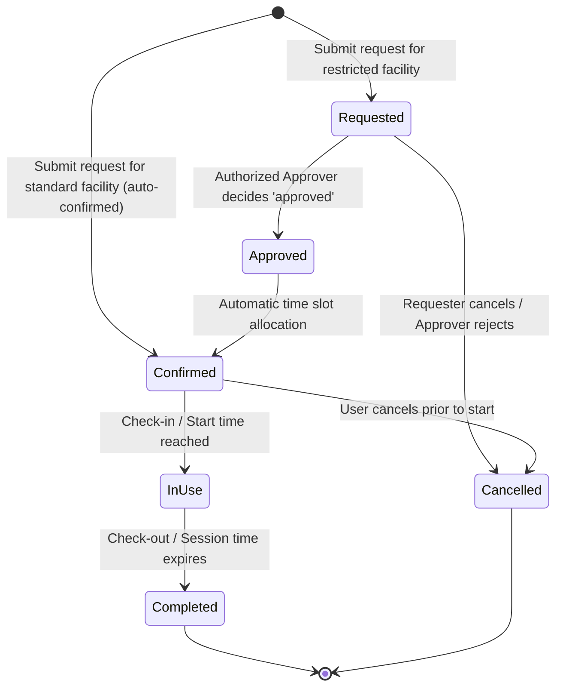
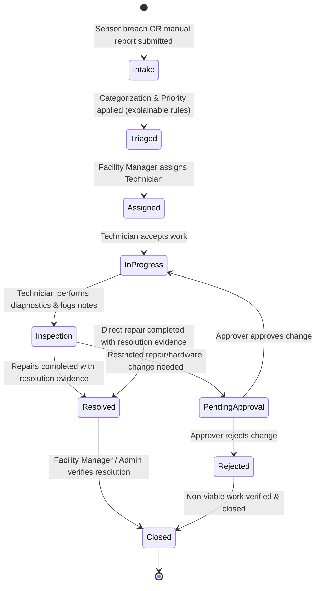

# Booking and Maintenance Ticket Lifecycle State Models

## 1. Overview
All state transitions in the Smart Campus platform are modeled as finite state machines (FSM). State updates are evaluated by backend domain services, validated against explicit guard conditions, protected by optimistic concurrency version tokens, and recorded in transactional audit logs.

---

## 2. Facility Booking Lifecycle

### Transition Guard Rules for Bookings

| Current State | Target State | Permitted Actor | Guard Conditions / Invariants |
|---|---|---|---|
| `[*] (None)` | `Requested` | Student, Faculty | Target facility has `is_restricted == True`. Slot must not overlap with active bookings. |
| `[*] (None)` | `Confirmed` | Student (standard), Faculty | Target facility has `is_restricted == False`. Database exclusion constraint confirms slot is free. |
| `Requested` | `Approved` | Department Approver, Admin | Approver must belong to relevant department/scope. Reason is mandatory. |
| `Requested` | `Cancelled` | Requester, Approver, Admin | Rejection reason must be logged. |
| `Approved` | `Confirmed` | System / Approver | Ensures slot has not been commandeered in the interim. |
| `Confirmed` | `InUse` | Requester, Manager | `current_time >= start_at` and `current_time < end_at`. |
| `InUse` | `Completed` | Requester, Manager, Admin | `current_time >= end_at` or manual check-out. |
| `Confirmed` | `Cancelled` | Requester, Manager, Admin | `current_time < start_at`. |

---

## 3. Maintenance Ticket Lifecycle

### Transition Guard Rules for Maintenance Tickets

| Current State | Target State | Permitted Actor | Guard Conditions / Invariants |
|---|---|---|---|
| `[*] (None)` | `Intake` | Sensor Client, Faculty, Student | Valid source identified; telemetry deduplication check passed. |
| `Intake` | `Triaged` | System / Facility Manager | Categorized by keyword rules; priority ($M1$ to $M4$) derived from Impact $\times$ Urgency matrix. |
| `Triaged` | `Assigned` | Facility Manager, Admin | Assignee must be active user with `role == 'technician'`. SLA due date calculated. |
| `Assigned` | `InProgress` | Assigned Technician | Technician acknowledges work order. |
| `InProgress` | `Inspection` | Assigned Technician | Technician records initial physical diagnostic findings. |
| `Inspection` | `PendingApproval` | Assigned Technician | Repair requires high-value parts, power shutdown, or room closure (`is_restricted_change == True`). |
| `PendingApproval`| `InProgress` | Department Approver, Admin | Approval decision recorded with justification reason. |
| `InProgress` / `Inspection` | `Resolved` | Assigned Technician | **Strict Rule:** `resolution_notes` must be non-empty and describe corrective action. Missing notes returns `HTTP 422`. |
| `Resolved` | `Closed` | Facility Manager, Admin | Administrative review validates satisfactory completion. |

---

## 4. Rejection of Invalid Transitions
Direct jumps across lifecycle boundaries (e.g., `Intake` directly to `Closed`, or `Confirmed` directly to `Completed`) are strictly rejected with `HTTP 422 Unprocessable Entity` and the error code `ILLEGAL_STATE_TRANSITION`. Every valid state transition atomically increments the entity's `version` field and logs an `AuditEvent`.
