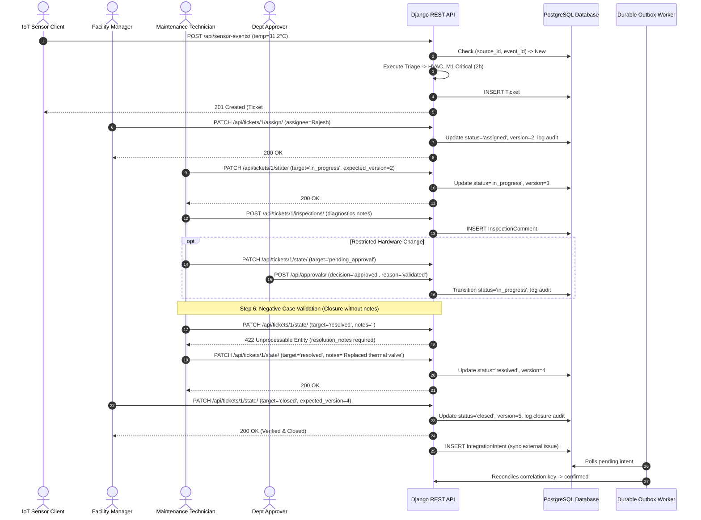

# Explainable Maintenance Triage & Evidence-Gated Lifecycle

## 1. Deterministic and Explainable Triage
The platform avoids opaque or hallucinatory black-box AI by implementing a transparent, deterministic rule-based triage engine (`backend/maintenance/triage_engine.py`).

### 1.1 Category Classification via Domain Keywords
The system scans reported incident titles and descriptions against an approved campus taxonomy:
- **HVAC:** `ac`, `air-conditioning`, `chiller`, `temperature`, `overheat`, `fan`, `cooling`, `ventilation`, `thermostat`
- **Plumbing:** `leak`, `pipe`, `water`, `flood`, `drain`, `faucet`, `toilet`, `overflow`, `sewage`
- **Electrical:** `spark`, `power`, `electrical`, `breaker`, `blackout`, `wiring`, `fuse`, `outlet`, `short-circuit`, `voltage`
- **Network:** `wifi`, `network`, `ethernet`, `router`, `switch`, `internet`, `connectivity`, `latency`, `gateway`
- **Structural:** `door`, `window`, `lock`, `ceiling`, `wall`, `crack`, `glass`, `hinge`, `roof`

### 1.2 Priority Assessment Matrix
Priority is computed using the university-approved $3 \times 3$ Impact $\times$ Urgency matrix:

| Teaching / Operational Impact | High Urgency (Immediate Disruption) | Medium Urgency | Low Urgency |
|---|---|---|---|
| **High Impact** | **M1 – Critical** (2h SLA) | **M2 – High** (4h SLA) | **M3 – Medium** (8h SLA) |
| **Medium Impact** | **M2 – High** (4h SLA) | **M3 – Medium** (8h SLA) | **M4 – Low** (24h SLA) |
| **Low Impact** | **M3 – Medium** (8h SLA) | **M4 – Low** (24h SLA) | **M4 – Low** (24h SLA) |

### 1.3 Generated Explainability Record
Each triaged ticket stores a detailed explainability rationale visible to facility managers:
```text
[Explainable Triage Engine]
1. Categorization: Matched keyword(s) ['chiller', 'temperature'] mapping to category 'hvac'.
2. Priority Assessment: Impact='HIGH' and Urgency='HIGH' evaluate via matrix to Priority M1.
3. SLA Target: Assigned resolution deadline of 120 minutes (2.0 hours).
```

---

## 2. Evidence-Gated Maintenance Lifecycle Workflow


