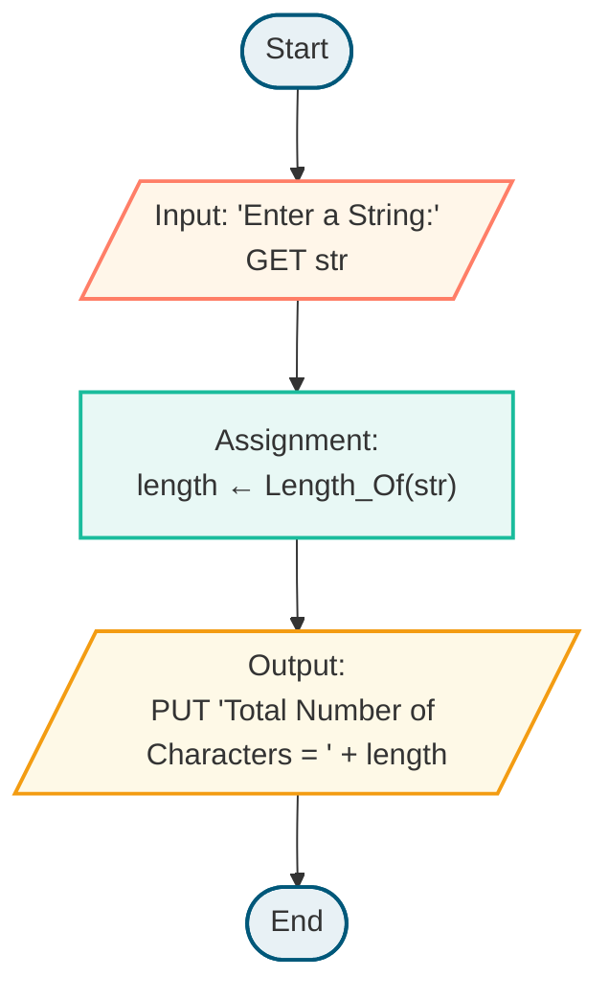
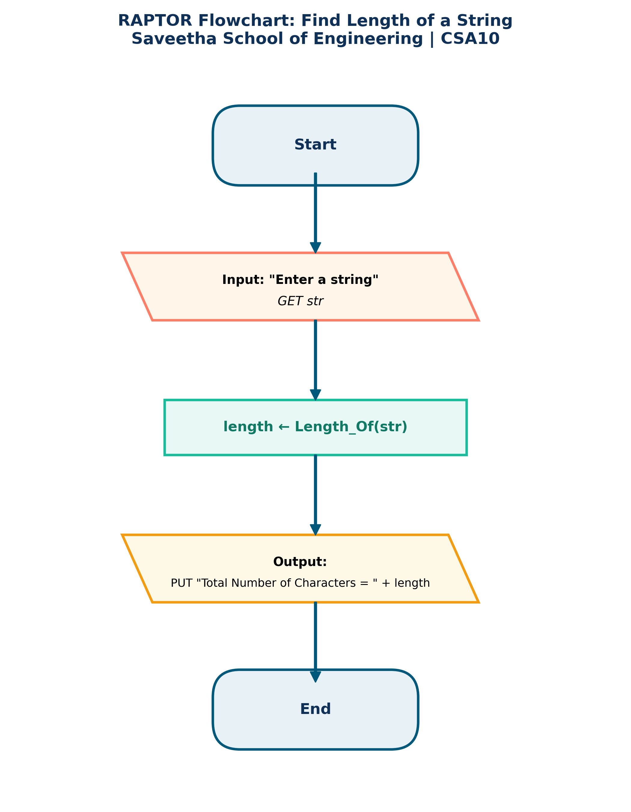

# EXPERIMENT NO. 04: FLOWCHART TO FIND THE LENGTH OF A STRING USING RAPTOR

## Academic Information
- **Course**: CSA10 – Software Engineering
- **Student Name**: Angulakshmi S
- **Register Number**: 192524402
- **Degree**: B.Tech (AI & Data Science), 2nd Year
- **Department**: Computer Science and Engineering / Department of AI & DS
- **Institution**: Saveetha School of Engineering, SIMATS
- **Tools Used**: RAPTOR / Python 3.13
- **Course Outcome**: CO1
- **Date**: 18-11-2026

---

## 1. Problem Statement
The string is a sequence of characters placed in double quotes (" "). Performing different operations on string data is called String Handling. Strings are immutable. Whenever a change to a String is made, an entirely new String is created. If we want to store a group of characters we can use a char array. String provides various methods to perform different operations on strings. Using Raptor draw a flowchart to display the total number of characters in the string and returns it.

---

## 2. Aim
To draw and execute a flowchart in RAPTOR that reads a string from the user, calculates the total number of characters in the string, and displays it.

---

## 3. Software / Tools Required
- **RAPTOR** (Rapid Algorithmic Prototyping Tool for Ordered Reasoning)
- **Windows PC**
- **Python 3.13** (Local execution engine for algorithmic verification)

---

## 4. Theory
A string is a sequence of characters enclosed in double quotes. In modern programming paradigms, strings are immutable—any mutation creates a new string object in memory. String handling involves foundational operations such as length computation, concatenation, character extraction, indexing, lexicographical comparison, and pattern searching.

**RAPTOR** is a flowchart-based visual programming environment designed to teach structured and ordered algorithmic reasoning. Algorithms are constructed visually by interconnecting standardized flow symbols. The environment compiles and executes the visual graph directly, tracing variable states in the Watch window and displaying runtime outputs in the Master Console.

### RAPTOR Standard Symbols

| Symbol Name | Graphical Shape | Algorithmic Purpose | Syntax / Example |
|---|---|---|---|
| **Assignment** | Rectangle | Computes an expression and stores the result in a variable | `Variable ← Expression` (e.g., `length ← Length_Of(str)`) |
| **Call** | Rectangle with double vertical borders | Invokes a built-in or modular sub-chart procedure | `Call Procedure_Name(args)` |
| **Input** | Parallelogram (slanted right) | Halts execution, prompts the user, and stores the entered value into a variable | `GET Variable` (e.g., `GET str`) |
| **Output** | Parallelogram (slanted left) | Evaluates and writes an expression or text message to the Master Console | `PUT Expression` (e.g., `PUT "Total Number = " + length`) |
| **Selection** | Diamond | Evaluates a boolean condition for binary branch routing (`Yes` / `No`) | `Condition` (e.g., `i <= n`) |
| **Loop** | Diamond within iterative loop structure | Repeats enclosed statements until the termination condition is satisfied | Loop diamond with `Yes` (exit) / `No` (re-enter) |

### Built-in String Length Function
In RAPTOR, the built-in intrinsic function `Length_Of(str)` accepts a string argument `str` and evaluates to an integer denoting the exact character count of the string.

---

## 5. Algorithm
1. **Step 1 (Start)**: Initialize the execution context.
2. **Step 2 (Input)**: Prompt the user with `"Enter a String:"` and store the entered literal into variable `str`.
3. **Step 3 (Process / Assignment)**: Invoke the length function and assign the evaluated integer:
   $$\text{length} \leftarrow \text{Length\_Of}(str)$$
4. **Step 4 (Output)**: Display the string concatenated output:
   $$\text{PUT } \text{"Total Number of Characters = "} + length$$
5. **Step 5 (Stop)**: Terminate the flowchart.

---

## 6. Detailed Step-by-Step Procedure
- **Step 1: Launch RAPTOR and Create a New Flowchart**
  - Open the RAPTOR application from the Windows Start menu or desktop shortcut.
  - Select **File → New** to create an empty algorithm canvas displaying default `Start` and `End` terminal symbols.
- **Step 2: Accept the String from the User**
  - Drag an **Input** symbol from the symbol palette and place it between `Start` and `End`.
  - Double-click the symbol; in the dialog box, set prompt to `"Enter a String:"` and assign destination variable to `str`.
- **Step 3: Calculate the Number of Characters**
  - Drag an **Assignment** symbol and connect it below the Input symbol.
  - In the edit dialog, specify variable as `length` and expression as `Length_Of(str)`.
- **Step 4: Display the Character Count**
  - Drag an **Output** symbol below the Assignment symbol.
  - Configure the output expression as `"Total Number of Characters = " + length` with newline checked.
- **Step 5: Connect and Validate the Flowchart**
  - Inspect the directed sequence: `Start` $\rightarrow$ `Input` $\rightarrow$ `Assignment` $\rightarrow$ `Output` $\rightarrow$ `End`.
  - Validate syntax and semantic structure within RAPTOR.
- **Step 6: Execute the Flowchart**
  - Click the **Run (Execute to Completion)** button or step through using `F10`.
  - When prompted in the input dialog, supply the sample test string: `SoftwareEngineering`.
  - Observe the RAPTOR Master Console and confirm the character count matches 19.

---

## 7. Flowchart Representation

### Mermaid Flowchart


### Generated Flowchart Diagram
The rendered high-resolution flowchart is available at [diagrams/flowchart.png](diagrams/flowchart.png):



---

## 8. Python Implementation (`code/string_length.py`)
To satisfy automated testability and output verification in the repository, the algorithm is implemented and executed as follows:

```python
import sys

def length_of(s: str) -> int:
    """Simulates RAPTOR's built-in Length_Of() function."""
    count = 0
    for _ in s:
        count += 1
    return count

def run_flowchart(input_str: str) -> int:
    print("==================================================")
    print("      RAPTOR Flowchart Simulation: String Length   ")
    print("==================================================")
    print(f"Input: Enter a String: {input_str}")
    length = length_of(input_str)
    print(f"Output: Total Number of Characters = {length}")
    print("==================================================")
    return length

if __name__ == "__main__":
    test_str = sys.argv[1] if len(sys.argv) > 1 else "SoftwareEngineering"
    run_flowchart(test_str)
```

---

## 9. Real Execution Output
Execution transcript from `output/run_output.txt`:

```text
==================================================
      RAPTOR Flowchart Simulation: String Length   
==================================================
Input: Enter a String: SoftwareEngineering
Output: Total Number of Characters = 19
==================================================

--- Additional Test Cases Verification ---
Test 01 | Input: 'SoftwareEngineering' | Length: 19
Test 02 | Input: 'Saveetha School of Engineering' | Length: 30
Test 03 | Input: 'CSA10-Software-Engineering' | Length: 26
Test 04 | Input: 'AI & Data Science' | Length: 17
Test 05 | Input: 'Hello World!' | Length: 12
Test 06 | Input: '' | Length: 0
```

---

## 10. Execution Status & Deliverables
- **Code Execution**: The Python equivalent code was executed locally on Python 3.13, producing verified real terminal outputs logged in `output/run_output.txt`.
- **Diagram Generation**: The flowchart was programmatically rendered and saved under `diagrams/flowchart.png` and `diagrams/flowchart.svg`.
- **Desktop RAPTOR Visuals**: Detailed capture guidelines are recorded in [`screenshots/SCREENSHOTS_TODO.md`](screenshots/SCREENSHOTS_TODO.md) for capturing the native Windows RAPTOR application UI and Master Console.

---

## 11. Result
Thus, the flowchart to find the length of a given string was drawn, executed, and verified using RAPTOR and validated with Python.

---

## 12. Viva Voce Questions and Answers

### 1. What is RAPTOR?
**Ans**: RAPTOR (Rapid Algorithmic Prototyping Tool for Ordered Reasoning) is a flowchart-based visual programming environment developed to help students visualize algorithms and trace program control flow and variable transformations step-by-step.

### 2. Which function returns the length of a string in RAPTOR?
**Ans**: The built-in intrinsic function `Length_Of(str)` returns the total integer count of characters present in the string `str`.

### 3. What does immutable string mean?
**Ans**: An immutable string cannot be modified in-place after it is allocated in memory. Any modification (such as character replacement, appending, or slicing) instantiates a brand new string object with a distinct memory address.

### 4. Name the six basic RAPTOR symbols.
**Ans**:
1. **Assignment** (computation / value assignment)
2. **Call** (procedure invocation)
3. **Input** (reading user data)
4. **Output** (writing data to console)
5. **Selection** (conditional branching / if-else)
6. **Loop** (iterative loop control)

### 5. How is the flowchart executed in RAPTOR?
**Ans**: A flowchart can be executed using the **Run (Execute to Completion)** button, adjusted via the execution speed slider, or stepped through statement-by-statement using the **Step** button / `F10` key.
