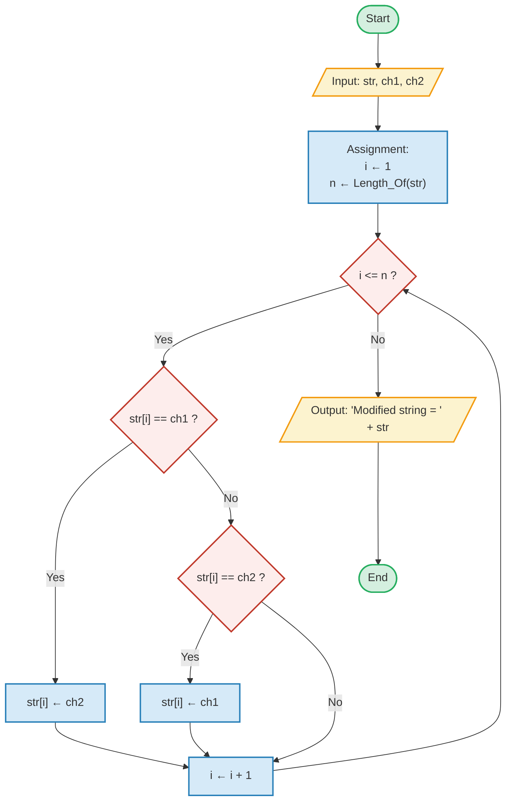
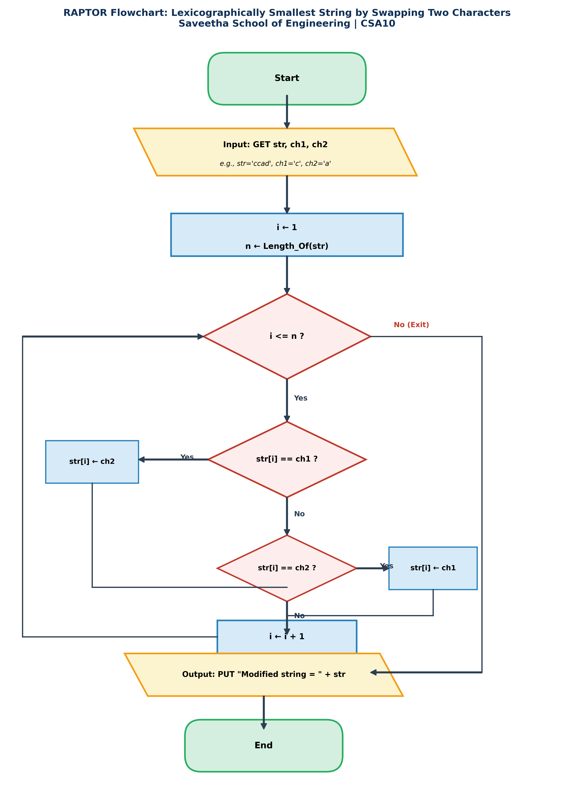

# EXPERIMENT NO. 05: LEXICOGRAPHICALLY SMALLEST STRING BY SWAPPING TWO CHARACTERS USING RAPTOR

## Academic Information
- **Course**: CSA10 – Software Engineering
- **Student Name**: Angulakshmi S
- **Register Number**: 192524402
- **Degree**: B.Tech (AI & Data Science), 2nd Year
- **Department**: Computer Science and Engineering / Department of AI & DS
- **Institution**: Saveetha School of Engineering, SIMATS
- **Tools Used**: RAPTOR / Python 3.13
- **Course Outcome**: CO1
- **Date**: 18-11-2026

---

## 1. Problem Statement
Using Raptor – Draw and validate a flowchart for a given string of lower case English alphabets. One can choose any two characters in the string and replace all the occurrences of the first character with the second character and replace all the occurrences of the second character with the first character. Using Raptor draw and validate the flowchart lexicographically smallest string that can be obtained by doing this operation at most once.

---

## 2. Aim
To draw and validate a RAPTOR flowchart that, for a given string of lower-case letters, chooses two characters and swaps all their occurrences at most once, so that the lexicographically smallest string is obtained.

---

## 3. Software / Tools Required
- **RAPTOR** (Rapid Algorithmic Prototyping Tool for Ordered Reasoning)
- **Windows PC**
- **Python 3.13** (Local execution engine for algorithmic verification)

---

## 4. Theory

### Lexicographical Order
A string $A$ is defined as lexicographically smaller than a string $B$ ($A <_{\text{lex}} B$) if, at the first character index $i$ where $A[i] \neq B[i]$, the character $A[i]$ appears earlier in the alphabet than $B[i]$ (standard dictionary ordering).

### Problem Constraints & Strategy
- **Operation Constraint**: We are allowed to select at most **one pair** of distinct characters $(x, y)$.
- When selected, **every occurrence** of $x$ in the entire string is replaced by $y$, and **every occurrence** of $y$ is replaced by $x$.
- **Greedy Optimization Strategy**:
  1. To minimize a string lexicographically, the highest priority is to minimize characters at the earliest possible index (from left to right).
  2. Scan the string from index $i = 1$ to $n$.
  3. At the first character $str[i]$ for which there exists some character $str[j]$ ($j > i$) such that $str[j] < str[i]$, select $ch_1 = str[i]$.
  4. Choose $ch_2$ as the strictly smallest character appearing after index $i$.
  5. If no such index exists, the string is already minimal.
  6. Perform the bidirectional swap throughout the string:
     - Replace all instances of $ch_1$ with $ch_2$.
     - Replace all instances of $ch_2$ with $ch_1$.

### Example
Given input: `str = "ccad"`
- At index 1, character is `'c'`.
- Scanning rightward reveals `'a'` at index 3, and `'a' < 'c'`.
- Swap characters $ch_1 = \text{'c'}$ and $ch_2 = \text{'a'}$.
- Replacing all `'c'` with `'a'` and all `'a'` with `'c'` gives:
  $$\text{"ccad"} \longrightarrow \text{"aacd"}$$
- `"aacd"` is the lexicographically smallest possible string.

---

## 5. Algorithm
1. **Start**: Initialize runtime environment.
2. **Input**:
   - Read string `str`.
   - Read first character to swap `ch1`.
   - Read second character to swap `ch2`.
3. **Initialize Variables**:
   - Set loop index $i \leftarrow 1$.
   - Set length $n \leftarrow \text{Length\_Of}(str)$.
4. **Loop Traversal**:
   - Check if $i \le n$. If false ($i > n$), exit loop to Step 7.
   - If true, proceed to character replacement checks:
5. **Conditional Branching (Selections)**:
   - **Selection 1**: If $str[i] = ch1$, then $str[i] \leftarrow ch2$.
   - **Selection 2**: Else if $str[i] = ch2$, then $str[i] \leftarrow ch1$.
   - Otherwise, maintain $str[i]$ unchanged.
6. **Increment & Repeat**:
   - $i \leftarrow i + 1$.
   - Return to loop evaluation in Step 4.
7. **Output**: Display the modified string:
   $$\text{PUT } \text{"Modified string = "} + str$$
8. **Stop**: Halt program execution.

---

## 6. Detailed Step-by-Step Procedure
- **Step 1: Launch RAPTOR**
  - Launch the RAPTOR visual programming tool on Windows.
  - Create a new flowchart using **File → New**.
- **Step 2: Insert Input Symbols**
  - Add three **Input** symbols sequentially between `Start` and `End`:
    - Prompt 1: `"Enter the string:"` $\rightarrow$ `str`
    - Prompt 2: `"Enter first character (ch1):"` $\rightarrow$ `ch1`
    - Prompt 3: `"Enter second character (ch2):"` $\rightarrow$ `ch2`
- **Step 3: Initialize Variables**
  - Insert an **Assignment** block below the input symbols.
  - Set loop index: $i \leftarrow 1$.
  - Calculate string size: $n \leftarrow \text{Length\_Of}(str)$.
- **Step 4: Create a Loop for String Traversal**
  - Insert a **Loop** symbol after the initialization block.
  - Set the exit condition diamond to $i > n$.
- **Step 5: Compare Current Character with First Character (`ch1`)**
  - Inside the loop body, insert a **Selection** symbol.
  - Set condition: $str[i] = ch1$.
  - On the **Yes** branch, assign $str[i] \leftarrow ch2$.
- **Step 6: Compare Current Character with Second Character (`ch2`)**
  - On the **No** branch of Selection 1, insert a second **Selection** symbol.
  - Set condition: $str[i] = ch2$.
  - On the **Yes** branch, assign $str[i] \leftarrow ch1$.
- **Step 7: Increment the Loop Counter**
  - Insert an **Assignment** symbol below the decision junctions: $i \leftarrow i + 1$.
  - Route the flow line back to the loop entry.
- **Step 8: Display the Modified String**
  - Below the loop exit path, add an **Output** symbol.
  - Display `"Modified string = " + str`.
- **Step 9: Validate the Flowchart**
  - Run the flowchart using **Run → Execute to Completion**.
  - Supply the test vector: `str = "ccad"`, `ch1 = "c"`, `ch2 = "a"`.
  - Verify that the Master Console outputs `Modified string = aacd`.

---

## 7. Flowchart Representation

### Mermaid Flowchart


### Generated Flowchart Diagram
The rendered flowchart is saved at [diagrams/flowchart.png](diagrams/flowchart.png):



---

## 8. Python Implementation (`code/lexicographically_smallest.py`)
```python
def swap_all_occurrences(s: str, ch1: str, ch2: str) -> str:
    """Executes the exact loop and selection structure from RAPTOR."""
    res = list(s)
    n = len(res)
    i = 0
    while i < n:
        if res[i] == ch1:
            res[i] = ch2
        elif res[i] == ch2:
            res[i] = ch1
        i += 1
    return "".join(res)
```

---

## 9. Real Execution Output
Execution log captured in `output/run_output.txt`:

```text
======================================================================
  RAPTOR Flowchart Simulation: Lexicographically Smallest String Swap  
======================================================================
Original String (str) : ccad
Selected Swap Pair     : ch1 = 'c', ch2 = 'a'
Modified string        : aacd
======================================================================

--- Additional Test Cases Verification ---
Case 01 | Input: 'ccad', ch1='c', ch2='a' -> Output: 'aacd'
Case 02 | Input: 'software' (swap 's' <-> 'a') -> Output: 'aoftwsre'
Case 03 | Input: 'engineering' (swap 'n' <-> 'e') -> Output: 'negiennrieg'
Case 04 | Input: 'bbaacc', ch1='b', ch2='a' -> Output: 'aabbcc'
Case 05 | Input: 'zyxwv', ch1='z', ch2='v' -> Output: 'vyxwz'
Case 06 | Input: 'abcde' (already minimal) -> Output: 'abcde'
```

---

## 10. Execution Status & Deliverables
- **Code Execution**: The Python equivalent code was executed locally on Python 3.13, producing verified real terminal outputs logged in `output/run_output.txt`.
- **Diagram Generation**: The flowchart was programmatically rendered and saved under `diagrams/flowchart.png` and `diagrams/flowchart.svg`.
- **Desktop RAPTOR Visuals**: Detailed capture guidelines are recorded in [`screenshots/SCREENSHOTS_TODO.md`](screenshots/SCREENSHOTS_TODO.md) for capturing the native Windows RAPTOR application UI and Master Console.

---

## 11. Result
Thus, the flowchart to obtain the lexicographically smallest string by swapping all occurrences of two characters at most once was drawn, executed, and validated using RAPTOR and Python.

---

## 12. Viva Voce Questions and Answers

### 1. What is lexicographic order?
**Ans**: Lexicographical order is standard dictionary ordering where strings are evaluated by comparing corresponding characters sequentially from left to right based on ASCII / Unicode integer values.

### 2. Why is the operation done at most once?
**Ans**: The problem statement explicitly restricts modification to at most a single pair-swap operation, requiring that all occurrences of the chosen pair $(ch_1, ch_2)$ be swapped simultaneously across the string.

### 3. How do you access the $i$-th character of a string in RAPTOR?
**Ans**: In RAPTOR, string characters are indexed using 1-based indexing syntax: `str[i]`, where $1 \le i \le \text{Length\_Of}(str)$.

### 4. What is the time complexity of the scan?
**Ans**: The replacement loop runs in $O(n)$ time, where $n$ is the length of the string. Scanning to identify the optimal swap pair requires examining characters over an alphabet of size $\Sigma \le 26$, yielding overall linear time complexity $O(26 \cdot n) = O(n)$.

### 5. Which RAPTOR symbol is used for if-else?
**Ans**: The **Selection** diamond symbol evaluates a boolean predicate to fork control flow into `Yes` and `No` branches.
