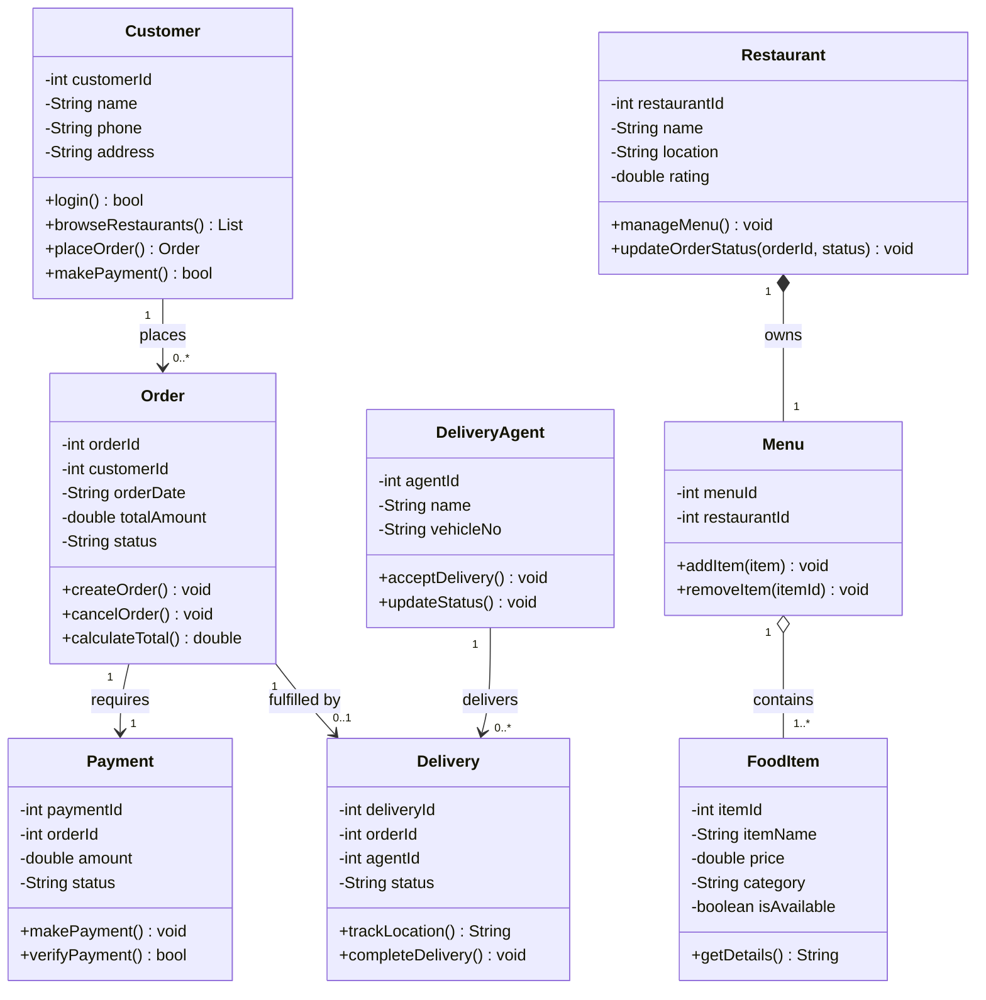
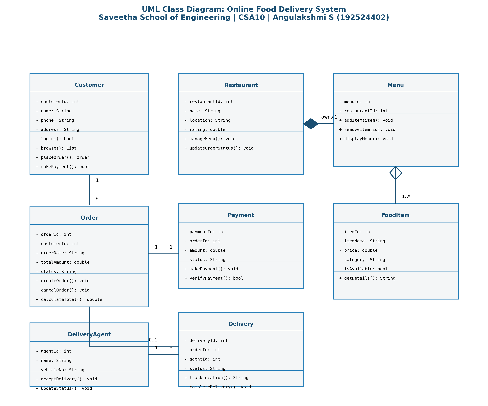
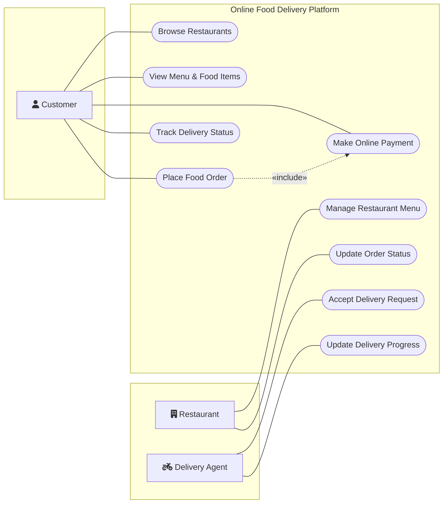
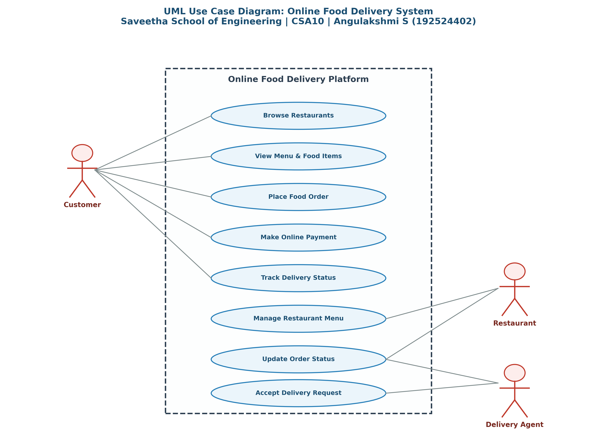
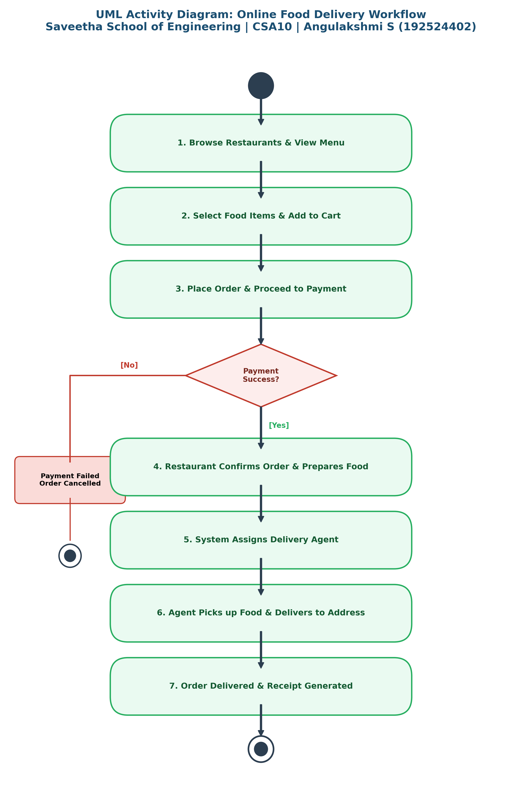

# EXPERIMENT NO. 06: UML CLASS, USE CASE AND ACTIVITY DIAGRAMS FOR AN ONLINE FOOD DELIVERY SYSTEM

## Academic Information
- **Course**: CSA10 – Software Engineering
- **Student Name**: Angulakshmi S
- **Register Number**: 192524402
- **Degree**: B.Tech (AI & Data Science), 2nd Year
- **Department**: Computer Science and Engineering / Department of AI & DS
- **Institution**: Saveetha School of Engineering, SIMATS
- **Tools Used**: Umbrello UML Modeller / StarUML / Python 3.13 / PlantUML
- **Course Outcome**: CO1
- **Date**: 18-11-2026

---

## 1. Problem Statement
An online food delivery platform enables customers to browse restaurants, view menus, place food orders, make online payments, and track delivery status. Restaurants use the system to manage their menus and update order status, while delivery agents are responsible for accepting delivery requests and updating delivery progress. Design a Class Diagram, Use case Diagram and Activity Diagram for the Online Food Delivery System showing the relevant classes, their attributes, methods, and relationships.

---

## 2. Aim
To design the Class diagram, Use Case diagram, and Activity diagram for an Online Food Delivery System showing the relevant classes, attributes, methods, actors, and workflow using UML modeling tools.

---

## 3. Software / Tools Required
- **Umbrello UML Modeller / StarUML**
- **PlantUML / Graphviz**
- **Python 3.13** (Domain model and simulation execution)
- **Windows / Linux PC**

---

## 4. Theory
The **Unified Modelling Language (UML)** is an international standard visual modeling language defined by the Object Management Group (OMG) for specifying, visualizing, constructing, and documenting software-intensive systems.

UML models are broadly organized into two primary categories:
1. **Structural Diagrams**: Capture static system architecture, entities, attributes, and relationships (e.g., Class Diagram, Object Diagram, Component Diagram, Deployment Diagram).
2. **Behavioral Diagrams**: Model dynamic behavior, control flow, actor interactions, and state transitions (e.g., Use Case Diagram, Activity Diagram, Sequence Diagram, State Machine Diagram).

### 4.1 Structural View: Class Diagram
A Class Diagram models the static structural backbone of the system.
- **Class**: Comprises Class Name, Attributes (data fields), and Operations (methods).
- **Visibility Markers**:
  - `+` Public
  - `-` Private
  - `#` Protected
- **Relationships**:
  - **Association**: General structural link between classes (e.g., Customer places Order).
  - **Aggregation (Hollow Diamond $\diamond$)**: Weak whole-part relationship where child components can exist independently of the whole (e.g., Menu contains FoodItems).
  - **Composition (Filled Diamond $\blacklozenge$)**: Strong whole-part relationship with cascading lifecycle dependency; child lifetime is governed by the parent (e.g., Restaurant owns Menu).
  - **Multiplicity**: Cardinality constraints ($1$, $0..1$, $1..*$, $*$).

### 4.2 Functional View: Use Case Diagram
A Use Case Diagram establishes the functional scope and interaction boundaries:
- **Actors**: External entities (human users or hardware systems) interacting with the system (`Customer`, `Restaurant`, `Delivery Agent`, `Administrator`).
- **System Boundary**: Visual boundary rectangle delimiting the software responsibilities from external agents.
- **Use Cases**: System functions represented as ellipses (`Browse Restaurants`, `Place Order`, `Make Payment`, etc.).
- **Stereotypes**:
  - `«include»`: Mandatory invocation of sub-behavior.
  - `«extend»`: Optional or conditional augmentation of behavior.

### 4.3 Dynamic View: Activity Diagram
An Activity Diagram represents business workflows, procedural logic, and step-by-step control transitions:
- **Initial Node**: Solid filled circle indicating entry point.
- **Action States**: Rounded rectangles denoting activities.
- **Decision / Merge Nodes**: Diamond nodes evaluating guards (`[Yes]` / `[No]`).
- **Fork / Join Bars**: Horizontal/vertical synchronization bars modeling concurrent parallel executions.
- **Activity Final Node**: Bullseye circle indicating workflow completion.

---

## 5. Detailed Step-by-Step Procedure
- **Step 1: Launch the UML Modeling Tool**
  - Open Umbrello UML Modeller or StarUML on your system.
  - Create a new project named `"Online Food Delivery System"`.
- **Step 2: Analyze the Problem Statement**
  - Identify system domain requirements: customer ordering, restaurant menu management, payment processing, and delivery routing.
  - Formulate the entity candidate classes and role actors.
- **Step 3: Create the Class Diagram**
  - Add a Class Diagram to the project hierarchy.
  - Construct classes: `Customer`, `Restaurant`, `Menu`, `FoodItem`, `Order`, `Payment`, `DeliveryAgent`, `Delivery`.
  - Assign typed attributes and public methods to each class.
  - Connect classes using association, composition (`Restaurant` $\blacklozenge\rightarrow$ `Menu`), and aggregation (`Menu` $\diamond\rightarrow$ `FoodItem`).
- **Step 4: Create the Use Case Diagram**
  - Add a Use Case Diagram.
  - Define actors: `Customer`, `Restaurant`, `Delivery Agent`, and `Administrator`.
  - Enclose use cases inside the `"Online Food Delivery Platform"` boundary rectangle.
  - Establish association links between actors and use cases.
- **Step 5: Create the Activity Diagram**
  - Add an Activity Diagram.
  - Place the Initial Node followed by actions: browse restaurants, select food items, place order, and proceed to payment.
  - Insert a decision node for payment verification (`[Yes]` / `[No]`).
  - Route the successful payment path through restaurant preparation, agent dispatch, location tracking, and order delivery.
  - Terminate with the Final Node.
- **Step 6–8: Verify Class, Use Case, and Activity Diagrams**
  - Check consistency of class attributes, methods, actor mappings, and transition guards.
- **Step 9–10: Save and Export Diagrams**
  - Save project files and export high-resolution diagrams to `diagrams/` as PNG and SVG.

---

## 6. System Design Diagrams

### 6.1 Class Diagram

#### Mermaid Architecture


#### Rendered Graphic
Available at [diagrams/class_diagram.png](diagrams/class_diagram.png):



---

### 6.2 Use Case Diagram

#### Mermaid Architecture


#### Rendered Graphic
Available at [diagrams/use_case_diagram.png](diagrams/use_case_diagram.png):



---

### 6.3 Activity Diagram

#### Mermaid Architecture
```mermaid
stateDiagram-v2
    [*] --> BrowseRestaurants : Customer Login
    BrowseRestaurants --> SelectFoodItems : Select Restaurant
    SelectFoodItems --> PlaceOrder : Add to Cart
    PlaceOrder --> MakePayment : Proceed to Checkout
    
    state PaymentDecision <<choice>>
    MakePayment --> PaymentDecision
    
    PaymentDecision --> PaymentFailed : [Payment Unsuccessful]
    PaymentFailed --> [*] : Cancel Order
    
    PaymentDecision --> RestaurantConfirmation : [Payment Successful]
    
    state ParallelProcessing {
        --
        RestaurantConfirmation --> PrepareFood : Kitchen Order Ticket
        PrepareFood --> PackageOrder
        --
        RestaurantConfirmation --> AssignAgent : Nearest Agent
        AssignAgent --> AcceptRequest
    }
    
    PackageOrder --> HandoverToAgent
    AcceptRequest --> HandoverToAgent
    
    HandoverToAgent --> OutForDelivery : Agent Picked Up
    OutForDelivery --> DeliverToCustomer : GPS Route Tracking
    DeliverToCustomer --> OrderDelivered : Confirmation Code
    OrderDelivered --> [*]
```

#### Rendered Graphic
Available at [diagrams/activity_diagram.png](diagrams/activity_diagram.png):



---

## 7. Python Domain Model Implementation (`code/food_delivery_model.py`)
To mathematically and computationally validate all entities, attributes, and relationships modeled in the Class Diagram, a fully functional Python domain model is implemented in `code/food_delivery_model.py`.

Key snippets demonstrating structural relationships:
```python
class Restaurant:
    """Composition relationship with Menu."""
    def __init__(self, restaurant_id: int, name: str, location: str, rating: float):
        self.restaurant_id = restaurant_id
        self.name = name
        self.location = location
        self.rating = rating
        self.menu = Menu(menu_id=restaurant_id * 10)  # Lifetime bound to Restaurant

class Menu:
    """Aggregation relationship with FoodItem."""
    def __init__(self, menu_id: int):
        self.menu_id = menu_id
        self.items: List[FoodItem] = []  # Aggregated items
```

---

## 8. Real Execution Output
Execution log captured from `output/model_execution_output.txt`:

```text
==================================================================
      ONLINE FOOD DELIVERY SYSTEM - UML MODEL EXECUTION           
==================================================================

[Customer: Angulakshmi S] Browsing Available Restaurants:
  • Spice Garden Restaurant | Location: Chennai Central | Rating: 4.6★

--- Menu (ID: 1010) ---
  [1] Paneer Butter Masala - Rs. 240.00 (Main Course) [Available]
  [2] Butter Naan (2 pcs) - Rs. 60.00 (Breads) [Available]
  [3] Veg Dum Biryani - Rs. 190.00 (Rice) [Available]
  [4] Gulab Jamun (2 pcs) - Rs. 70.00 (Dessert) [Available]

[Customer: Angulakshmi S] Placed Order #5001 with 3 items. Total: Rs. 370.00

[Payment #9001] Processing Rs. 370.00 via UPI / GPay...
[Order #5001] Status -> Paid & Confirmed
[Payment #9001] Payment SUCCESSFUL.
[Restaurant: Spice Garden Restaurant] Order #5001 status updated to: 'Food Preparation in Progress'
[Delivery Agent: Ramesh Kumar] Accepted Delivery for Order #5001. Vehicle: TN-09-AB-1234
[Delivery #7001] Live Status: Picked up from Spice Garden (Destination: Saveetha Hostels, Chennai)
[Delivery #7001] Live Status: Out for Delivery - 5 mins away (Destination: Saveetha Hostels, Chennai)
[Delivery #7001] Live Status: Order Delivered Successfully to Customer (Destination: Saveetha Hostels, Chennai)
[Order #5001] Status -> Completed
==================================================================
                 WORKFLOW SIMULATION COMPLETED                    
==================================================================
```

---

## 9. Execution Status & Deliverables
- **Model Simulation**: The domain model was fully implemented and executed locally in Python 3.13, validating end-to-end entity interactions with real logs stored in `output/model_execution_output.txt`.
- **Diagram Generation**: High-resolution diagrams for Class, Use Case, and Activity views were rendered to PNG and SVG formats in `diagrams/`, accompanied by standard PlantUML specifications (`*.puml`).
- **Desktop Umbrello/StarUML Visuals**: Step-by-step instructions for native desktop UI captures are cataloged in [`screenshots/SCREENSHOTS_TODO.md`](screenshots/SCREENSHOTS_TODO.md).

---

## 10. Result
Thus, the Class diagram, Use Case diagram, and Activity diagram for the Online Food Delivery System were designed, verified using UML specifications, and validated through an object-oriented simulation.

---

## 11. Viva Voce Questions and Answers

### 1. What is UML?
**Ans**: UML (Unified Modelling Language) is an industry-standard graphical modeling language used in software engineering to visualize, specify, construct, and document the architectural artifacts of software systems.

### 2. Differentiate aggregation and composition.
**Ans**:
- **Aggregation** (represented by a hollow diamond $\diamond$) is a weak "has-a" relationship where constituent child components can exist independently outside the parent lifecycle (e.g., FoodItems exist even if a specific Menu is cleared).
- **Composition** (represented by a filled diamond $\blacklozenge$) is a strong "owns-a" relationship with strict lifecycle dependency where child objects cannot exist without the parent container (e.g., a Menu cannot exist without its host Restaurant).

### 3. What is an actor?
**Ans**: An actor is an external entity (such as a human user, external system, or sensor device) that interacts with the system by initiating or participating in use case scenarios.

### 4. What is the difference between «include» and «extend»?
**Ans**:
- **«include»**: Represents an unconditional, mandatory sub-flow that is always executed as part of the base use case (e.g., placing an order *includes* payment).
- **«extend»**: Represents an optional, conditional sub-flow that executes only when specific extension conditions or exceptions occur.

### 5. What is a fork node in an activity diagram?
**Ans**: A fork node (drawn as a thick horizontal or vertical synchronization bar) splits a single incoming control flow into two or more concurrent, parallel execution paths.
