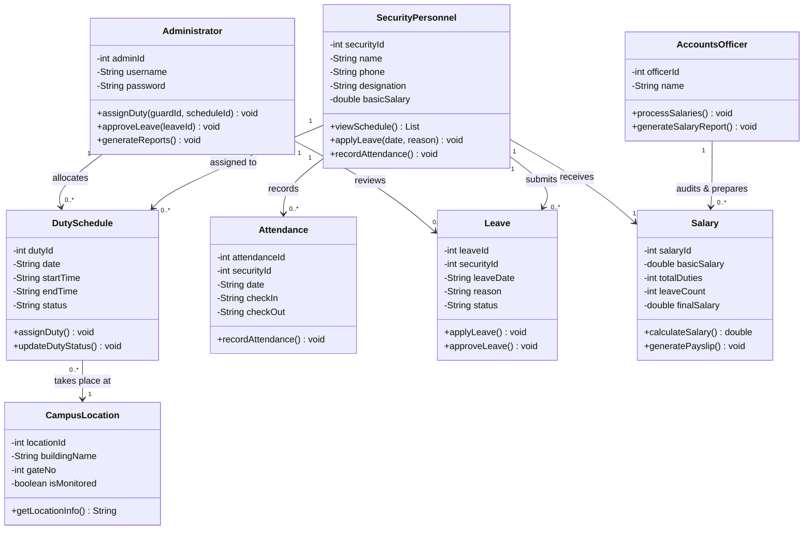
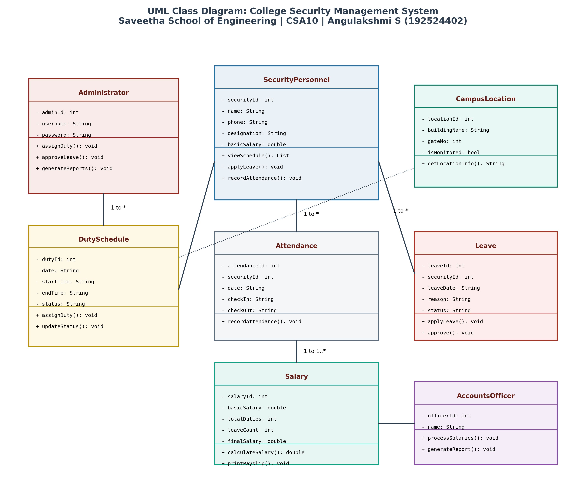
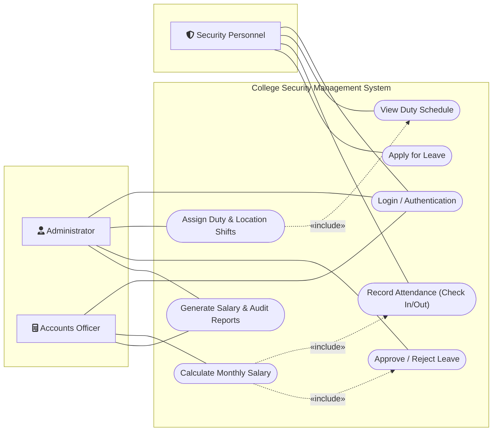
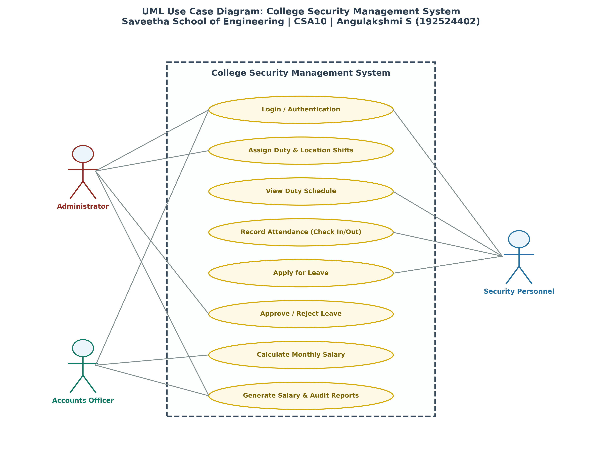
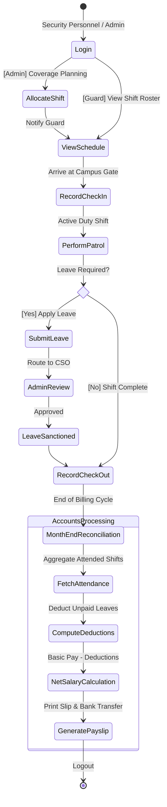
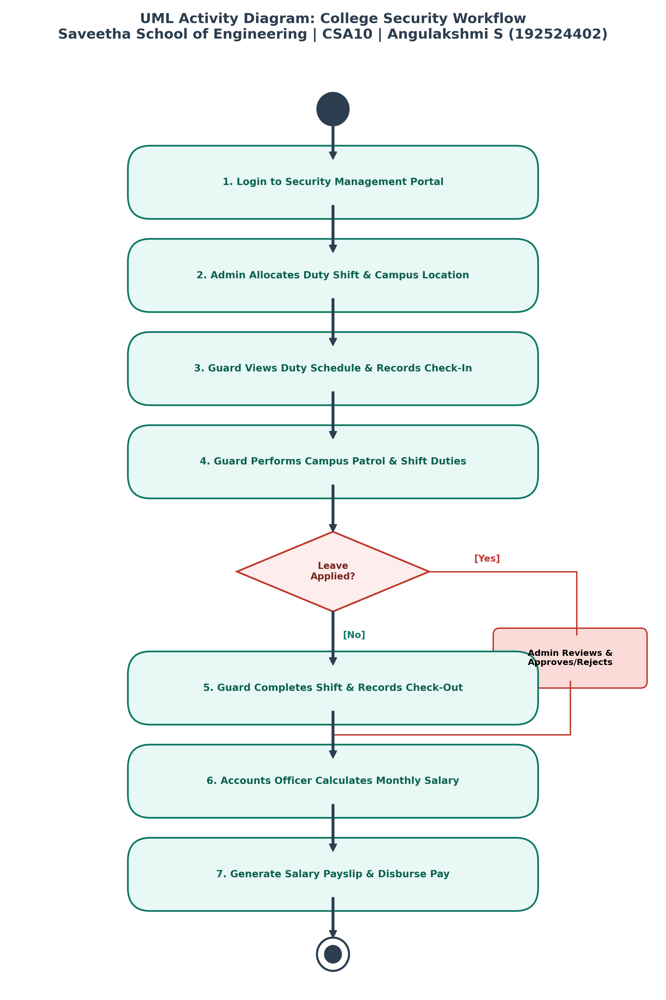

# EXPERIMENT NO. 07: UML DIAGRAMS FOR A COLLEGE SECURITY MANAGEMENT SYSTEM

## Academic Information
- **Course**: CSA10 – Software Engineering
- **Student Name**: Angulakshmi S
- **Register Number**: 192524402
- **Degree**: B.Tech (AI & Data Science), 2nd Year
- **Department**: Computer Science and Engineering / Department of AI & DS
- **Institution**: Saveetha School of Engineering, SIMATS
- **Tools Used**: Umbrello UML Modeller / StarUML / Python 3.13 / PlantUML
- **Course Outcome**: CO1
- **Date**: 18-11-2026

---

## 1. Problem Statement
A college employs a large number of security personnel who are assigned duties at various locations across the campus. Each security person follows a duty schedule that includes date, duty start time, duty end time, and assigned location, ensuring that every campus location is covered. If a security person takes leave, it is recorded manually, and at the end of each month, salaries are calculated based on duties performed and leaves taken. Since manual handling of duty allocation, leave management, and salary calculation is time-consuming and complex, the college plans to develop an Online Security Management System to automate these activities. Develop Class Diagram, Use case Diagram and Activity Diagram to represent the workflow of the Online Security Management System.

---

## 2. Aim
To design the Class diagram, Use Case diagram, and Activity diagram for a Security Management System that manages the security personnel of a college.

---

## 3. Software / Tools Required
- **Umbrello UML Modeller / StarUML**
- **PlantUML / Graphviz**
- **Python 3.13** (Domain model and simulation execution)
- **Windows / Linux PC**

---

## 4. Theory
Managing campus-wide security operations requires coordination across personnel rosters, geographical checkpoint coverage, biometric or digital attendance, leave processing, and payroll reconciliation. UML provides three complementary architectural perspectives to model such an enterprise system:

### 4.1 Static Perspective (Class Diagram)
Represents the domain entities, persistent attributes, behavioral interfaces, and structural relationships:
- **Classes**:
  - `Administrator`: Superintends duty rosters and sanctions leave.
  - `SecurityPersonnel`: Core operational agent undergoing shift rotations.
  - `DutySchedule`: Shift allocation record linking date, timing, guard, and post.
  - `CampusLocation`: Physical security post (e.g., Main Gate, Library, Hostels).
  - `Attendance`: Daily check-in/check-out timestamped logs.
  - `Leave`: Absence requests with approval workflow status.
  - `Salary`: Monthly payroll object aggregating attended shifts, basic pay, and deductions.
  - `AccountsOfficer`: Administrative stakeholder responsible for auditing payroll.
- **Multiplicity**: Indicates the quantitative participation of instances at association ends:
  - $1$: Exactly one instance.
  - $0..1$: Optional (zero or one instance).
  - $1..*$: One or more instances.
  - $*$ or $0..*$: Zero or more instances.

### 4.2 Functional Perspective (Use Case Diagram)
Delimits the system boundary and visualizes actor interactions:
- **Actors**: `Administrator`, `Security Personnel`, `Accounts Officer`.
- **System Boundary**: A bounding box establishing the scope of the College Security Management System.
- **Use Cases**: System features including shift scheduling, attendance recording, leave requests/approvals, and automated salary reporting.

### 4.3 Dynamic Perspective (Activity Diagram)
Models the sequential and conditional execution flow of duties:
$$\text{Login} \longrightarrow \text{View Shift} \longrightarrow \text{Check-In} \longrightarrow \text{Patrol/Post Duty} \longrightarrow \text{[Decision: Leave Request?]} \longrightarrow \text{Check-Out} \longrightarrow \text{Salary Calculation} \longrightarrow \text{Logout}$$

---

## 5. Detailed Step-by-Step Procedure
- **Step 1: Launch the UML Modeling Tool**
  - Open Umbrello UML Modeller or StarUML on your workstation.
  - Initialize a new project named `"Online Security Management System"`.
- **Step 2: Analyze the Problem Statement**
  - Identify the primary automated functions: duty scheduling, campus checkpoint assignment, attendance tracking, leave sanctioning, and monthly salary disbursement.
- **Step 3: Create the Class Diagram**
  - Add a Class Diagram view.
  - Construct classes: `Administrator`, `SecurityPersonnel`, `DutySchedule`, `CampusLocation`, `Attendance`, `Leave`, `Salary`, `AccountsOfficer`.
  - Populate typed fields and operation signatures.
  - Configure associations and label cardinalities ($1$, $0..*$, $1..*$).
- **Step 4: Create the Use Case Diagram**
  - Add a Use Case Diagram.
  - Define actors: `Administrator`, `Security Personnel`, and `Accounts Officer`.
  - Enclose use cases inside the system boundary.
  - Link actors to authorized use cases with association lines.
- **Step 5: Create the Activity Diagram**
  - Add an Activity Diagram.
  - Insert Initial Node, action rectangles for duty scheduling, attendance check-in, patrol activities, and leave decision guards.
  - Route the end-of-month path through accounts salary computation and payslip generation to the Final Node.
- **Step 6–8: Verify Class, Use Case, and Activity Diagrams**
  - Audit multiplicities, association navigability, and guard branch paths.
- **Step 9–10: Save and Export Diagrams**
  - Save the UML workspace and export high-resolution diagrams to `diagrams/` as PNG and SVG.

---

## 6. System Design Diagrams

### 6.1 Class Diagram

#### Mermaid Architecture


#### Rendered Graphic
Available at [diagrams/class_diagram.png](diagrams/class_diagram.png):



---

### 6.2 Use Case Diagram

#### Mermaid Architecture


#### Rendered Graphic
Available at [diagrams/use_case_diagram.png](diagrams/use_case_diagram.png):



---

### 6.3 Activity Diagram

#### Mermaid Architecture


#### Rendered Graphic
Available at [diagrams/activity_diagram.png](diagrams/activity_diagram.png):



---

## 7. Python Domain Model Implementation (`code/security_management_model.py`)
To computationally validate the duty scheduling, leave deductions, and salary formulation modeled in the Class Diagram, a domain program was implemented in `code/security_management_model.py`.

Key salary calculation method:
```python
def calculate_salary(self, total_working_days: int = 30) -> float:
    self.total_duties = len(self.guard.attendance_records)
    self.leave_count = sum(1 for l in self.guard.leaves if l.status == "Approved")
    per_day_rate = self.basic_salary / total_working_days
    deductions = self.leave_count * per_day_rate
    self.final_salary = max(0.0, self.basic_salary - deductions)
    return self.final_salary
```

---

## 8. Real Execution Output
Execution transcript from `output/model_execution_output.txt`:

```text
==================================================================
      COLLEGE SECURITY MANAGEMENT SYSTEM - MODEL EXECUTION        
==================================================================
[Admin: ChiefSecurityOfficer] Assigned Duty #1001 to M. Thangaraj at Main Entrance Gate (Gate 1)
[Admin: ChiefSecurityOfficer] Assigned Duty #1002 to K. Selvam at Central Library Block (Gate 3)

[Security Guard: M. Thangaraj] Assigned Duty Schedules:
  • Date: 2026-11-19 | Shift: 06:00 AM - 02:00 PM | Location: Main Entrance Gate (Gate 1) | Status: Scheduled
[Attendance] Guard M. Thangaraj checked in at 05:55 AM, checked out at 02:05 PM on 2026-11-19
[Security Guard: M. Thangaraj] Applied for Leave on 2026-11-25. Reason: 'Medical checkup and personal leave'
[Admin: ChiefSecurityOfficer] Approved Leave #301 for Guard #501

========================================================
             COLLEGE SECURITY SALARY PAYSLIP            
========================================================
Salary Slip ID   : SAL-701
Month            : November 2026
Security Guard   : M. Thangaraj (ID: 501)
Designation      : Senior Guard
Basic Monthly Pay: Rs. 24,000.00
Duties Attended  : 1 shifts
Approved Leaves  : 1 days
Leave Deductions : Rs. 800.00
--------------------------------------------------------
NET PAYABLE SALARY: Rs. 23,200.00
========================================================
```

---

## 9. Execution Status & Deliverables
- **Model Simulation**: The domain model was fully implemented and executed locally in Python 3.13, validating end-to-end entity interactions with real logs stored in `output/model_execution_output.txt`.
- **Diagram Generation**: High-resolution diagrams for Class, Use Case, and Activity views were rendered to PNG and SVG formats in `diagrams/`, accompanied by standard PlantUML specifications (`*.puml`).
- **Desktop Umbrello/StarUML Visuals**: Step-by-step instructions for native desktop UI captures are cataloged in [`screenshots/SCREENSHOTS_TODO.md`](screenshots/SCREENSHOTS_TODO.md).

---

## 10. Result
Thus, the Class diagram, Use Case diagram, and Activity diagram for the College Security Management System were designed, verified using UML modeling techniques, and validated through an object-oriented Python implementation.

---

## 11. Viva Voce Questions and Answers

### 1. What is multiplicity?
**Ans**: Multiplicity is a constraint specification placed on association ends in a class diagram defining the permissible number of object instances of one class that can be linked to a single instance of the associated class (e.g., `1`, `0..1`, `1..*`, `*`).

### 2. What is a system boundary?
**Ans**: A system boundary is a rectangular frame drawn in a Use Case Diagram that visually demarcates the software system’s internal scope (use cases) from the external environment (actors).

### 3. Which diagram shows the static structure of a system?
**Ans**: The **Class Diagram** models the static structure of a system, portraying classes, attributes, operations, interfaces, and structural relationships without temporal execution details.

### 4. What is a swimlane?
**Ans**: A swimlane (partition) in an Activity Diagram groups activities and actions according to the role, business unit, actor, or component responsible for their execution.

### 5. What is generalization?
**Ans**: Generalization is a taxonomic relationship where a specialized subclass or child actor inherits structural attributes and behavioral methods from a generalized parent class or actor (Object-Oriented inheritance).
