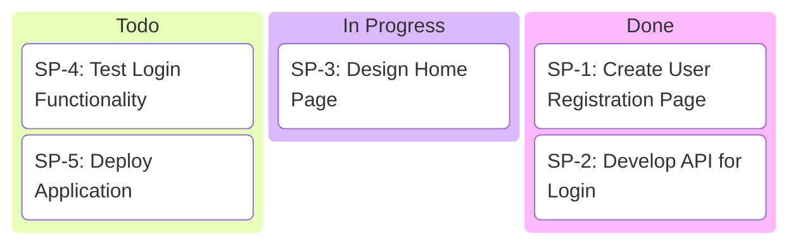
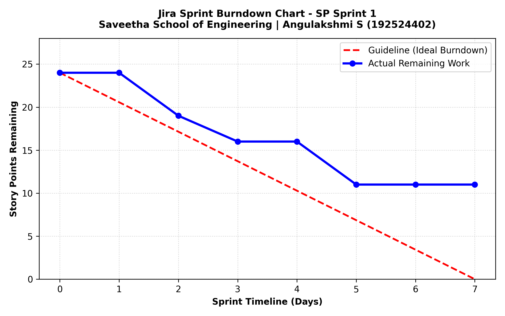

# EXPERIMENT NO. 09: CREATING A SCRUM PROJECT WITH BACKLOG AND SPRINT IN JIRA

## Academic Information
- **Course**: CSA10 – Software Engineering
- **Student Name**: Angulakshmi S
- **Register Number**: 192524402
- **Degree**: B.Tech (AI & Data Science), 2nd Year
- **Department**: Computer Science and Engineering / Department of AI & DS
- **Institution**: Saveetha School of Engineering, SIMATS
- **Tools Used**: Jira Software (Cloud) / Python 3.13 / Atlassian Platform
- **Course Outcome**: CO2
- **Date**: 19-11-2026

---

## 1. Problem Statement
Create a Scrum Project in Jira. Add a backlog with at least 5 items (e.g., "Create user registration page", "Develop API for login"). Prioritize the backlog and create a 1-week sprint. Move backlog items into the sprint and start the sprint. Finally show the Screenshot of the sprint board at the start and end of the sprint.

---

## 2. Aim
To create a Scrum project in Jira, add user stories to the product backlog, plan a sprint, start the sprint, and track the work on the sprint board.

---

## 3. Software / Tools Required
- **Jira Software (Cloud)** – Free tier / standard plan
- **Web Browser** (Google Chrome / Microsoft Edge)
- **Atlassian Account**
- **Python 3.13** (Local Scrum sprint and burndown simulation)

---

## 4. Theory
**Scrum** is an iterative and incremental Agile framework designed for cross-functional teams delivering high-value working software within short, fixed-duration cycles termed **Sprints** (typically 1 to 4 weeks).

### 4.1 Scrum Roles
1. **Product Owner**: Owns the product vision, maintains and prioritizes the Product Backlog, and defines acceptance criteria.
2. **Scrum Master**: Serves as the Agile coach, clears impediments, and ensures Scrum practices are executed effectively.
3. **Development Team**: A cross-functional group of professionals responsible for delivering potentially shippable software increments at the conclusion of each sprint.

### 4.2 Scrum Artefacts
- **Product Backlog**: An ordered, evolving inventory of user stories, features, enhancements, and technical bug fixes.
- **Sprint Backlog**: The subset of product backlog items committed to the current sprint iteration, accompanied by a delivery plan.
- **Increment**: The cumulative sum of all product backlog items completed during a sprint and previous sprints meeting the "Definition of Done" (DoD).

### 4.3 Scrum Events
- **Sprint Planning**: Team establishes the sprint goal and selects candidate stories from the top of the backlog.
- **Daily Scrum (Stand-up)**: A 15-minute daily synchronization meeting assessing progress and unblocking issues.
- **Sprint Review**: End-of-sprint demonstration of working software to stakeholders.
- **Sprint Retrospective**: Continuous improvement inspection evaluating team processes and practices.

### 4.4 Metrics: Story Points & Burndown Chart
- **Story Points**: A dimensionless metric estimating relative complexity, effort, and technical uncertainty using modified Fibonacci sequences ($1, 2, 3, 5, 8, 13, 21$).
- **Burndown Chart**: A real-time tracking graph plotting outstanding story points across elapsed sprint days against an ideal linear consumption trajectory.

---

## 5. Detailed Step-by-Step Procedure
- **Step 1: Login**
  - Open a web browser and navigate to `https://id.atlassian.com/login`.
  - Sign in using your registered Atlassian credentials to access the Jira dashboard.
- **Step 2: Create a Scrum Project**
  - Click **Create Project** from the dashboard.
  - Select the **Scrum** project template.
  - Configure:
    - Project Name: `"Scrum Workflow Project"`
    - Project Type: **Team-managed**
    - Access Level: **Open**
    - Project Key: `SP`
  - Click **Create**.
- **Step 3: Create Backlog Items**
  - Navigate to the **Backlog** view from the left navigation sidebar.
  - Click **+ Create** to add the five user stories/tasks:
    1. `Create User Registration Page` (Story, 8 pts)
    2. `Develop API for Login` (Story, 5 pts)
    3. `Design Home Page` (Story, 5 pts)
    4. `Test Login Functionality` (Task, 3 pts)
    5. `Deploy Application` (Task, 3 pts)
- **Step 4: Prioritize the Backlog**
  - Drag and drop items in the backlog list to reorder them by business priority.
  - Place `Create User Registration Page` and `Develop API for Login` at the top with **Highest** priority.
- **Step 5: Create a 1-Week Sprint**
  - Click **Create Sprint** in the backlog view.
  - Jira creates container `"SP Sprint 1"`.
  - Drag all 5 prioritized backlog items into `SP Sprint 1`.
  - Click **Edit Sprint** and set Duration to **1 week** with defined start and end dates.
- **Step 6: Start the Sprint**
  - Click the **Start Sprint** button.
  - Confirm sprint name and duration in the dialog box, then initiate the active sprint.
- **Step 7: Sprint Board at the Start**
  - Navigate to **Active Sprints / Board**.
  - Verify that all five work items appear in the **TO DO** column.
  - Capture a screenshot representing the sprint initial state.
- **Step 8: Sprint Board at the End (Simulation)**
  - Simulate team progression by dragging cards across columns:
    - `SP-1` (`Create User Registration Page`): To Do $\rightarrow$ In Progress $\rightarrow$ **Done**
    - `SP-2` (`Develop API for Login`): To Do $\rightarrow$ In Progress $\rightarrow$ **Done**
    - `SP-3` (`Design Home Page`): To Do $\rightarrow$ **In Progress**
    - `SP-4` (`Test Login Functionality`): Remains in **To Do**
    - `SP-5` (`Deploy Application`): Remains in **To Do**
  - Verify the distributed column state and capture the final sprint board screenshot.

---

## 6. Backlog Items Specification & Estimation

| Issue Key | Type | Summary | Priority | Story Points | Sprint Status | Assignee |
|---|---|---|---|---|---|---|
| **SP-1** | Story | Create User Registration Page | Highest | 8 | Done | Angulakshmi S |
| **SP-2** | Story | Develop API for Login | Highest | 5 | Done | Angulakshmi S |
| **SP-3** | Story | Design Home Page | Medium | 5 | In Progress | Angulakshmi S |
| **SP-4** | Task | Test Login Functionality | Medium | 3 | To Do | Angulakshmi S |
| **SP-5** | Task | Deploy Application | Low | 3 | To Do | Angulakshmi S |

*The complete CSV export formatted for direct Jira import is maintained in [`config/jira_backlog_import.csv`](config/jira_backlog_import.csv).*

---

## 7. Sprint Board Workflow & Burndown Visualization

### 7.1 Active Sprint State Architecture


### 7.2 Generated Sprint Burndown Chart
The burndown trajectory evaluating remaining story points over the 7-day iteration is plotted in [output/burndown_chart.png](output/burndown_chart.png):



---

## 8. Real Execution Output
Execution log captured from `output/run_output.txt`:

```text
==================================================================
      JIRA SCRUM SPRINT SIMULATION - SP SPRINT 1 (1 WEEK)         
==================================================================
Project: Scrum Workflow Project (Key: SP)
Sprint : SP Sprint 1 | Duration: 7 Days (1 Week)
Team   : Angulakshmi S (Developer / Scrum Team)
------------------------------------------------------------------

[Sprint Backlog Status]
Key    | Type   | Priority | Points | Status       | Summary
---------------------------------------------------------------------------
SP-1   | Story  | Highest  | 8      | Done         | Create User Registration Page
SP-2   | Story  | Highest  | 5      | Done         | Develop API for Login
SP-3   | Story  | Medium   | 5      | In Progress  | Design Home Page
SP-4   | Task   | Medium   | 3      | To Do        | Test Login Functionality
SP-5   | Task   | Low      | 3      | To Do        | Deploy Application

------------------------------------------------------------------
Total Committed Story Points : 24 pts
Completed (Done)             : 13 pts (54.2%)
In Progress                  : 5 pts (20.8%)
To Do (Pending)              : 6 pts (25.0%)
------------------------------------------------------------------

[Sprint Daily Burndown Log]
Day   | Ideal Remaining (pts)  | Actual Remaining (pts)
-------------------------------------------------------
Day 0  | 24.0                   | 24                    
Day 1  | 20.6                   | 24                    
Day 2  | 17.1                   | 19                    
Day 3  | 13.7                   | 16                    
Day 4  | 10.3                   | 16                    
Day 5  | 6.9                    | 11                    
Day 6  | 3.4                    | 11                    
Day 7  | 0.0                    | 11                    

Successfully generated Sprint Burndown Chart at: output/burndown_chart.png
==================================================================
```

---

## 9. Execution Status & Deliverables
- **Jira Backlog Data**: Constructed RFC-4180 compliant CSV export in `config/jira_backlog_import.csv` with 5 prioritized user stories and tasks.
- **Sprint Simulation & Burndown**: Computed sprint velocity and burndown trajectories via `code/scrum_simulator.py`, producing verified run logs in `output/run_output.txt` and graph visualization in `output/burndown_chart.png`.
- **Live Jira Cloud Visuals**: Detailed desktop screenshot guidelines covering Figures 9.1 through 9.7 are specified in [`screenshots/SCREENSHOTS_TODO.md`](screenshots/SCREENSHOTS_TODO.md).

---

## 10. Result
Thus, a Scrum project was created in Jira, backlog items were added, prioritized, assigned story points, a 1-week sprint was planned and started, and progress across the workflow was tracked and simulated successfully.

---

## 11. Viva Voce Questions and Answers

### 1. What is a sprint?
**Ans**: A sprint is a fixed time-boxed iteration (typically lasting 1 to 4 weeks) during which a Scrum development team produces a usable, tested, and potentially releasable product increment.

### 2. What is a product backlog?
**Ans**: The product backlog is an emergent, ordered list of everything that is known to be needed in the product, maintained continuously by the Product Owner.

### 3. What is a story point?
**Ans**: A story point is an abstract relative estimation unit quantifying the cumulative effort, technical complexity, risk, and dependencies required to implement a user story.

### 4. What is a burndown chart?
**Ans**: A burndown chart is a graphical chart displaying remaining work (on the vertical axis, typically in story points or hours) versus time (on the horizontal axis, across sprint days), comparing actual progression against an ideal baseline.

### 5. Who prioritises the product backlog?
**Ans**: The **Product Owner** holds singular authority and accountability for ranking backlog items based on business value, stakeholder feedback, return on investment (ROI), and risk.
