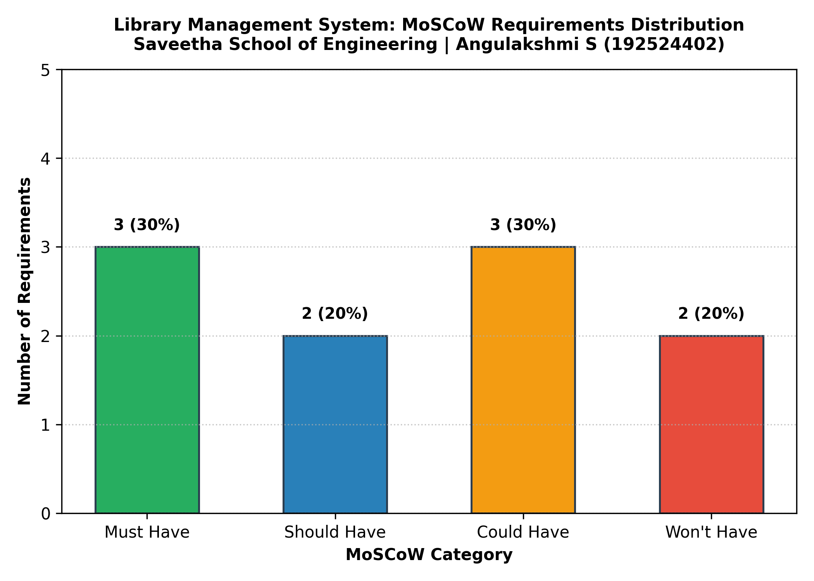
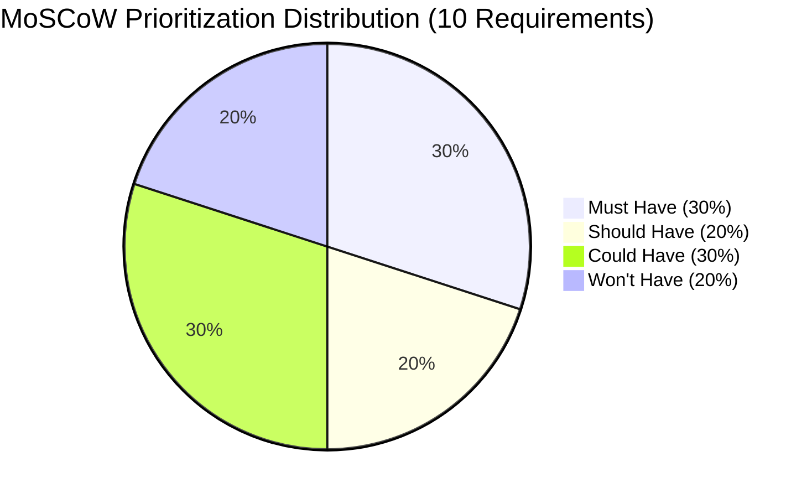

# EXPERIMENT NO. 10: MOSCOW PRIORITIZATION OF LIBRARY MANAGEMENT SYSTEM REQUIREMENTS

## Academic Information
- **Course**: CSA10 – Software Engineering
- **Student Name**: Angulakshmi S
- **Register Number**: 192524402
- **Degree**: B.Tech (AI & Data Science), 2nd Year
- **Department**: Computer Science and Engineering / Department of AI & DS
- **Institution**: Saveetha School of Engineering, SIMATS
- **Tools Used**: Google Sheets / Microsoft Excel / Python 3.13 (`openpyxl`)
- **Course Outcome**: CO2
- **Date**: 19-11-2026

---

## 1. Problem Statement
Use the following requirements for a Library Management System: Add a feature to search books by title and author. Implement an online book reservation system. Generate monthly reports on borrowed books for administrators. Enable email notifications for overdue books. Add support for QR code scanning for borrowing and returning books. Create a user-friendly dashboard for librarians. Allow users to review and rate books. Integrate a chatbot for user assistance. Develop a mobile app version of the system. Provide multi-language support. Categorize each requirement using MOSCOW Method (Must-Have, Should-Have, Could-Have, or Won’t-Have) based on the following criteria: Impact on the users and stakeholders. Feasibility considering time, budget, and resource constraints. Finally Submit the completed Google Sheet or Excel file with all requirements categorized and justified.

---

## 2. Aim
To categorize the requirements of a Library Management System into Must-Have, Should-Have, Could-Have, and Won’t-Have using the MoSCoW method, with justification based on impact and feasibility, in Google Sheets / Excel.

---

## 3. Software / Tools Required
- **Microsoft Excel / Google Sheets**
- **Python 3.13** with `openpyxl` and `matplotlib` (Automated workbook generation, formatting, and mathematical verification)
- **Web Browser / Desktop PC**

---

## 4. Theory
Requirements prioritization is a critical requirements engineering activity in Agile and iterative software delivery. Because software engineering projects are governed by fixed constraints (time, budget, staffing, and technology limitations), teams must systematically establish delivery order.

### 4.1 The MoSCoW Framework
Formulated originally within the **Dynamic Systems Development Method (DSDM)**, the MoSCoW technique classifies functional and non-functional requirements into four mutually exclusive buckets:

1. **Must Have (M)**: Non-negotiable core capabilities essential for minimum viable delivery. Without these, the software is deemed a legal, operational, or business failure.
2. **Should Have (S)**: High-priority, critical capabilities that significantly enhance value. Although vital, their omission does not render the primary system non-functional and can be deferred if necessary.
3. **Could Have (C)**: Desirable or "nice-to-have" enhancements that add convenience or user delight. These are incorporated only if spare bandwidth, budget, and time permit.
4. **Won’t Have [this time] (W)**: Features mutually agreed upon by stakeholders as out of scope for the current release milestone, reserved for future iteration cycles.

*(The lower-case "o" characters in the MoSCoW acronym are mnemonic connectors added purely to make the abbreviation pronounceable).*

### 4.2 Prioritization Evaluation Criteria
Each requirement is evaluated against two fundamental dimensions:
1. **User & Business Impact**: Operational value, user necessity, compliance, and risk reduction.
2. **Implementation Feasibility**: Engineering effort, infrastructural dependencies, budgetary constraints, and schedule alignment.

---

## 5. Detailed Step-by-Step Procedure
- **Step 1: Read the Problem Statement**
  - Extract and analyze the 10 functional requirements of the Library Management System.
- **Step 2: Open Google Sheets or Microsoft Excel**
  - Launch Excel or open Google Sheets.
  - Create a new spreadsheet and set its title to `"Library Management System – MoSCoW Prioritization"`.
- **Step 3: Create the Spreadsheet Structure**
  - Define table headers:
    1. `Requirement ID`
    2. `Requirement Description`
    3. `MoSCoW Category`
    4. `User Impact`
    5. `Implementation Feasibility`
    6. `Justification`
- **Step 4: List the Requirements**
  - Populate rows with all 10 candidate features (`R1` through `R10`).
- **Step 5: Categorize the Requirements**
  - Evaluate and allocate each feature strictly into one of the four MoSCoW tiers:
    - Must-Have: `R1`, `R2`, `R6` (30%)
    - Should-Have: `R3`, `R4` (20%)
    - Could-Have: `R5`, `R7`, `R10` (30%)
    - Won't-Have: `R8`, `R9` (20%)
- **Step 6: Justify Each Category**
  - Formulate concise, rigorous rationales citing impact and feasibility constraints.
- **Step 7: Review the Categorization**
  - Confirm mutually exclusive assignment and complete coverage without missing or duplicate entries.
- **Step 8: Format the Spreadsheet**
  - Apply professional formatting: dark blue headers (`#1F497D`), white bold text, auto-adjusted column widths, text wrapping, and color-coded category highlighting.
- **Step 9: Save and Export the Spreadsheet**
  - Save the completed workbook as `Library_Management_System_MoSCoW.xlsx` and export summary charts.

---

## 6. MoSCoW Categorization & Justification Table

| Requirement ID | Requirement Description | MoSCoW Category | User Impact | Implementation Feasibility | Academic & Engineering Justification |
|---|---|---|---|---|---|
| **R1** | Search books by title and author | **Must Have** | High | High | Fundamental core capability required by every student, scholar, and librarian to locate resources in the catalogue. |
| **R2** | Online book reservation | **Must Have** | High | Medium | Essential service preventing lending collisions, reducing physical queues, and guaranteeing book availability. |
| **R3** | Monthly borrowed-book reports for admin | **Should Have** | Medium | High | Necessary for administrative inventory audits and collection management; can immediately follow initial deployment. |
| **R4** | Email notification for overdue books | **Should Have** | High | High | High ROI automation that accelerates return rates and limits defaulter penalties with minimal implementation effort. |
| **R5** | QR code scanning for borrow/return | **Could Have** | Medium | Medium | Accelerates counter circulation and self-checkout kiosks, but relies on physical scanner hardware deployment. |
| **R6** | User-friendly librarian dashboard | **Must Have** | High | High | Indispensable operational console enabling librarians to issue books, process returns, and manage catalogue integrity. |
| **R7** | Review and rate books | **Could Have** | Low | High | Fosters community engagement and peer recommendations; non-essential for primary lending lifecycle. |
| **R8** | Chatbot for user assistance | **Won't Have** | Low | Low | Disproportionate development, AI training, and maintenance costs with low immediate return for initial release. |
| **R9** | Mobile app version | **Won't Have** | Medium | Low | Requires duplicate mobile codebase and app-store maintenance; responsive web interface fully serves user needs. |
| **R10** | Multi-language support | **Could Have** | Medium | Medium | Desirable accessibility enhancement for campus linguistic diversity; moderate localization and translation effort. |

---

## 7. Summary Metrics & Distribution Analysis

### 7.1 Quantitative Breakdown

| Category | Requirement Count | Percentage Formula | Formula Syntax | Proportion |
|---|---|---|---|---|
| **Must Have** | 3 | $3 / 10 \times 100\%$ | `=COUNTIF(C6:C15, "Must Have")` | **30.0%** |
| **Should Have** | 2 | $2 / 10 \times 100\%$ | `=COUNTIF(C6:C15, "Should Have")` | **20.0%** |
| **Could Have** | 3 | $3 / 10 \times 100\%$ | `=COUNTIF(C6:C15, "Could Have")` | **30.0%** |
| **Won't Have** | 2 | $2 / 10 \times 100\%$ | `=COUNTIF(C6:C15, "Won't Have")` | **20.0%** |
| **Total** | **10** | **100.0%** | `=SUM(B18:B21)` | **100.0%** |

### 7.2 Visual Distribution Chart
The generated distribution graphic is stored at [output/moscow_distribution_chart.png](output/moscow_distribution_chart.png):



### 7.3 Mermaid Visual Breakdown


---

## 8. Real Execution & Spreadsheet Verification
The spreadsheet generation script `code/generate_excel_analysis.py` was executed locally, constructing the production-grade workbook at `output/Library_Management_System_MoSCoW.xlsx`.

Execution transcript from `output/run_output.txt`:

```text
==================================================================
   EXPERIMENT 10: MOSCOW PRIORITIZATION EVALUATION COMPLETE       
==================================================================
Generated formatted Excel file: Library_Management_System_MoSCoW.xlsx
Generated summary chart image : moscow_distribution_chart.png

Category        | Count    | Percentage
----------------------------------------
Must Have       | 3        |     30.0%
Should Have     | 2        |     20.0%
Could Have      | 3        |     30.0%
Won't Have      | 2        |     20.0%
----------------------------------------
Total           | 10       |    100.0%
==================================================================
```

---

## 9. Execution Status & Deliverables
- **Real Spreadsheet Files**: Created raw data CSV at [`data/Library_Management_System_MoSCoW.csv`](data/Library_Management_System_MoSCoW.csv) and professionally styled Excel workbook at [`output/Library_Management_System_MoSCoW.xlsx`](output/Library_Management_System_MoSCoW.xlsx) containing embedded Excel charts, color highlights, and formulas.
- **Distribution Chart**: Exported high-resolution summary graphic to `output/moscow_distribution_chart.png`.
- **Desktop Spreadsheet Visuals**: Instructions for capturing Google Sheets / Excel application windows are recorded in [`screenshots/SCREENSHOTS_TODO.md`](screenshots/SCREENSHOTS_TODO.md).

---

## 10. Result
Thus, the ten functional requirements of the Library Management System were prioritized using the MoSCoW method with comprehensive impact-feasibility justifications and submitted as formatted `.csv` and `.xlsx` deliverables.

---

## 11. Viva Voce Questions and Answers

### 1. Expand MoSCoW.
**Ans**: **M**ust have, **S**hould have, **C**ould have, **W**on’t have (this time).

### 2. Why are the lower-case o’s in MoSCoW?
**Ans**: The lower-case letters 'o' are purely mnemonic connectors inserted to make the acronym pronounceable as a memorable word.

### 3. What criteria did you use to prioritize?
**Ans**: Prioritization was conducted using a two-dimensional trade-off matrix:
1. **User and Stakeholder Impact**: Criticality to the library lending lifecycle and user volume affected.
2. **Implementation Feasibility**: Development effort, budgetary requirements, and schedule constraints.

### 4. Name two other prioritization techniques.
**Ans**:
1. **Kano Model**: Classifies requirements into Basic, Performance, and Excitement features based on customer satisfaction.
2. **100-Point Method (Cumulative Voting)**: Stakeholders allocate 100 points across requirements to gauge relative weights.
3. **Analytic Hierarchy Process (AHP)**: Mathematical pairwise comparison matrix technique.

### 5. What does Won’t Have mean?
**Ans**: It signifies that the requirement is explicitly agreed by all stakeholders to be out of scope for the current release milestone, but remains documented for future release consideration.
