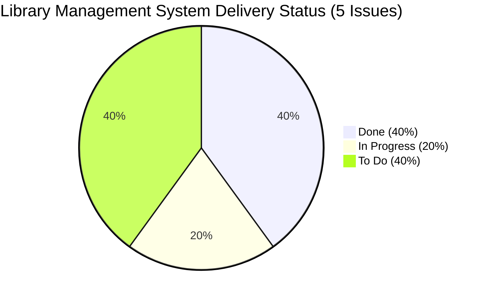
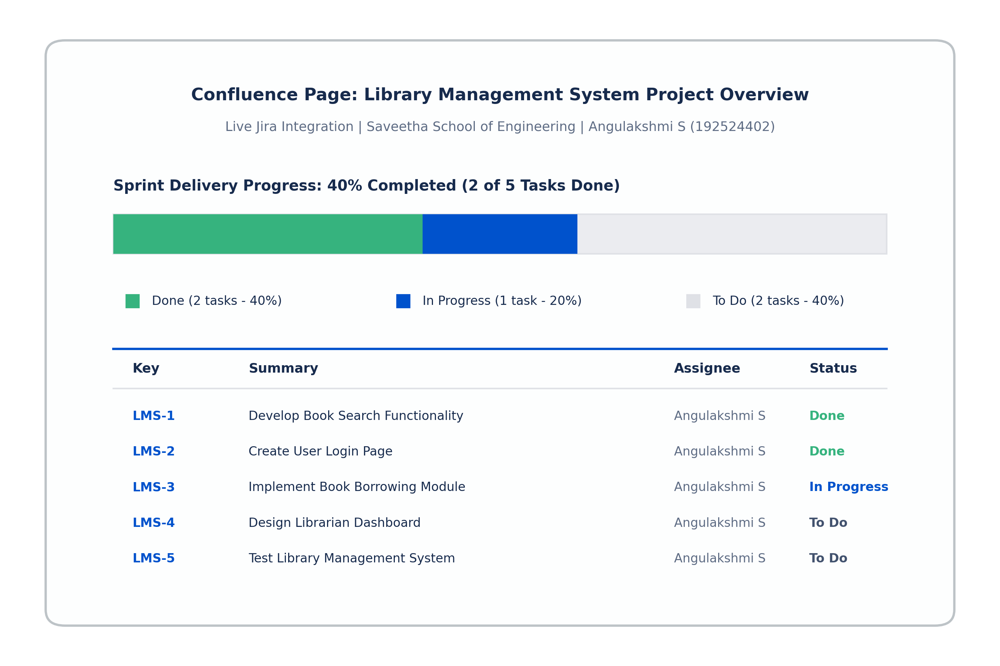

# EXPERIMENT NO. 11: LINKING JIRA ISSUES WITH CONFLUENCE FOR PROGRESS TRACKING

## Academic Information
- **Course**: CSA10 – Software Engineering
- **Student Name**: Angulakshmi S
- **Register Number**: 192524402
- **Degree**: B.Tech (AI & Data Science), 2nd Year
- **Department**: Computer Science and Engineering / Department of AI & DS
- **Institution**: Saveetha School of Engineering, SIMATS
- **Tools Used**: Jira Software (Cloud) / Confluence (Cloud) / Python 3.13 / Atlassian Platform
- **Course Outcome**: CO2
- **Date**: 19-11-2026

---

## 1. Problem Statement
Link Jira tasks with Confluence to streamline task tracking and progress monitoring for the Library Management System development. Create a new page in Confluence titled "Library Management System Project Overview." Embed at least 5 Jira issues related to the development of the Library Management System (e.g., tasks from the sprint like "Develop book search functionality," "Create user login page," etc.). Use the Jira macro to display issues with status (e.g., "To Do," "In Progress," "Done"). Add a progress bar in the Confluence page to visually track the completion of each embedded Jira task (e.g., percentage of tasks completed in the sprint). Submit a screenshot of the Confluence page showing the embedded Jira tasks and the progress bar.

---

## 2. Aim
To link Jira tasks of a Library Management System with a Confluence page, embed at least five Jira issues using the Jira macro with their status, and add a progress bar to track completion.

---

## 3. Software / Tools Required
- **Jira Software (Cloud)**
- **Confluence (Cloud)**
- **Web Browser** (Google Chrome / Microsoft Edge)
- **Atlassian Cloud Account**
- **Python 3.13** (Local tracking verification and progress dashboard rendering)

---

## 4. Theory
Modern software engineering organizations utilize integrated toolchains to maintain alignment between project management work items and system documentation:

### 4.1 Jira Software vs Confluence
- **Jira Software**: Serves as the issue-tracking, backlog-grooming, and sprint-execution engine where individual units of development work (Epics, Stories, Tasks, Bugs) are assigned, estimated, and transitioned through defined workflow lifecycles.
- **Confluence**: Acts as an enterprise team workspace, documentation repository, and knowledge base where product architecture, specifications, technical decisions, meeting notes, and project charters reside.

### 4.2 Integration Mechanisms
Atlassian provides native bi-directional integration between Jira and Confluence:
1. **Jira Issue Macro (`/jira`)**: A Confluence dynamic macro that embeds single issues or dynamic lists of issues based on **Jira Query Language (JQL)**. The macro renders real-time data directly from the Jira database without manual copy-pasting.
2. **JQL Filtering**: Precise syntax selecting target work items. For example:
   ```sql
   project = LMS AND type = Task ORDER BY status DESC
   ```
3. **Progress Bar / Status Macro**: Visual tracking widget that computes and displays delivery progress (e.g., $2 \text{ of } 5 \text{ tasks completed} = 40\%$).
4. **Linked Jira Spaces**: Allows team members to view associated Confluence specification pages directly from the Jira project sidebar under the **Pages** tab.

---

## 5. Detailed Step-by-Step Procedure
- **Step 1: Login to Atlassian Cloud**
  - Open a web browser and navigate to `https://id.atlassian.com/login`.
  - Authenticate with your Atlassian credentials to access the common application hub.
- **Step 2: Create Jira Issues**
  - Open the **Library Management System** project (Key: `LMS`).
  - Create the 5 development tasks:
    1. `Develop Book Search Functionality` (`LMS-1`)
    2. `Create User Login Page` (`LMS-2`)
    3. `Implement Book Borrowing Module` (`LMS-3`)
    4. `Design Librarian Dashboard` (`LMS-4`)
    5. `Test Library Management System` (`LMS-5`)
- **Step 3: Verify the Issues and Connect Confluence**
  - Open the **Board / Backlog** view in Jira.
  - Transition task statuses to reflect active work:
    - `LMS-1` $\rightarrow$ **Done**
    - `LMS-2` $\rightarrow$ **Done**
    - `LMS-3` $\rightarrow$ **In Progress**
    - `LMS-4` $\rightarrow$ **To Do**
    - `LMS-5` $\rightarrow$ **To Do**
  - From the project sidebar, select **Pages** and link the project to your Confluence team workspace.
- **Step 4: Create a New Confluence Page**
  - In Confluence, open the connected space and click **+ Create**.
  - Set the page title to `"Library Management System Project Overview"`.
  - Add introductory project context, objectives, and sprint milestone summaries.
- **Step 5: Display Task Status & Embed Jira Macro**
  - In the Confluence page editor, type `/jira` and select the **Jira Issue / Filter Macro**.
  - Enter the JQL query: `project = LMS AND type = Task ORDER BY status DESC`.
  - Choose table view mode with columns: `Key`, `Summary`, `Assignee`, `Priority`, and `Status`.
- **Step 6: Add Progress Bar Widget**
  - Below the table, insert a progress bar or status macro.
  - Calculate sprint completion ($2 / 5 = 40.0\%$) and format visual progress: `40% Done`.
- **Step 7: Publish and Submit Output**
  - Click **Publish** to make the Confluence document live.
  - Verify that the embedded table renders real-time live issue states from Jira.
  - Capture a full-page screenshot demonstrating the embedded table and progress bar.

---

## 6. Embedded Jira Work Items & Status Roster

| Issue Key | Type | Summary | Assignee | Priority | Status | Resolution |
|:---:|:---:|---|:---:|:---:|:---:|:---:|
| **LMS-1** | Task | Develop Book Search Functionality | Angulakshmi S | Medium | `DONE` ✅ | Completed |
| **LMS-2** | Task | Create User Login Page | Angulakshmi S | Medium | `DONE` ✅ | Completed |
| **LMS-3** | Task | Implement Book Borrowing Module | Angulakshmi S | Medium | `IN PROGRESS` ⏳ | Unresolved |
| **LMS-4** | Task | Design Librarian Dashboard | Angulakshmi S | Medium | `TO DO` 📋 | Unresolved |
| **LMS-5** | Task | Test Library Management System | Angulakshmi S | Medium | `TO DO` 📋 | Unresolved |

*The complete data export is maintained in [`config/lms_jira_issues.csv`](config/lms_jira_issues.csv), and the full markdown page representation is stored in [`confluence/Library_Management_System_Project_Overview.md`](confluence/Library_Management_System_Project_Overview.md).*

---

## 7. Visual Progress Bar & Tracker Card

### 7.1 Status Breakdown Architecture


### 7.2 Generated Confluence Tracker Card
The rendered Confluence progress tracker card is saved at [output/confluence_progress_tracker.png](output/confluence_progress_tracker.png):



---

## 8. Real Execution Output
Execution log captured from `output/run_output.txt`:

```text
==================================================================
      ATLASSIAN JIRA + CONFLUENCE PROGRESS TRACKING INTEGRATION   
==================================================================
Confluence Space : Library Management System (LMS)
Confluence Page  : Library Management System Project Overview
Jira JQL Query   : project = LMS AND type = Task ORDER BY status DESC
------------------------------------------------------------------
Key      | Type   | Priority | Status       | Summary
----------------------------------------------------------------------
LMS-1    | Task   | Medium   | Done         | Develop Book Search Functionality
LMS-2    | Task   | Medium   | Done         | Create User Login Page
LMS-3    | Task   | Medium   | In Progress  | Implement Book Borrowing Module
LMS-4    | Task   | Medium   | To Do        | Design Librarian Dashboard
LMS-5    | Task   | Medium   | To Do        | Test Library Management System

------------------------------------------------------------------
Total Embedded Issues : 5
Completed (Done)      : 2 (40.0%)
In Progress           : 1 (20.0%)
To Do                 : 2 (40.0%)
Overall Progress      : 40.0% COMPLETE
------------------------------------------------------------------
Generated Confluence tracker image: confluence_progress_tracker.png
==================================================================
```

---

## 9. Execution Status & Deliverables
- **Jira Issue Data**: Real RFC-4180 CSV export created at [`config/lms_jira_issues.csv`](config/lms_jira_issues.csv).
- **Confluence Page Source**: Full Markdown documentation page modeled in [`confluence/Library_Management_System_Project_Overview.md`](confluence/Library_Management_System_Project_Overview.md).
- **Tracker Simulation**: Evaluated metrics and generated high-resolution card at `output/confluence_progress_tracker.png`.
- **Desktop Atlassian Cloud Visuals**: Live web UI capture steps for Figures 11.1 through 11.5 are outlined in [`screenshots/SCREENSHOTS_TODO.md`](screenshots/SCREENSHOTS_TODO.md).

---

## 10. Result
Thus, Jira development tasks for the Library Management System were linked with a Confluence overview page using the Jira macro, live statuses were displayed alongside a visual progress bar (40% completion), and progress tracking was verified successfully.

---

## 11. Viva Voce Questions and Answers

### 1. What is Confluence?
**Ans**: Confluence is an enterprise team-collaboration, content-authoring, and knowledge-management workspace developed by Atlassian that enables teams to create, share, and organize product documentation, requirements, meeting notes, and technical architectures.

### 2. How do you insert Jira issues into a Confluence page?
**Ans**: In the Confluence page editor, type `/jira` or use the **Insert macro** menu to invoke the **Jira Issue / Filter Macro**, then supply an individual issue key (e.g., `LMS-1`) or a dynamic JQL query.

### 3. What is JQL?
**Ans**: **Jira Query Language (JQL)** is a structured query language provided by Atlassian to search, filter, and sort issues in Jira using criteria such as project keys, issue types, assignees, priorities, and workflow statuses.

### 4. Will the issue status in Confluence update automatically?
**Ans**: **Yes.** The Jira macro creates a dynamic live connection to Jira. When an issue transitions from `In Progress` to `Done` in Jira, the Confluence page automatically reflects the updated status upon refresh without manual editing.

### 5. Why integrate Jira with Confluence?
**Ans**: Integrating Jira with Confluence bridges the gap between project specifications and development execution. It provides complete transparency for stakeholders, eliminates stale redundant documentation, and maintains single-source-of-truth visibility.
