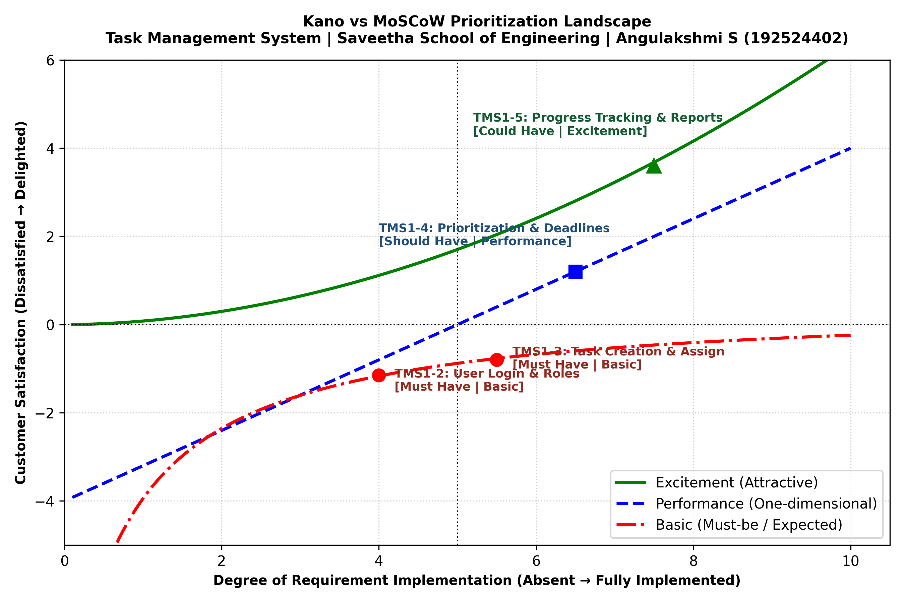

# EXPERIMENT NO. 12: PRIORITIZING TASK MANAGEMENT SYSTEM REQUIREMENTS USING MOSCOW AND KANO IN JIRA

## Academic Information
- **Course**: CSA10 – Software Engineering
- **Student Name**: Angulakshmi S
- **Register Number**: 192524402
- **Degree**: B.Tech (AI & Data Science), 2nd Year
- **Department**: Computer Science and Engineering / Department of AI & DS
- **Institution**: Saveetha School of Engineering, SIMATS
- **Tools Used**: Jira Software (Cloud) / Python 3.13 / Atlassian Platform
- **Course Outcome**: CO2
- **Date**: 19-11-2026

---

## 1. Problem Statement
You are designing a Task Management System for a small team. The system should include the following features: User Login and Role Assignment Task Creation and Assignment Task Prioritization and Deadlines Progress Tracking and Reporting Prioritize these requirements using the MoSCoW and Kano models in Jira.

---

## 2. Aim
To create the requirements of a Task Management System as Jira issues and prioritize them using the MoSCoW and Kano models.

---

## 3. Software / Tools Required
- **Jira Software (Cloud)** – Scrum Project Template
- **Web Browser** (Google Chrome / Microsoft Edge)
- **Atlassian Account**
- **Python 3.13** (Local prioritization evaluation and Kano curve plotting)

---

## 4. Theory
Effective requirements prioritization harmonizes commercial delivery constraints with end-user psychological perception. Combining **MoSCoW** and the **Kano Model** provides product engineering teams with a robust two-dimensional analytical framework:

### 4.1 MoSCoW Framework (Business Necessity)
Derived from DSDM, MoSCoW assesses the absolute necessity of features with respect to time-boxed delivery:
- **Must Have**: Critical foundation without which the system cannot function or be released.
- **Should Have**: Important capabilities providing major value, but not strictly fatal if omitted in the immediate increment.
- **Could Have**: Desirable features that can be incorporated if surplus capacity exists.
- **Won’t Have**: Features consciously scoped out for future iterations.

### 4.2 Kano Model (Customer Satisfaction Dynamics)
Developed by Dr. Noriaki Kano in 1984, the Kano Model maps feature execution against user emotion:

| Kano Category | Characteristic | Impact on Customer Satisfaction |
|---|---|---|
| **Basic (Must-be)** | Mandatory expected baseline | Absence causes severe dissatisfaction; presence is taken for granted without increasing delight. |
| **Performance (One-dimensional)** | Linear competitive features | Customer satisfaction is directly proportional to how well the feature is engineered and delivered. |
| **Excitement (Attractive)** | Latent unexpected delight | Delights users tremendously when present; causes zero dissatisfaction when omitted because users did not anticipate it. |
| **Indifferent** | Neutral feature | Users do not care whether the feature is present or absent. |
| **Reverse** | Detrimental feature | Presence causes user dissatisfaction; absence improves satisfaction. |

### 4.3 Why Combine MoSCoW and Kano?
- **MoSCoW** captures **development necessity and feasibility** from the product sponsor's perspective.
- **Kano** captures **emotional satisfaction and delight** from the customer's perspective.
- Combining both guarantees that the team builds an MVP that is both commercially viable and competitively appealing.

---

## 5. Detailed Step-by-Step Procedure
- **Step 1: Login to Jira Cloud**
  - Open a web browser, navigate to `https://id.atlassian.com/login`, and sign in to Atlassian Cloud.
- **Step 2: Create a New Project**
  - Click **Create Project** on the dashboard.
  - Choose the **Scrum** project template.
  - Enter Project Name: `"Task Management System"`.
  - Select **Team-managed** project type, access as **Open**, and project key as `TMS1`.
  - Click **Create**.
- **Step 3: Open Backlog and Create Requirements as Tasks**
  - Select the **Backlog** tab from the left sidebar.
  - Create the four core requirements:
    1. `User Login and Role Assignment` (`TMS1-2`)
    2. `Task Creation and Assignment` (`TMS1-3`)
    3. `Task Prioritization and Deadlines` (`TMS1-4`)
    4. `Progress Tracking and Reporting` (`TMS1-5`)
- **Step 4: Add Tasks to Sprint**
  - Click **Create Sprint** to instantiate `"TMS1 Sprint 1"`.
  - Drag and drop all four tasks from the Product Backlog into the active sprint container.
- **Step 5: Start the Sprint**
  - Click **Start Sprint**.
  - Configure the duration to **1 Week** with start and end dates, then click **Start**.
- **Step 6: Prioritize Requirements Using the MoSCoW Model**
  - Open each task and configure the MoSCoW priority using priority fields or tags:
    - `User Login and Role Assignment` $\rightarrow$ **Must Have** (`Highest`)
    - `Task Creation and Assignment` $\rightarrow$ **Must Have** (`Highest`)
    - `Task Prioritization and Deadlines` $\rightarrow$ **Should Have** (`High`)
    - `Progress Tracking and Reporting` $\rightarrow$ **Could Have** (`Medium`)
- **Step 7: Categorize Requirements Using the Kano Model**
  - Apply corresponding Kano labels to each Jira task:
    - `User Login and Role Assignment` $\rightarrow$ `Kano-Basic`
    - `Task Creation and Assignment` $\rightarrow$ `Kano-Basic`
    - `Task Prioritization and Deadlines` $\rightarrow$ `Kano-Performance`
    - `Progress Tracking and Reporting` $\rightarrow$ `Kano-Excitement`
- **Step 8: Verify Prioritization**
  - Verify that each task accurately reflects its dual MoSCoW and Kano classifications in both the issue detail pane and the backlog summary list.
- **Step 9: Simulate Sprint Execution and Capture Output**
  - Move cards across workflow columns:
    - `TMS1-4` (`Task Prioritization and Deadlines`) $\rightarrow$ **Done**
    - `TMS1-3` (`Task Creation and Assignment`) $\rightarrow$ **In Progress**
    - `TMS1-2` and `TMS1-5` $\rightarrow$ **To Do**
  - Capture screenshots of the Backlog, Sprint Board, and Task Detail Views.

---

## 6. Dual-Model Prioritization Matrix

| Jira Key | Requirement Description | MoSCoW Priority | Kano Category | Story Points | Sprint Status | Strategic Rationale |
|---|---|:---:|:---:|:---:|:---:|---|
| **TMS1-2** | User Login and Role Assignment | **Must Have** | **Basic** | 5 | To Do | Essential baseline security requirement. Without authentication, multi-user permissions cannot operate. |
| **TMS1-3** | Task Creation and Assignment | **Must Have** | **Basic** | 8 | In Progress | Primary functional core of any task management platform; non-negotiable for system viability. |
| **TMS1-4** | Task Prioritization and Deadlines | **Should Have** | **Performance** | 5 | Done | High-value driver. Better deadline alerting and prioritization linearly scales team productivity. |
| **TMS1-5** | Progress Tracking and Reporting | **Could Have** | **Excitement** | 3 | To Do | Delight factor providing high executive visibility and visual charts that differentiate the tool. |

*The complete CSV export formatted for Jira import is located in [`config/tms_jira_backlog.csv`](config/tms_jira_backlog.csv).*

---

## 7. Kano vs MoSCoW Landscape Visualization

### 7.1 Visual Classification Landscape
The mathematical Kano satisfaction curve mapping the four candidate features is plotted in [output/moscow_kano_matrix.png](output/moscow_kano_matrix.png):



### 7.2 Strategic Alignment Diagram
```mermaid
quadrantChart
    title Prioritization Matrix: Business Criticality vs Customer Delight
    x-axis Low Customer Delight --> High Customer Delight
    y-axis Low Business Criticality --> High Business Criticality
    quadrant-1 Performance Driver (Should Have)
    quadrant-2 Mandatory Baseline (Must Have)
    quadrant-3 Out of Scope (Won't Have)
    quadrant-4 Delight Feature (Could Have)
    "TMS1-2: Login & Roles": [0.2, 0.9]
    "TMS1-3: Task Creation": [0.35, 0.85]
    "TMS1-4: Prioritization": [0.65, 0.65]
    "TMS1-5: Progress Reports": [0.85, 0.35]
```

---

## 8. Real Execution Output
Execution log captured from `output/run_output.txt`:

```text
==================================================================
   JIRA TASK MANAGEMENT SYSTEM: MOSCOW & KANO DUAL EVALUATION     
==================================================================
Project: Task Management System (Key: TMS1)
Sprint : TMS1 Sprint 1 | Duration: 1 Week
Team   : Angulakshmi S (192524402)
------------------------------------------------------------------
Key     | Summary                             | MoSCoW      | Kano         | Status
--------------------------------------------------------------------------------
TMS1-2  | User Login and Role Assignment      | Must Have   | Basic        | To Do
TMS1-3  | Task Creation and Assignment        | Must Have   | Basic        | In Progress
TMS1-4  | Task Prioritization and Deadlines   | Should Have | Performance  | Done
TMS1-5  | Progress Tracking and Reporting     | Could Have  | Excitement   | To Do

------------------------------------------------------------------
Prioritization Synthesis:
  • Must Have + Basic       : Essential baseline foundation (Zero tolerance for omission)
  • Should Have + Performance: Linear competitive driver (Directly scales user satisfaction)
  • Could Have + Excitement  : Differentiator & delight factor (Competitive edge for team)
------------------------------------------------------------------
Generated Kano-MoSCoW matrix chart: moscow_kano_matrix.png
==================================================================
```

---

## 9. Execution Status & Deliverables
- **Jira Backlog Data**: Created RFC-4180 CSV export in [`config/tms_jira_backlog.csv`](config/tms_jira_backlog.csv) with MoSCoW priorities, Kano labels, and story points.
- **Matrix Generation**: Simulated the dual-model framework and exported high-resolution curve plots to `output/moscow_kano_matrix.png` via Python 3.13.
- **Desktop Jira Cloud Visuals**: Step-by-step screenshot requirements for Figures 12.1 through 12.6 are cataloged in [`screenshots/SCREENSHOTS_TODO.md`](screenshots/SCREENSHOTS_TODO.md).

---

## 10. Result
Thus, the requirements of the Task Management System were created as Jira issues, prioritized using the MoSCoW and Kano models, incorporated into a 1-week sprint, and tracked across the active sprint board successfully.

---

## 11. Viva Voce Questions and Answers

### 1. What is the Kano model?
**Ans**: The Kano model is a customer-satisfaction framework developed by Dr. Noriaki Kano that classifies product features according to their emotional impact on customer satisfaction, separating basic expectations from performance drivers and attractive differentiators.

### 2. Give an example of a Basic feature.
**Ans**: **User Login and Password Authentication** in a web application. Users take login for granted; its presence yields no special praise, but its absence or malfunction causes complete product rejection.

### 3. Give an example of an Excitement feature.
**Ans**: **Automated AI progress forecasting, smart meeting summaries, or automatic task deadline reminders**. Users did not explicitly request or expect them, but their presence elicits delight and boosts adoption.

### 4. How can MoSCoW priority be stored in Jira?
**Ans**: MoSCoW priorities can be stored in Jira via:
1. Native **Priority** field mapping (`Highest` = Must, `High` = Should, `Medium` = Could, `Low` = Won't).
2. Custom Jira **Labels** (e.g., `MoSCoW-Must`, `MoSCoW-Should`).
3. Dedicated **Custom Select-List Fields** configured in project settings.

### 5. Why use both MoSCoW and Kano?
**Ans**: MoSCoW focuses on business viability and delivery feasibility under time constraints, whereas Kano focuses on customer satisfaction and emotional delight. Combining both gives a balanced perspective, preventing teams from delivering a feature-complete product that fails to satisfy users.
