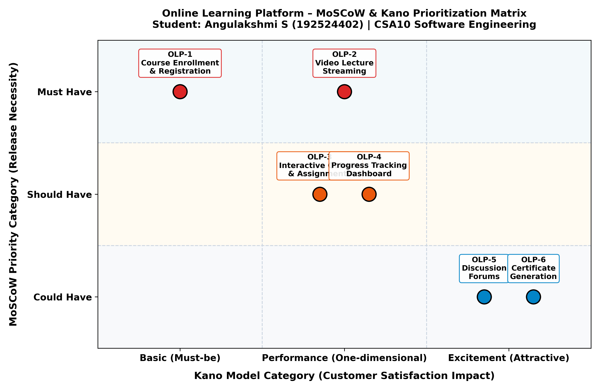

# Experiment 13: Prioritizing Online Learning Platform Requirements using MoSCoW and Kano in Jira

### Student Information
- **Student Name:** Angulakshmi S
- **Register Number:** 192524402
- **Department:** Computer Science and Engineering / Artificial Intelligence & Data Science
- **Institution:** Saveetha School of Engineering, SIMATS
- **Course Outcome:** CO2
- **Date:** 21-11-2026

---

## Problem Statement
You are tasked with developing an Online Learning Platform. The platform should include the following functionalities: Course Enrollment and Registration, Video Lecture Streaming, Interactive Quizzes and Assignments, Progress Tracking Dashboard, Peer-to-Peer Discussion Forums, Certificate Generation. Use Jira to categorize and prioritize these requirements using MoSCoW and Kano techniques.

---

## Aim
To categorize and prioritize the functional requirements of an Online Learning Platform in Jira using the MoSCoW and Kano techniques.

---

## Software / Tools Required
- Jira Software (Cloud) – Scrum project
- Web browser (Google Chrome / Mozilla Firefox / Microsoft Edge)
- Atlassian account

---

## Theory
Requirement prioritization helps engineering teams decide which functionalities deliver maximal business and user value within iteration boundaries, constrained budgets, and release timelines. Combining **MoSCoW** and the **Kano Model** provides a balanced, two-dimensional prioritization framework:

1. **MoSCoW Technique (Dynamic Systems Development Method - DSDM):**
   - **Must Have (M):** Non-negotiable requirements critical for the current delivery; without these, the product cannot function or launch.
   - **Should Have (S):** Important features that offer significant value and should be included if feasible, but temporary workarounds exist.
   - **Could Have (C):** Desirable features that provide enhancements or delight, implemented only if time and spare capacity allow.
   - **Won't Have (W):** Explicitly agreed to be out-of-scope for the current release milestone, deferred to later phases.

2. **Kano Model (Dr. Noriaki Kano, 1984):**
   Classifies software features based on customer perception and emotional satisfaction relative to functional execution:
   - **Basic (Must-be):** Taken for granted by learners. Their presence does not increase satisfaction, but their absence triggers absolute dissatisfaction.
   - **Performance (One-dimensional):** Customer satisfaction is directly proportional to how well the feature is implemented (e.g., streaming latency, query response time).
   - **Excitement (Attractive):** Unexpected innovations that trigger high delight and virality. Absence causes zero dissatisfaction because users never expected them.
   - **Indifferent:** Features that users do not care about either way.
   - **Reverse:** Features whose presence annoys or dissatisfies users.

### Prioritization Mapping Table
| Requirement ID | Functional Requirement | MoSCoW Priority | Kano Category | Release Sprint | Justification |
| :--- | :--- | :--- | :--- | :--- | :--- |
| **OLP-1** | Course Enrollment and Registration | **Must Have** | **Basic** | Sprint 1 (MVP) | Foundational access gate; users cannot access courses without authentication and enrollment. |
| **OLP-2** | Video Lecture Streaming | **Must Have** | **Performance** | Sprint 1 (MVP) | Core value delivery channel; high-bitrate streaming directly drives educational utility. |
| **OLP-3** | Interactive Quizzes & Assignments | **Should Have** | **Performance** | Sprint 1 (Targeted) | Essential pedagogical feedback mechanism that validates student learning progress. |
| **OLP-4** | Progress Tracking Dashboard | **Should Have** | **Performance** | Sprint 1 (Targeted) | Motivates learners via completion metrics, study streaks, and remaining module indicators. |
| **OLP-5** | Peer-to-Peer Discussion Forums | **Could Have** | **Excitement** | Sprint 2 (Delight) | Fosters collaborative social learning communities; valuable differentiator but non-blocking for launch. |
| **OLP-6** | Certificate Generation | **Could Have** | **Excitement** | Sprint 2 (Delight) | Verifiable credentialing upon completion; delightful reward that can be deployed post-course-setup. |

---

## Step-by-Step Procedure

### Step 1: Login
- Open a web browser and navigate to Jira: `https://id.atlassian.com/login`.
- Sign in to your Jira account using registered email address and credentials.
- Access the Jira dashboard upon successful authentication.

### Step 2: Create a New Project
- Click **Create Project** from the Jira dashboard.
- Select the **Scrum** project template to enable sprint cycles and story point estimation.
- Set the project name to **Online Learning Platform**.
- Choose **Team-managed** project type, set access to **Open**, and define the key as **OLP**.
- Click **Create** to initialize the workspace.

### Step 3: Open the Backlog
- Select the `Online Learning Platform` project from the navigation sidebar.
- Click the **Backlog** tab.
- Click **Create sprint** to initialize `OLP Sprint 1`.

### Step 4: Create the Project Requirements as Tasks
- In the Backlog view, click **+ Create issue** and create the 6 user stories/tasks:
  1. `Course Enrollment and Registration`
  2. `Video Lecture Streaming`
  3. `Interactive Quizzes and Assignments`
  4. `Progress Tracking Dashboard`
  5. `Peer-to-Peer Discussion Forums`
  6. `Certificate Generation`

### Step 5: Add Tasks to the Sprint
- Drag and drop all six tasks from the Product Backlog section into the `OLP Sprint 1` container.
- Confirm all six issues are staged within the sprint.

### Step 6: Start the Sprint
- Click the **Start Sprint** button at the top of the sprint container.
- Enter the Sprint Name: `OLP Sprint 1`.
- Set the Duration: `1 week` (or custom 1–2 weeks).
- Define the Sprint Goal: *"Deliver functional course enrollment and streaming MVP with core assessments."*
- Click **Start**.

### Step 7: Prioritize Requirements Using the MoSCoW Model
- Open each task card and configure the **Priority** field and custom labels:
  - `OLP-1`: Priority = **Highest**, Label = `MoSCoW-Must`
  - `OLP-2`: Priority = **Highest**, Label = `MoSCoW-Must`
  - `OLP-3`: Priority = **High**, Label = `MoSCoW-Should`
  - `OLP-4`: Priority = **High**, Label = `MoSCoW-Should`
  - `OLP-5`: Priority = **Medium**, Label = `MoSCoW-Could`
  - `OLP-6`: Priority = **Medium**, Label = `MoSCoW-Could`

### Step 8: Categorize Requirements Using the Kano Model
- Open each task card and add the corresponding Kano label:
  - `OLP-1`: Label = `Kano-Basic`
  - `OLP-2`: Label = `Kano-Performance`
  - `OLP-3`: Label = `Kano-Performance`
  - `OLP-4`: Label = `Kano-Performance`
  - `OLP-5`: Label = `Kano-Excitement`
  - `OLP-6`: Label = `Kano-Excitement`

### Step 9: Verify the Prioritization
- Verify that both MoSCoW and Kano tags appear on the card tokens in the **Active Sprint Board**.
- Use Jira JQL queries or board filters (e.g., `labels = Kano-Basic`, `labels = MoSCoW-Must`) to filter work items dynamically.

---

## Code & Artifact Implementation
To programmatically analyze and visualize this dual prioritization model, an automated analysis script was developed in Python:
- Source Code: [`code/moscow_kano_online_learning.py`](code/moscow_kano_online_learning.py)
- Jira CSV Import: [`config/olp_jira_backlog.csv`](config/olp_jira_backlog.csv)
- Generated Chart: [`output/moscow_kano_olp_matrix.png`](output/moscow_kano_olp_matrix.png)
- Terminal Run Log: [`output/run_output.txt`](output/run_output.txt)
- Screenshot Checklist: [`screenshots/SCREENSHOTS_TODO.md`](screenshots/SCREENSHOTS_TODO.md)

---

## Output

### Visual Prioritization Matrix


### Execution Output Log
```
=====================================================================================
EXPERIMENT 13: ONLINE LEARNING PLATFORM REQUIREMENTS PRIORITIZATION
STUDENT: Angulakshmi S | REGISTER NUMBER: 192524402
=====================================================================================

[1] REQUIREMENT ANALYSIS MATRIX (MoSCoW vs. KANO):

Key     | Requirement Title                      | MoSCoW       | Kano         | SP  | Sprint
-------------------------------------------------------------------------------------
OLP-1   | Course Enrollment and Registration     | Must Have    | Basic        | 5   | Sprint 1 (MVP)
OLP-2   | Video Lecture Streaming                | Must Have    | Performance  | 8   | Sprint 1 (MVP)
OLP-3   | Interactive Quizzes and Assignments    | Should Have  | Performance  | 5   | Sprint 1 (Targeted)
OLP-4   | Progress Tracking Dashboard            | Should Have  | Performance  | 5   | Sprint 1 (Targeted)
OLP-5   | Peer-to-Peer Discussion Forums         | Could Have   | Excitement   | 5   | Sprint 2 (Enhancement)
OLP-6   | Certificate Generation                 | Could Have   | Excitement   | 3   | Sprint 2 (Enhancement)

=====================================================================================
[2] SPRINT PLANNING BREAKDOWN:

- SPRINT 1 (MVP Delivery - Must & High Shoulds):
  * [OLP-1] Course Enrollment and Registration (5 pts) -> MoSCoW: Must Have, Kano: Basic
  * [OLP-2] Video Lecture Streaming (8 pts) -> MoSCoW: Must Have, Kano: Performance
  * [OLP-3] Interactive Quizzes and Assignments (5 pts) -> MoSCoW: Should Have, Kano: Performance
  * [OLP-4] Progress Tracking Dashboard (5 pts) -> MoSCoW: Should Have, Kano: Performance
  Total Sprint 1 Story Points: 23 pts

- SPRINT 2 (Enhancement & Delight - Coulds):
  * [OLP-5] Peer-to-Peer Discussion Forums (5 pts) -> MoSCoW: Could Have, Kano: Excitement
  * [OLP-6] Certificate Generation (3 pts) -> MoSCoW: Could Have, Kano: Excitement
  Total Sprint 2 Story Points: 8 pts

=====================================================================================
[3] DUAL-FRAMEWORK STRATEGY SUMMARY:
  * MoSCoW governs immediate release feasibility (Must = Non-negotiable, Should = High value).
  * Kano governs user satisfaction and adoption dynamics (Basic = Baseline trust, Performance = Quality, Excitement = Delighters).
  * The unified roadmap ensures the MVP is reliable (Basic), competitive (Performance), and primed for viral retention (Excitement).
=====================================================================================
```

---

## Result
Thus the requirements of the Online Learning Platform were created in Jira and categorized and prioritized using the MoSCoW and Kano techniques.

---

## Viva Voce Questions and Answers

### 1. Why is course enrolment a Basic feature?
**Answer:** Learners expect course enrollment as a mandatory table-stakes capability. Without user registration and course enrollment, the platform cannot be authenticated or accessed, causing immediate and complete dissatisfaction.

### 2. Why is certificate generation an Excitement feature?
**Answer:** It delights learners upon completing the coursework, but its absence does not stop them from watching lecture videos or acquiring knowledge during day-to-day study.

### 3. What is a performance feature?
**Answer:** A feature whose better implementation gives proportionally higher satisfaction (e.g., seamless, buffer-free video streaming or ultra-fast quiz grading).

### 4. How do you filter issues by label in Jira?
**Answer:** In Jira, you can filter using the quick filter bar on the board or through JQL (Jira Query Language) such as: `labels = Kano-Basic` or `labels = MoSCoW-Must`.

### 5. Can Kano categories change over time?
**Answer:** Yes. Over time, features naturally migrate downward across the Kano lifecycle: what was once an **Excitement** delighter eventually becomes a standard **Performance** expectation, and ultimately transforms into a **Basic** requirement that users take for granted.
