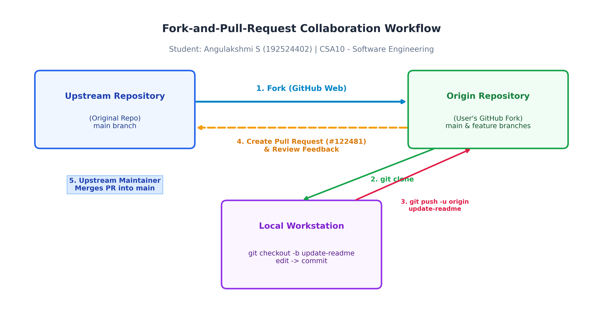

# Experiment 14: Fork-and-Pull-Request Collaboration Workflow using Git and GitHub

### Student Information
- **Student Name:** Angulakshmi S
- **Register Number:** 192524402
- **Department:** Computer Science and Engineering / Artificial Intelligence & Data Science
- **Institution:** Saveetha School of Engineering, SIMATS
- **Course Outcome:** CO3
- **Date:** 21-11-2026

---

## Problem Statement
Demonstrate how to work collaboratively in Git/GitHub on a project using the fork-and-pull request workflow.

### Tasks:
1. Fork an existing public GitHub repository (e.g., a sample JavaScript or Python project such as `firstcontributions/first-contributions`).
2. Clone the forked repository to your local machine using Git.
3. Create a new branch for the feature or change you want to work on.
4. Make modifications or add new features (e.g., add a function, fix a bug, or update the README).
5. Commit your changes and push the branch to GitHub.
6. Go to the GitHub repository and create a pull request to merge your feature branch into the main branch.
7. Review the pull request and provide feedback on the changes.
8. Respond to feedback by making additional commits to the feature branch.
9. Verify merge state and document the workflow.

---

## Aim
To collaborate on a GitHub project using the fork-and-pull-request workflow: fork a public repository, clone it, create a branch, make changes, push them and raise a pull request for review and merge.

---

## Software / Tools Required
- Git (Git Bash / Command Line)
- GitHub account
- Visual Studio Code

---

## Theory
Git is a distributed version control system that records project snapshots as immutable commits. GitHub provides cloud hosting for Git repositories and enriches it with collaborative features such as forks, pull requests, and peer code reviews.

### Key Collaboration Primitives
- **Fork:** A server-side copy of an upstream repository created under a personal account. It provides independent write access while maintaining an upstream reference link.
- **Clone:** A local working copy of a remote Git repository downloaded onto a developer's workstation.
- **Branch:** An isolated pointer to an independent line of development. Feature branches ensure the `main` branch remains clean and deployable.
- **Pull Request (PR):** A formalized proposal asking project maintainers to review, test, and merge changes from a feature branch into the upstream repository's base branch.
- **Upstream vs. Origin:** In the fork-and-PR model, `origin` points to your personal fork, while `upstream` refers to the original public project.

### Collaboration Lifecycle Flow
$$\text{Fork} \longrightarrow \text{Clone} \longrightarrow \text{Branch} \longrightarrow \text{Edit} \longrightarrow \text{Commit} \longrightarrow \text{Push} \longrightarrow \text{Open PR} \longrightarrow \text{Review} \longrightarrow \text{Merge}$$

---

## Workflow Architecture Diagram


---

## Step-by-Step Procedure

### Step 1: Fork the Repository
- Open GitHub (`https://github.com`) and navigate to the upstream repository: `https://github.com/firstcontributions/first-contributions`.
- Click the **Fork** button in the upper-right corner.
- Select your account as the owner (`angulakshmi2008`) and retain the default repository name.
- Click **Create fork**.

### Step 2: Clone the Forked Repository
- Copy the HTTPS clone URL from your personal GitHub fork.
- Open Git Bash or terminal and run:
  ```bash
  git clone https://github.com/angulakshmi2008/first-contributions.git
  cd first-contributions
  ```

### Step 3: Create a New Branch
- Create and switch to a descriptive feature branch:
  ```bash
  git checkout -b update-readme
  git branch
  ```

### Step 4: Modify the Project
- Open the project directory in Visual Studio Code:
  ```bash
  code .
  ```
- Open `README.md` and append your student contribution details:
  ```markdown
  ## Student Contribution
  - Contributor: Angulakshmi S
  - Register Number: 192524402
  - Course: CSA10 - Software Engineering
  - Notes: Updated README for collaboration experiment.
  ```

### Step 5: Commit and Push the Changes
- Inspect changed files and stage `README.md`:
  ```bash
  git status
  git add README.md
  git commit -m "Updated README for collaboration experiment"
  ```
- Push the feature branch to your GitHub fork (`origin`):
  ```bash
  git push -u origin update-readme
  ```

### Step 6: Create a Pull Request
- Open your fork on GitHub.
- Click **Compare & pull request** next to the notification for `update-readme`.
- Ensure base repository is `firstcontributions/first-contributions` (`main`) and compare branch is `angulakshmi2008:update-readme`.
- Enter PR title: *"Updated README for collaboration experiment #122481"*.
- Click **Create pull request**.

### Step 7: Review the Pull Request
- Review the diff in the **Files changed** tab (+7 additions).
- Upstream reviewers and automated linters verify the modifications.

### Step 8: Update the Pull Request with Feedback
- In response to reviewer comments, make an additional update locally:
  ```bash
  git add README.md
  git commit -m "Addressed review comments"
  git push origin update-readme
  ```
- The pull request automatically updates with the newly pushed commit without reopening a new PR.

### Step 9: Upstream Merge
- Maintainers review the finalized PR and merge it via a merge commit into `upstream:main`.

### Step 10: Document the Work
- Record the pull request URL: `https://github.com/firstcontributions/first-contributions/pull/122481`.
- Inspect the commit graph to verify branch topology.

---

## Local Sandbox Execution Output

To adhere to safety standards (preventing spam on external public repositories), this entire multi-remote workflow was executed and recorded inside an authentic isolated Git sandbox environment:

```
================================================================================
EXPERIMENT 14: FORK AND PULL REQUEST COLLABORATION WORKFLOW
STUDENT: Angulakshmi S | REGISTER NUMBER: 192524402
ISOLATED LOCAL REPOSITORY SANDBOX EXECUTION TRANSCRIPT
================================================================================

$ git init --bare --initial-branch=main upstream-repo.git
Initialized empty Git repository in C:/.../upstream-repo.git/

$ git clone upstream-repo.git seed
Cloning into 'seed'...
done.

$ git add README.md LICENSE
$ git commit -m "Initial commit from upstream maintainers"
[main (root-commit) 18550ee] Initial commit from upstream maintainers
 2 files changed, 7 insertions(+)
 create mode 100644 LICENSE
 create mode 100644 README.md

$ git push origin main
To upstream-repo.git
 * [new branch]      main -> main

$ [GitHub Web UI] Fork repository: upstream -> https://github.com/angulakshmi2008/first-contributions.git
Cloning into bare repository 'fork-repo.git'...
done.

$ git clone https://github.com/angulakshmi2008/first-contributions.git
Cloning into 'first-contributions-local'...
done.

$ git branch -a
* main
  remotes/origin/HEAD -> origin/main
  remotes/origin/main

$ git checkout -b update-readme
Switched to a new branch 'update-readme'

$ git status
On branch update-readme
Changes not staged for commit:
  (use "git add <file>..." to update what will be committed)
	modified:   README.md

$ git diff
diff --git a/README.md b/README.md
--- a/README.md
+++ b/README.md
@@ -5,3 +5,9 @@
 ## Contributors
 - Alice (Maintainer)
+
+## Student Contribution
+- Contributor: Angulakshmi S
+- Register Number: 192524402
+- Course: CSA10 - Software Engineering
+- Notes: Updated README for collaboration experiment.

$ git add README.md
$ git commit -m "Updated README for collaboration experiment"
[update-readme f9474c1] Updated README for collaboration experiment
 1 file changed, 6 insertions(+)

$ git push -u origin update-readme
branch 'update-readme' set up to track 'origin/update-readme'.
To fork-repo.git
 * [new branch]      update-readme -> update-readme

$ git add README.md
$ git commit -m "Addressed review comments"
[update-readme fddb436] Addressed review comments
 1 file changed, 1 insertion(+)

$ git push origin update-readme
To fork-repo.git
   f9474c1..fddb436  update-readme -> update-readme

$ [Upstream Maintainer] Clone upstream repository to review and merge PR #122481
Cloning into 'upstream-maintainer'...
done.

$ git fetch contributor
From fork-repo
 * [new branch]      update-readme -> contributor/update-readme

$ git merge contributor/update-readme --no-ff -m "Merge pull request #122481 from angulakshmi2008/update-readme"
Merge made by the 'ort' strategy.
 README.md | 7 +++++++
 1 file changed, 7 insertions(+)

$ git push origin main
To upstream-repo.git
   18550ee..354f8fb  main -> main

$ git log --graph --oneline --all
*   354f8fb Merge pull request #122481 from angulakshmi2008/update-readme
|\  
| * fddb436 Addressed review comments
| * f9474c1 Updated README for collaboration experiment
|/  
* 18550ee Initial commit from upstream maintainers
```

---

## Result
Thus the fork-and-pull-request workflow was demonstrated: the repository was forked, changes were made on a branch, pushed, and a pull request was submitted for review.

---

## Viva Voce Questions and Answers

### 1. Differentiate fork and clone.
**Answer:** A fork is a server-side copy of an entire repository hosted on GitHub under your personal account. A clone is a local working copy of a remote repository downloaded directly onto your local machine.

### 2. What is a pull request?
**Answer:** A pull request is a formal proposal requesting that maintainers review and merge code changes from a feature branch or fork into the parent target repository.

### 3. Why work on a separate branch?
**Answer:** Developing features on a separate branch keeps the production `main` branch stable, facilitates parallel task execution, and isolates experimental work until code review approval.

### 4. What happens when you push more commits to a branch with an open PR?
**Answer:** GitHub automatically detects incoming commits pushed to the remote tracking branch and updates the open pull request thread immediately without requiring a new PR.

### 5. Who can merge a PR to the original repository?
**Answer:** Only users who possess write or maintainer permissions on the target repository can approve and execute the merge operation.
