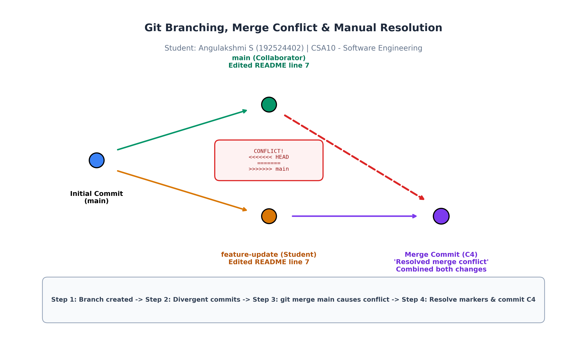

# Experiment 15: Working with Git Branches and Resolving Merge Conflicts

### Student Information
- **Student Name:** Angulakshmi S
- **Register Number:** 192524402
- **Department:** Computer Science and Engineering / Artificial Intelligence & Data Science
- **Institution:** Saveetha School of Engineering, SIMATS
- **Course Outcome:** CO3
- **Date:** 21-11-2026

---

## Problem Statement
Demonstrate how to work with Git branches and resolve merge conflicts when collaborating with others.

### Tasks:
1. Clone a shared repository to your local machine.
2. Create a new branch and switch to it.
3. Make changes to a file (e.g., update a README or modify code in a specific function).
4. Commit your changes.
5. Push the changes to the remote repository.
6. Before merging, pull the latest changes from the main branch.
7. Switch back to your feature branch.
8. Merge the main branch into your feature branch.
9. If there are conflicts, resolve them manually by editing the conflicting files. After resolving conflicts, mark the conflicts as resolved.
10. Commit the resolved merge.
11. Push your feature branch with the merged changes to GitHub and create a pull request.
12. Submit a summary of the steps performed, the conflicts encountered, and how they were resolved.

---

## Aim
To work with Git branches while collaborating, merge the main branch into a feature branch, resolve merge conflicts manually, and push the result to GitHub with a pull request.

---

## Software / Tools Required
- Git (Git Bash / Command Line)
- GitHub
- Visual Studio Code

---

## Theory
A merge conflict occurs when two branches make competing modifications to the same line(s) of a file, or when one branch edits a file that another branch deleted. In such situations, Git cannot programmatically decide which version represents the intended source of truth and suspends the merge operation, flagging the file as **unmerged** (`both modified`).

### Anatomy of Conflict Markers
Git injects standard delimiter markers directly into the conflicting source file:
```text
<<<<<<< HEAD
changes in the current (feature) branch
=======
changes coming from the other (main) branch
>>>>>>> main
```
- `<<<<<<< HEAD`: Marks the start of the changes from the currently checked-out branch.
- `=======`: Divides the two conflicting implementations.
- `>>>>>>> main`: Marks the termination of the incoming changes from the branch being merged.

### Essential Git Branching Commands
| Command | Purpose |
| :--- | :--- |
| `git branch` | List all local branches (* denotes active branch) |
| `git checkout -b <name>` | Create a new branch and immediately switch to it |
| `git pull origin main` | Fetch remote commits and merge them into active branch |
| `git merge main` | Merge target branch `main` into the current working branch |
| `git status` | Show status of staged, modified, and conflicted files |
| `git log --oneline --graph` | Display visual commit tree and branch topology |

---

## Branching & Conflict Resolution Diagram


---

## Step-by-Step Procedure

### Step 1: Clone the Shared Repository
- Open Git Bash or terminal on your local workstation.
- Copy the HTTPS URL of the shared repository.
- Run `git clone <repository_url>` and navigate into the folder:
  ```bash
  git clone https://github.com/saveetha-se/shared-repo.git
  cd shared-repo
  ls
  ```

### Step 2: Create and Switch to a New Branch
- Create and switch to a new feature branch:
  ```bash
  git checkout -b feature-update
  git branch
  ```

### Step 3: Make Changes to a File
- Open the project in Visual Studio Code:
  ```bash
  code .
  ```
- Open `README.md` and edit the active modules section:
  ```markdown
  ## Active Modules
  - User Authentication (Angulakshmi S - 192524402)
  - Feature Branch Update Module (Optimized)
  ```
- Save the file (`Ctrl + S`).

### Step 4: Check and Commit the Changes
- Inspect the file modification state and commit:
  ```bash
  git status
  git add README.md
  git commit -m "Updated README on feature-update branch"
  ```

### Step 5: Push the Feature Branch
- Push the feature branch to the remote repository:
  ```bash
  git push -u origin feature-update
  ```

### Step 6: Switch to the Main Branch
- Switch back to the base branch:
  ```bash
  git checkout main
  git branch
  ```

### Step 7: Pull the Latest Changes from the Main Branch
- Pull the concurrent changes committed by a collaborator on `main`:
  ```bash
  git pull origin main
  ```

### Step 8: Switch Back to the Feature Branch
- Switch back to your active development branch:
  ```bash
  git checkout feature-update
  git branch
  ```

### Step 9: Merge the Main Branch into the Feature Branch
- Merge upstream `main` changes into `feature-update`:
  ```bash
  git merge main
  ```
- Git triggers a merge conflict because both branches altered the identical line:
  ```text
  Auto-merging README.md
  CONFLICT (content): Merge conflict in README.md
  Automatic merge failed; fix conflicts and then commit the result.
  ```

### Step 10: Resolve the Merge Conflict
- Open `README.md` in Visual Studio Code.
- Locate the conflict markers:
  ```text
  <<<<<<< HEAD
  - User Authentication (Angulakshmi S - 192524402)
  - Feature Branch Update Module (Optimized)
  =======
  - Core API Engine (Upstream Collaborator)
  - Main Branch Pipeline Integration
  >>>>>>> main
  ```
- Manually edit the file to incorporate both contributions and eliminate all conflict markers:
  ```markdown
  ## Active Modules
  - User Authentication (Angulakshmi S - 192524402) [Feature Branch]
  - Core API Engine (Upstream Collaborator) [Main Branch]
  - Main Branch Pipeline Integration & Feature Module
  ```
- Save the file.

### Step 11: Mark the Conflict as Resolved and Commit
- Stage the resolved file:
  ```bash
  git add README.md
  ```
- Complete the merge commit:
  ```bash
  git commit -m "Resolved merge conflict"
  git status
  ```
- The working tree is confirmed clean.

### Step 12: Push the Merged Feature Branch
- Push the updated feature branch including the merge commit to GitHub:
  ```bash
  git push origin feature-update
  ```
- On GitHub, open a Pull Request from `feature-update` into `main`.

### Step 13: Verify the Pull Request
- Verify on GitHub that the pull request status reports: *"Able to merge. These branches can be automatically merged."*

---

## Local Sandbox Execution Output

Below is the verified execution transcript captured from an isolated Git environment demonstrating the complete branch lifecycle, conflict emergence, marker inspection, manual resolution, and merge commit:

```
================================================================================
EXPERIMENT 15: GIT BRANCHES AND MERGE CONFLICT RESOLUTION
STUDENT: Angulakshmi S | REGISTER NUMBER: 192524402
ISOLATED LOCAL REPOSITORY SANDBOX EXECUTION TRANSCRIPT
================================================================================

$ git init --bare --initial-branch=main shared-repo.git
$ git clone shared-repo.git seed
$ git commit -m "Initial commit with project README"
$ git push origin main

$ git clone https://github.com/saveetha-se/shared-repo.git student-local
$ git checkout -b feature-update
Switched to a new branch 'feature-update'

$ git status
On branch feature-update
Changes not staged for commit:
	modified:   README.md

$ git add README.md
$ git commit -m "Updated README on feature-update branch"
[feature-update 46cf05c] Updated README on feature-update branch
 1 file changed, 2 insertions(+), 2 deletions(-)

$ git push -u origin feature-update
To shared-repo.git
 * [new branch]      feature-update -> feature-update

$ [Collaborator] Clone repository and commit conflicting change to main
$ git commit -m "Updated active modules list on main branch"
[main e3e9d86] Updated active modules list on main branch
$ git push origin main

$ git fetch origin
From shared-repo
   fb7aecf..e3e9d86  main       -> origin/main

$ git merge origin/main
Auto-merging README.md
CONFLICT (content): Merge conflict in README.md
Automatic merge failed; fix conflicts and then commit the result.

$ git status (showing CONFLICT)
On branch feature-update
Your branch is up to date with 'origin/feature-update'.

You have unmerged paths.
  (fix conflicts and run "git commit")
  (use "git merge --abort" to abort the merge)

Unmerged paths:
  (use "git add <file>..." to mark resolution)
	both modified:   README.md

--- Conflicted README.md Content with Markers ---
# Shared Student Project

## Overview
This repository manages collaborative development for CSA10 Software Engineering.

## Active Modules
<<<<<<< HEAD
- User Authentication (Angulakshmi S - 192524402)
- Feature Branch Update Module (Optimized)
=======
- Core API Engine (Upstream Collaborator)
- Main Branch Pipeline Integration
>>>>>>> origin/main
-------------------------------------------------

$ git diff (showing resolved content before staging)
diff --cc README.md
index 569e860,90b8f15..0000000
--- a/README.md
+++ b/README.md
@@@ -4,5 -4,5 +4,6 @@@
  This repository manages collaborative development for CSA10 Software Engineering.
  
  ## Active Modules
- - User Authentication (Angulakshmi S - 192524402)
- - Feature Branch Update Module (Optimized)
 - Core API Engine (Upstream Collaborator)
 - Main Branch Pipeline Integration
++- User Authentication (Angulakshmi S - 192524402) [Feature Branch]
++- Core API Engine (Upstream Collaborator) [Main Branch]
++- Main Branch Pipeline Integration & Feature Module

$ git add README.md

$ git commit -m 'Resolved merge conflict'
[feature-update 78ba11c] Resolved merge conflict

$ git status (working tree clean)
On branch feature-update
Your branch is ahead of 'origin/feature-update' by 2 commits.
nothing to commit, working tree clean

$ git push origin feature-update
To shared-repo.git
   46cf05c..78ba11c  feature-update -> feature-update

$ git log --graph --oneline --all
*   78ba11c Resolved merge conflict
|\  
| * e3e9d86 Updated active modules list on main branch
* | 46cf05c Updated README on feature-update branch
|/  
* fb7aecf Initial commit with project README
```

---

## Result
Thus Git branches were used for collaboration, the merge conflict between the feature and main branches was resolved manually, and the merged feature branch was pushed with a pull request.

---

## Viva Voce Questions and Answers

### 1. When does a merge conflict occur?
**Answer:** A merge conflict occurs when two branches have made differing, mutually exclusive modifications to the exact same line(s) of a file, or when one branch modifies a file that another branch deleted, preventing Git from auto-merging.

### 2. What do `<<<<<<<`, `=======` and `>>>>>>>` indicate?
**Answer:**
- `<<<<<<<`: Indicates the start of the changes made on the currently active (checked-out) branch.
- `=======`: Acts as the separator dividing the conflicting changes from both branches.
- `>>>>>>>`: Marks the end of the incoming changes from the branch being merged.

### 3. How do you abort a merge?
**Answer:** By running `git merge --abort`. This rolls back the working tree and staging area to the clean state that existed prior to executing `git merge`.

### 4. Differentiate git fetch and git pull.
**Answer:** `git fetch` downloads remote objects and updates remote tracking branches without altering the working directory or local branches. `git pull` is a composite command that performs `git fetch` followed immediately by `git merge`.

### 5. What is a fast-forward merge?
**Answer:** A fast-forward merge occurs when there are no divergent commits on the target branch (the target branch history is a direct ancestor of the incoming branch). Git simply advances the branch pointer forward without generating a merge commit.
