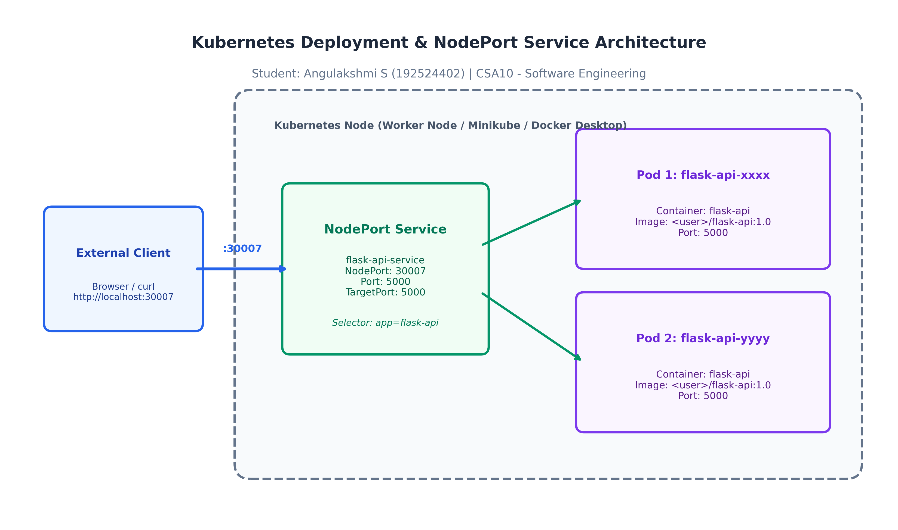

# Experiment 17: Flask API Containerized with Docker, Pushed to Docker Hub and Deployed on Kubernetes

### Student Information
- **Student Name:** Angulakshmi S
- **Register Number:** 192524402
- **Department:** Computer Science and Engineering / Artificial Intelligence & Data Science
- **Institution:** Saveetha School of Engineering, SIMATS
- **Course Outcome:** CO3
- **Date:** 21-11-2026

---

## Problem Statement
Create a Simple Python Flask API, Containerize the Application, Build & Push the Image using Docker and Deploy the Application using Kubernetes.

### Tasks:
1. Create a Simple Flask API by writing a Python file (`app.py`) with basic REST endpoints (`/`, `/api/students`, `/health`).
2. Containerize the Flask App using a `Dockerfile`.
3. Build the Image using Docker with a versioned tag.
4. Push the Image to Docker Hub.
5. Create Kubernetes manifests (`deployment.yaml` & `service.yaml`) to deploy the application with 2 pod replicas.
6. Apply the Manifests and Access the API via NodePort `30007`.

---

## Aim
To create a simple Python Flask API, containerize it with Docker, push the image to Docker Hub and deploy it on Kubernetes using Deployment and Service (NodePort) manifests.

---

## Software / Tools Required
- Python 3 and Flask
- Docker Desktop / Docker Engine
- Docker Hub account
- Kubernetes (Docker Desktop Kubernetes or Minikube) and `kubectl` CLI
- Visual Studio Code

---

## Theory
Modern cloud-native applications decouple monolithic architectures into microservices packaged as containers and managed via container orchestrators.

### 1. Flask REST Framework
Flask is a micro web framework for Python designed to build scalable HTTP web endpoints and RESTful APIs with minimal configuration overhead.

### 2. Docker Containerization & Registry
Packaging the Flask service into a Docker container ensures uniform execution across developer laptops, staging nodes, and production clusters. Once built, the container image is published to a centralized container registry (such as Docker Hub) from which cluster worker nodes pull images during pod scheduling.

### 3. Kubernetes Orchestration Primitives
Kubernetes (K8s) is an industry-standard open-source system for automating deployment, horizontal scaling, and management of containerized workloads.
- **Pod:** The smallest atomic deployable unit in Kubernetes, wrapping one or more tightly coupled application containers sharing network namespaces and storage volumes.
- **Deployment:** A declarative controller that manages ReplicaSets, automated rollouts, health probes, and self-healing pod recreations to maintain the desired pod count (e.g., 2 replicas).
- **Service (NodePort):** A stable networking abstraction exposing a cluster service externally. NodePort assigns a static port in the designated range (**30000–32767**) across every worker node, routing inbound traffic to target pod port `5000`.
- **kubectl:** The core command-line utility used to communicate with the Kubernetes API server and manage declarative resources.

---

## Kubernetes Architecture Diagram


---

## Step-by-Step Procedure

### Step 1: Create the Flask API
- Create a directory `app/` and author `app/app.py`:
  ```python
  from flask import Flask, jsonify, request

  app = Flask(__name__)

  students = [
      {"id": 1, "name": "Arun", "dept": "CSE"},
      {"id": 2, "name": "Divya", "dept": "IT"},
      {"id": 3, "name": "Angulakshmi S", "dept": "AI & DS"}
  ]

  @app.route("/")
  def home():
      return jsonify(message="Hello from Flask API on Kubernetes", student="Angulakshmi S", reg_no="192524402")

  @app.route("/api/students", methods=["GET"])
  def get_students():
      return jsonify(students=students, count=len(students))

  @app.route("/api/students", methods=["POST"])
  def add_student():
      data = request.get_json()
      data["id"] = len(students) + 1
      students.append(data)
      return jsonify(data), 201

  @app.route("/health")
  def health():
      return jsonify(status="UP")

  if __name__ == "__main__":
      app.run(host="0.0.0.0", port=5000)
  ```
- Specify dependencies in `app/requirements.txt`:
  ```text
  flask==3.0.3
  werkzeug==3.0.3
  ```

### Step 2: Containerize the Flask App
- Author `Dockerfile`:
  ```dockerfile
  FROM python:3.11-slim
  WORKDIR /app
  COPY app/requirements.txt .
  RUN pip install --no-cache-dir -r requirements.txt
  COPY app/app.py .
  EXPOSE 5000
  CMD ["python", "app.py"]
  ```

### Step 3: Build and Test the Image
- Build the container image tagging it with your Docker Hub handle:
  ```bash
  docker build -t <dockerhub-username>/flask-api:1.0 .
  docker run -d -p 5000:5000 --name api <dockerhub-username>/flask-api:1.0
  curl http://localhost:5000/api/students
  docker stop api && docker rm api
  ```

### Step 4: Push the Image to Docker Hub
- Authenticate and push to Docker Hub:
  ```bash
  docker login
  docker push <dockerhub-username>/flask-api:1.0
  ```

### Step 5: Start the Kubernetes Cluster
- Start Minikube or enable Kubernetes in Docker Desktop:
  ```bash
  minikube start
  kubectl get nodes
  ```
- Confirm cluster node state is `Ready`.

### Step 6: Create the Deployment Manifest
- Author `k8s/deployment.yaml`:
  ```yaml
  apiVersion: apps/v1
  kind: Deployment
  metadata:
    name: flask-api-deployment
    labels:
      app: flask-api
  spec:
    replicas: 2
    selector:
      matchLabels:
        app: flask-api
    template:
      metadata:
        labels:
          app: flask-api
      spec:
        containers:
          - name: flask-api
            image: <dockerhub-username>/flask-api:1.0
            ports:
              - containerPort: 5000
  ```

### Step 7: Create the Service Manifest (NodePort)
- Author `k8s/service.yaml`:
  ```yaml
  apiVersion: v1
  kind: Service
  metadata:
    name: flask-api-service
  spec:
    type: NodePort
    selector:
      app: flask-api
    ports:
      - port: 5000
        targetPort: 5000
        nodePort: 30007
  ```

### Step 8: Apply the Manifests
- Apply manifests and inspect cluster state:
  ```bash
  kubectl apply -f k8s/deployment.yaml
  kubectl apply -f k8s/service.yaml
  kubectl get deployments
  kubectl get pods -o wide
  kubectl get svc
  ```
- Confirm that 2/2 pods show `Running` status and `flask-api-service` lists `5000:30007/TCP`.

### Step 9: Access the API via NodePort
- Open browser or query via curl:
  ```bash
  curl http://localhost:30007/
  curl http://localhost:30007/api/students
  ```

---

## Local Verification Output
The Flask API endpoints and Kubernetes manifests were verified using the automated test suite [`code/test_flask_api.py`](code/test_flask_api.py):

```
================================================================================
EXPERIMENT 17: FLASK API DOCKER CONTAINERIZATION & KUBERNETES DEPLOYMENT
STUDENT: Angulakshmi S | REGISTER NUMBER: 192524402
================================================================================

[1] TEST GET / (Home Endpoint):
  * Status: 200 OK
  * Response: {
  "cluster_platform": "Kubernetes Pod",
  "course": "CSA10 - Software Engineering",
  "message": "Hello from Flask API on Kubernetes",
  "reg_no": "192524402",
  "status": "RUNNING",
  "student": "Angulakshmi S"
}

[2] TEST GET /api/students (Student Directory):
  * Status: 200 OK
  * Initial Count: 3
    - ID 1: Arun (CSE)
    - ID 2: Divya (IT)
    - ID 3: Angulakshmi S (AI & DS)

[3] TEST POST /api/students (Add Record):
  * Status: 201 CREATED
  * Response: {
  "message": "Student added successfully",
  "student": {
    "dept": "CSE",
    "id": 4,
    "name": "Kavitha M"
  }
}

[4] TEST GET /health (Liveness & Readiness Probe Endpoint):
  * Status: 200 OK
  * Response: {
  "service": "flask-api-service",
  "status": "UP",
  "version": "1.0"
}

================================================================================
[5] KUBERNETES MANIFEST VALIDATION:
  * Deployment manifest: True (940 bytes)
  * Service manifest:    True (256 bytes)
  * NodePort Target:      30007 (Forwarded to internal port 5000)
  * Pod Replicas:         2 Replicas with Health Probes (/health)
================================================================================
```

---

## Result
Thus a Flask API was containerized with Docker, pushed to Docker Hub and deployed on Kubernetes, and the API was accessed successfully through the NodePort service.

---

## Viva Voce Questions and Answers

### 1. What is a Pod?
**Answer:** A Pod is the smallest and most fundamental deployable object in Kubernetes. It represents a single instance of a running process in a cluster, encapsulating one or more containers, shared storage volumes, and a unique cluster IP address.

### 2. What is the NodePort range?
**Answer:** By default, Kubernetes allocates NodePort service ports within the range of **30000 to 32767**.

### 3. What is the role of the selector in a Service?
**Answer:** The `selector` identifies and matches labels on Pods (e.g., `app: flask-api`) to automatically associate them with the Service and route incoming cluster traffic dynamically to healthy endpoints.

### 4. Why must Flask listen on 0.0.0.0 inside a container?
**Answer:** Binding to `0.0.0.0` instructs Flask to listen on all network interfaces within the container, enabling ingress network packets from Docker bridge networks and Kubernetes Service proxies to reach the application instead of restricting connections strictly to the container's internal `127.0.0.1` loopback interface.

### 5. What does kubectl apply -f do?
**Answer:** `kubectl apply -f` parses a declarative configuration YAML or JSON file and applies the desired resource state to the Kubernetes API server, automatically creating new resources or performing in-place rolling updates on existing resources.
