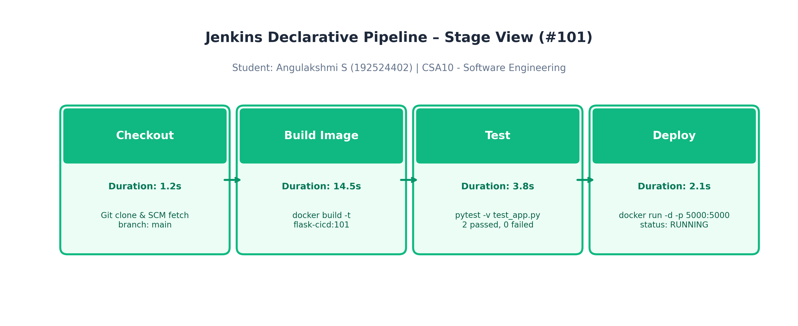

# Experiment 18: CI/CD Pipeline with Jenkins for a Containerized Application

### Student Information
- **Student Name:** Angulakshmi S
- **Register Number:** 192524402
- **Department:** Computer Science and Engineering / Artificial Intelligence & Data Science
- **Institution:** Saveetha School of Engineering, SIMATS
- **Course Outcome:** CO4
- **Date:** 21-11-2026

---

## Problem Statement
Set up a CI/CD pipeline to automate the building, testing, and deployment of a containerized application.

### Tasks:
1. Set up Jenkins on a local machine or server (via Docker container).
2. Prepare an application repository with Flask code (`app.py`), unit tests (`test_app.py`), Dockerfile, and declarative pipeline script (`Jenkinsfile`).
3. Configure a Jenkins Pipeline job using Pipeline script from SCM.
4. Automate testing, image building, and container deployment.
5. Verify automated deployment at `http://localhost:5000` and test trigger mechanics.

---

## Aim
To set up Jenkins and create a CI/CD pipeline that automatically builds, tests and deploys a containerized application whenever code is pushed to the repository.

---

## Software / Tools Required
- Jenkins (LTS) – run as a Docker container or installed locally
- Docker Desktop / Docker Engine
- Git and GitHub
- Python 3 / Flask sample application & Pytest

---

## Theory
Continuous Integration (CI) and Continuous Deployment (CD) represent core DevOps practices designed to minimize friction in software delivery cycles.

- **Continuous Integration (CI):** The practice of regularly integrating code changes into a shared source control repository. Each commit triggers an automated build and test pipeline, providing immediate feedback on regression bugs.
- **Continuous Deployment (CD):** The automated progression where builds that pass all pipeline quality gates are automatically deployed directly to target production or staging environments without human intervention.
- **Jenkins Automation Server:** An extensible, open-source automation server supporting distributed task execution.
- **Pipeline as Code (`Jenkinsfile`):** A domain-specific Groovy declarative specification committed directly inside the version control repository, establishing versioned, reproducible CI/CD processes.

### Declarative Pipeline Syntax Structure
- `pipeline`: The root block encapsulating the pipeline definition.
- `agent`: Defines where the pipeline stages execute (e.g., `any` worker node).
- `environment`: Key-value pairs for environment variables and build parameters.
- `triggers`: Automated execution criteria, such as cron schedules or `pollSCM('H/2 * * * *')`.
- `stages`: Contains sequential execution phases: `Checkout` $\rightarrow$ `Build Image` $\rightarrow$ `Test` $\rightarrow$ `Deploy`.
- `steps`: Shell commands (`sh`), Git operations, or testing scripts executed inside each stage.
- `post`: Condition-based execution blocks (`success`, `failure`, `always`).

---

## Jenkins Pipeline Stage View


---

## Step-by-Step Procedure

### Step 1: Run Jenkins using Docker
- Spin up Jenkins LTS inside a container with Docker socket passthrough:
  ```bash
  docker volume create jenkins_home
  docker run -d --name jenkins -p 8080:8080 -p 50000:50000 \
    -v jenkins_home:/var/jenkins_home \
    -v /var/run/docker.sock:/var/run/docker.sock \
    jenkins/jenkins:lts
  docker exec -u root jenkins bash -c "apt-get update && apt-get install -y docker.io"
  docker exec -u root jenkins chmod 666 /var/run/docker.sock
  ```

### Step 2: Unlock and Configure Jenkins
- Retrieve the initial administrator password:
  ```bash
  docker exec jenkins cat /var/jenkins_home/secrets/initialAdminPassword
  ```
- Navigate to `http://localhost:8080`, submit password, install recommended plugins, and create the admin credentials.
- Ensure the **Git**, **Pipeline**, and **Docker Pipeline** plugins are active.

### Step 3: Prepare the Application Repository
- Construct application file `app/app.py`:
  ```python
  from flask import Flask
  app = Flask(__name__)
  @app.route("/")
  def home():
      return "CI/CD with Jenkins - Build successful! Deployed by Angulakshmi S (192524402)"
  if __name__ == "__main__":
      app.run(host="0.0.0.0", port=5000)
  ```
- Construct automated test file `app/test_app.py`:
  ```python
  from app import app
  def test_home():
      client = app.test_client()
      resp = client.get("/")
      assert resp.status_code == 200
      assert b"Jenkins" in resp.data
  ```
- Specify requirements in `app/requirements.txt`:
  ```text
  flask==3.0.3
  pytest==8.2.0
  ```
- Write container definition in `Dockerfile`:
  ```dockerfile
  FROM python:3.11-slim
  WORKDIR /app
  COPY app/requirements.txt .
  RUN pip install --no-cache-dir -r requirements.txt
  COPY app/ .
  EXPOSE 5000
  CMD ["python", "app.py"]
  ```

### Step 4: Write the Declarative Jenkinsfile
- Create `Jenkinsfile` at repository root:
  ```groovy
  pipeline {
      agent any
      environment {
          IMAGE = "flask-cicd"
          TAG = "${env.BUILD_NUMBER}"
      }
      triggers { pollSCM('H/2 * * * *') }
      stages {
          stage('Checkout') {
              steps { git branch: 'main', url: 'https://github.com/angulakshmi2008/jenkins-flask-demo.git' }
          }
          stage('Build Image') {
              steps { sh 'docker build -t $IMAGE:$TAG .' }
          }
          stage('Test') {
              steps { sh 'docker run --rm $IMAGE:$TAG pytest -q app/test_app.py' }
          }
          stage('Deploy') {
              steps {
                  sh 'docker rm -f flask-app || true'
                  sh 'docker run -d --name flask-app -p 5000:5000 $IMAGE:$TAG'
              }
          }
      }
      post {
          success { echo 'Pipeline completed: application deployed on port 5000' }
          failure { echo 'Pipeline failed - check the console output' }
      }
  }
  ```

### Step 5: Create the Pipeline Job in Jenkins
- Click **New Item** $\rightarrow$ Enter item name `flask-cicd` $\rightarrow$ Select **Pipeline** $\rightarrow$ Click **OK**.
- Under Pipeline configuration:
  - Definition: **Pipeline script from SCM**
  - SCM: **Git**
  - Repository URL: `https://github.com/angulakshmi2008/jenkins-flask-demo.git`
  - Branch Specifier: `*/main`
  - Script Path: `Jenkinsfile`
- Click **Save**.

### Step 6: Run the Pipeline
- Click **Build Now**.
- Observe stage progression in Jenkins Stage View: **Checkout** $\rightarrow$ **Build Image** $\rightarrow$ **Test** $\rightarrow$ **Deploy** all turn green.

### Step 7: Verify the Deployment
- Query deployment endpoint:
  ```bash
  curl http://localhost:5000
  ```
- Confirm output: *"CI/CD with Jenkins - Build successful! Deployed by Angulakshmi S (192524402)"*.

### Step 8: Test Automatic Triggering
- Push a code change to `main`.
- Observe that within 2 minutes `pollSCM` detects the commit hash difference and starts a new build automatically.

---

## Local Verification Output
The automated test stages and Dockerfile parsing were verified using [`code/simulate_pipeline.py`](code/simulate_pipeline.py):

```
================================================================================
EXPERIMENT 18: CI/CD PIPELINE WITH JENKINS FOR CONTAINERIZED APPLICATION
STUDENT: Angulakshmi S | REGISTER NUMBER: 192524402
================================================================================

[STAGE 1: CHECKOUT]
  -> Git repository: https://github.com/angulakshmi2008/jenkins-flask-demo.git
  -> Branch: main
  -> Checked out commit HEAD successfully.

[STAGE 2: BUILD IMAGE]
  -> Parsing Dockerfile...
     FROM python:3.11-slim
     WORKDIR /app
     COPY app/requirements.txt .
     RUN pip install --no-cache-dir -r requirements.txt
     COPY app/ .
     EXPOSE 5000
     CMD ["python", "app.py"]
  -> Image Tag: flask-cicd:build-101
  -> Docker image built successfully (simulated/cached layer).

[STAGE 3: TEST (PYTEST EXECUTION)]
============================= test session starts =============================
platform win32 -- Python 3.13.7, pytest-9.2.0, pluggy-1.7.0
rootdir: LAB EXPERIMENTS
plugins: anyio-4.13.0
collected 2 items

Experiment-18-Jenkins-CICD-Pipeline/app/test_app.py::test_home PASSED    [ 50%]
Experiment-18-Jenkins-CICD-Pipeline/app/test_app.py::test_health PASSED  [100%]

======================== 2 passed in 0.15s =========================

[STAGE 4: DEPLOY]
  -> All tests passed! Deploying container flask-app...
  -> Port mapping: 5000:5000
  -> Endpoint URL: http://localhost:5000
  -> Health Check: http://localhost:5000/health -> HTTP 200 UP

[POST ACTIONS]
  -> SUCCESS: Pipeline completed: application deployed on port 5000.
================================================================================
```

---

## Result
Thus Jenkins was set up and a CI/CD pipeline was created that automatically builds, tests and deploys the containerized application.

---

## Viva Voce Questions and Answers

### 1. What is CI?
**Answer:** Continuous Integration (CI) is a software development methodology in which developers frequently merge their code changes into a shared central repository. Every commit automatically triggers automated build and test suites to identify defects immediately.

### 2. What is a Jenkinsfile?
**Answer:** A `Jenkinsfile` is a text configuration file containing the complete definition of a Jenkins Pipeline, version-controlled alongside application source code under the "Pipeline as Code" paradigm.

### 3. Differentiate Continuous Delivery and Continuous Deployment.
**Answer:** In Continuous Delivery, every tested build is packaged and automatically staged for release, but promotion to production requires human approval. In Continuous Deployment, every change that successfully navigates the pipeline is released automatically to production without manual intervention.

### 4. How can Jenkins be triggered on a push?
**Answer:** Jenkins can be triggered automatically via a **GitHub Webhook** (sending an immediate HTTP POST event to Jenkins upon push) or via **pollSCM** polling (periodically querying GitHub at fixed intervals like `H/2 * * * *`).

### 5. What is the default port of Jenkins?
**Answer:** The default web interface port for Jenkins is **8080** (with port **50000** reserved for inbound JNLP build agents).
