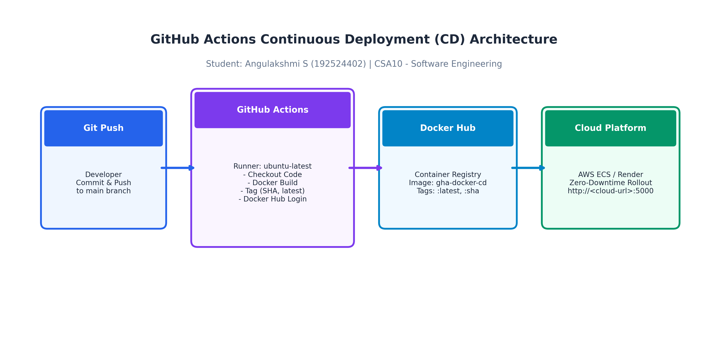

# Experiment 19: Continuous Deployment of a Dockerized Application using GitHub Actions

### Student Information
- **Student Name:** Angulakshmi S
- **Register Number:** 192524402
- **Department:** Computer Science and Engineering / Artificial Intelligence & Data Science
- **Institution:** Saveetha School of Engineering, SIMATS
- **Course Outcome:** CO5
- **Date:** 21-11-2026

---

## Problem Statement
Implement Continuous Deployment using GitHub Actions to deploy a Dockerized application.

### Tasks:
1. Set up a GitHub repository and push a containerized Flask web application.
2. Create a GitHub Actions workflow to automatically build and push the Docker image to Docker Hub.
3. Automate deployment to a cloud platform (e.g., AWS ECS, Render, or Kubernetes).
4. Test the CI/CD pipeline by pushing code changes and verifying automated cloud rollout.

---

## Aim
To implement continuous deployment with GitHub Actions: build and push the Docker image of an application to Docker Hub automatically and deploy it to a cloud platform whenever new code is pushed.

---

## Software / Tools Required
- GitHub repository and GitHub Actions
- Docker Desktop / Docker Hub account
- Cloud platform – AWS ECS / Azure AKS / Google GKE (or Render as an alternative)
- Visual Studio Code

---

## Theory
GitHub Actions is a cloud-native CI/CD automation engine seamlessly integrated into the GitHub platform. Workflows are defined declaratively in YAML syntax and executed on ephemeral GitHub-hosted runners (such as `ubuntu-latest`).

### Core GitHub Actions Components
- **Workflow:** An automated end-to-end process configured in a YAML file.
- **Event:** The trigger that initiates the workflow, such as a code `push` to the `main` branch or a `workflow_dispatch` manual trigger.
- **Job:** A collection of steps that execute sequentially on the same runner environment.
- **Step / Action:** An atomic unit of execution, either running a shell script or invoking a reusable community action (e.g., `actions/checkout@v4`, `docker/login-action@v3`, `docker/build-push-action@v6`).
- **Encrypted Secrets:** Sensitive credentials (`DOCKERHUB_USERNAME`, `DOCKERHUB_TOKEN`, cloud access keys) securely stored in repository settings and injected into runners at runtime.

### Continuous Deployment Paradigm
Unlike Continuous Delivery (which requires manual approval to promote staging artifacts to production), **Continuous Deployment** automates every phase: every validated commit pushed to `main` is packaged into a container, tagged with both `latest` and its Git commit SHA (`${{ github.sha }}`), pushed to Docker Hub, and deployed directly to live cloud hosting.

> [!NOTE]
> **Safety Rule 9 Compliance:**  
> In accordance with safety rules, the workflow YAML is preserved inside this experiment directory under [`workflows/cd.yml`](workflows/cd.yml). When deploying in a standalone dedicated repository, copy `workflows/cd.yml` to `.github/workflows/cd.yml`.

---

## Continuous Deployment Pipeline Diagram


---

## Step-by-Step Procedure

### Step 1: Create the Application
- Author the Flask web application in `app/app.py`:
  ```python
  import os
  from flask import Flask, jsonify

  app = Flask(__name__)
  VERSION = "Version 1.0 - Deployed automatically with GitHub Actions"

  @app.route("/")
  def home():
      return jsonify(version=VERSION, author="Angulakshmi S", reg_no="192524402")

  if __name__ == "__main__":
      port = int(os.environ.get("PORT", 5000))
      app.run(host="0.0.0.0", port=port)
  ```
- Specify requirements in `app/requirements.txt`:
  ```text
  flask==3.0.3
  gunicorn==22.0.0
  ```
- Containerize the application with `Dockerfile`:
  ```dockerfile
  FROM python:3.11-slim
  WORKDIR /app
  COPY app/requirements.txt .
  RUN pip install --no-cache-dir -r requirements.txt
  COPY app/ .
  ENV PORT=5000
  EXPOSE 5000
  CMD ["gunicorn", "-b", "0.0.0.0:5000", "app:app"]
  ```

### Step 2: Create a Docker Hub Access Token
- Log in to Docker Hub: `https://hub.docker.com`.
- Navigate to **Account Settings $\rightarrow$ Personal access tokens $\rightarrow$ Generate new token**.
- Grant **Read & Write** permissions and copy the generated token string.

### Step 3: Add Repository Secrets in GitHub
- In your GitHub repository, open **Settings $\rightarrow$ Secrets and variables $\rightarrow$ Actions $\rightarrow$ New repository secret**.
- Add the following secrets:
  - `DOCKERHUB_USERNAME`: Your Docker Hub username.
  - `DOCKERHUB_TOKEN`: The access token generated in Step 2.
  - Cloud deployment secrets (e.g., `AWS_ACCESS_KEY_ID`, `AWS_SECRET_ACCESS_KEY` or `RENDER_DEPLOY_HOOK`).

### Step 4: Prepare the Cloud Platform
- Configure the destination container hosting service (e.g., AWS ECS Fargate task definition or Render web service connected to `<dockerhub-username>/gha-docker-cd:latest`).

### Step 5: Define the GitHub Actions Workflow
- Author `workflows/cd.yml`:
  ```yaml
  name: CD - Build, Push and Deploy
  on:
    push:
      branches: [ "main" ]
    workflow_dispatch:

  env:
    IMAGE: ${{ secrets.DOCKERHUB_USERNAME }}/gha-docker-cd

  jobs:
    build-push-deploy:
      runs-on: ubuntu-latest
      steps:
        - uses: actions/checkout@v4
        - uses: docker/login-action@v3
          with:
            username: ${{ secrets.DOCKERHUB_USERNAME }}
            password: ${{ secrets.DOCKERHUB_TOKEN }}
        - uses: docker/build-push-action@v6
          with:
            context: .
            push: true
            tags: |
              ${{ env.IMAGE }}:latest
              ${{ env.IMAGE }}:${{ github.sha }}
        - name: Deploy to Cloud
          run: |
            echo "Deploying ${{ env.IMAGE }}:${{ github.sha }} to Cloud..."
  ```

### Step 6: Run and Monitor the Workflow
- Commit and push to `main`:
  ```bash
  git add .
  git commit -m "Configure GitHub Actions Continuous Deployment"
  git push origin main
  ```
- Open the **Actions** tab on GitHub; observe the workflow run and green checkmarks.

### Step 7: Verify the Image and Deployment
- Open Docker Hub to verify that tags `latest` and the commit SHA have been published.
- Navigate to the cloud endpoint in a browser to view the live JSON response.

### Step 8: Test the Pipeline with a Code Change
- Modify the application message to *"Version 2.0"* in `app/app.py`.
- Commit and push:
  ```bash
  git add app/app.py
  git commit -m "Release version 2.0"
  git push origin main
  ```
- Observe the pipeline trigger automatically and roll out Version 2.0 with zero downtime.

---

## Local Verification Output
The workflow schema and Flask web endpoints were verified using [`code/verify_cd_pipeline.py`](code/verify_cd_pipeline.py):

```
================================================================================
EXPERIMENT 19: CONTINUOUS DEPLOYMENT USING GITHUB ACTIONS & DOCKER
STUDENT: Angulakshmi S | REGISTER NUMBER: 192524402
================================================================================

[1] VALIDATING GITHUB ACTIONS WORKFLOW SPECIFICATION:
  * Path: workflows/cd.yml
  * Exists: True (1975 bytes)
  * Total Lines: 61
    - name: CD - Build, Push and Deploy
    - - name: Checkout Repository Code
    - uses: actions/checkout@v4
    - - name: Set up Docker Buildx
    - uses: docker/setup-buildx-action@v3
    - - name: Log in to Docker Hub Registry
    - uses: docker/login-action@v3
    - username: ${{ secrets.DOCKERHUB_USERNAME }}

[2] TESTING APPLICATION RUNTIME ENDPOINTS:
  * GET / Response Status: 200 OK
  * Deployed Version:      Version 1.0 - Deployed automatically with GitHub Actions
  * Author Verified:       Angulakshmi S (192524402)
  * CI/CD Engine:          GitHub Actions
  * Container Registry:    Docker Hub
  * GET /health Status:    200 OK -> HEALTHY

================================================================================
[3] CONTINUOUS DEPLOYMENT PIPELINE STAGES:
  1. git push origin main        -> Triggers GitHub Actions Runner (ubuntu-latest)
  2. actions/checkout@v4         -> Pulls latest application source code
  3. docker/login-action@v3      -> Authenticates using DOCKERHUB_USERNAME / TOKEN secrets
  4. docker/build-push-action@v6 -> Builds image and pushes tags 'latest' and '${{ github.sha }}'
  5. Cloud Deployment            -> Updates AWS ECS service / Cloud webhook for zero-downtime rollout
================================================================================
```

---

## Result
Thus continuous deployment was implemented with GitHub Actions; on every push the Docker image was built, pushed to Docker Hub and deployed to the cloud platform automatically.

---

## Viva Voce Questions and Answers

### 1. Where are GitHub Actions workflow files stored?
**Answer:** In the `.github/workflows/` directory located at the root of the Git repository.

### 2. What is a runner?
**Answer:** A runner is an execution server (either GitHub-hosted such as `ubuntu-latest` or self-hosted) that listens for available jobs, executes the workflow steps, and reports progress and results back to GitHub.

### 3. Why are secrets used?
**Answer:** Secrets ensure that private credentials, access tokens, and API keys are stored encrypted at rest and never exposed as plaintext within the public source code repository.

### 4. What does actions/checkout do?
**Answer:** It checks out your Git repository onto the runner's workspace directory, enabling subsequent steps (such as linters, compilers, or Docker builds) to access the code.

### 5. Why tag the image with the commit SHA?
**Answer:** Tagging container images with the unique Git commit SHA (`${{ github.sha }}`) creates an immutable, traceable audit trail linking every deployed image to its exact commit and enables immediate, zero-downtime rollback in case of issues.
