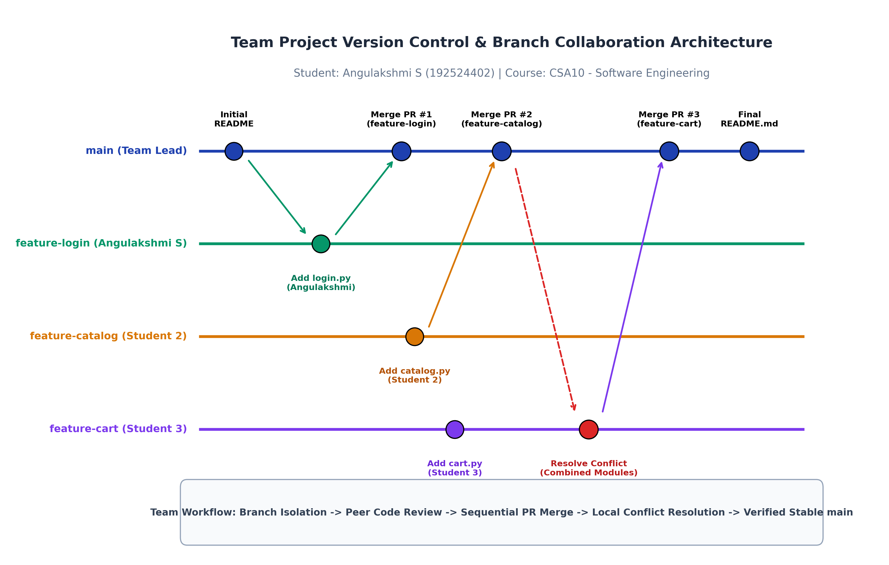

# Experiment 20: Team Project Repository with Branches, Pull Requests and README Documentation

### Student Information
- **Student Name:** Angulakshmi S
- **Register Number:** 192524402
- **Department:** Computer Science and Engineering / Artificial Intelligence & Data Science
- **Institution:** Saveetha School of Engineering, SIMATS
- **Course Outcome:** CO5
- **Date:** 21-11-2026

---

## Problem Statement
Create a GitHub Repository and Implement Version Control for a multi-developer team project.

### Tasks:
1. Set up a shared repository for a team project (`team-project`).
2. Create dedicated feature branches for individual team modules (`feature-login`, `feature-catalog`, `feature-cart`).
3. Merge branches via pull requests after systematic peer code reviews.
4. Simulate and resolve merge conflicts during branch integration.
5. Document the team workflow, member responsibilities, and execution instructions in the `README.md` file.
6. Verify and submit the repository link and commit network graph.

---

## Aim
To set up a GitHub repository for a team project, create branches for individual modules, merge them using pull requests after code review, resolve merge conflicts and document the workflow in the README file.

---

## Software / Tools Required
- Git (Git Bash / Command Line)
- GitHub (Organization or shared repository)
- Visual Studio Code
- Python 3

---

## Theory
Version control empowers distributed teams to collaborate concurrently on a single codebase without overwriting each other's changes. The industry standard **Feature-Branch Workflow** enforces that the `main` branch always maintains thoroughly reviewed, functional production code.

### Team Governance & Workflow Strategies
- **Collaborators & Branch Protection:** The repository administrator invites team members and establishes branch protection rules on `main` (requiring status checks and at least 1 approving pull request review prior to merging).
- **Code Review:** Peer reviewers inspect the line-by-line diff, suggest refactorings, identify security pitfalls, and validate coding standards before granting approval.
- **Merge Strategies:**
  - *Create a Merge Commit (`--no-ff`):* Preserves the full historical topology of feature branches.
  - *Squash and Merge:* Condenses all feature branch commits into a single commit on `main`.
  - *Rebase and Merge:* Replays feature commits onto the tip of `main` for a linear history.
- **Project Documentation (`README.md`):** Acts as the entry portal for developers, establishing architecture overviews, module ownership tables, branch policies, and setup commands.

### Team Module Division
| Team Member | Module Name | Feature Branch | Deliverables |
| :--- | :--- | :--- | :--- |
| **Angulakshmi S (192524402)** | Login / Authentication | `feature-login` | `login.py` (Credential validation) |
| Student 2 | Product Catalog | `feature-catalog` | `catalog.py` (Item catalog & prices) |
| Student 3 | Shopping Cart & Checkout | `feature-cart` | `cart.py` (Tax & total calculation) |
| Team Lead | Integration & Documentation | `main` | PR reviews, conflict resolution, README |

---

## Team Branching Architecture Diagram


---

## Step-by-Step Procedure

### Step 1: Create the Team Repository
- The team lead creates repository `team-project` on GitHub, sets visibility to **Public**, and checks **Add a README file**.
- Under **Settings $\rightarrow$ Collaborators $\rightarrow$ Add people**, invite team members (`Angulakshmi S`, `Student 2`, `Student 3`).
- Under **Settings $\rightarrow$ Branches**, add a branch protection rule for `main` requiring pull request reviews before merging.

### Step 2: Clone the Repository
- Each team member clones the remote repository locally:
  ```bash
  git clone https://github.com/angulakshmi2008/team-project.git
  cd team-project
  git branch -a
  ```

### Step 3: Create Branches for Individual Modules
- Each developer creates and checks out their assigned feature branch:
  ```bash
  git checkout -b feature-login    # Angulakshmi S (Student 1)
  git checkout -b feature-catalog  # Student 2
  git checkout -b feature-cart     # Student 3
  ```

### Step 4: Develop Modules and Push Branches
- **Student 1 (Angulakshmi S)** implements `login.py`:
  ```python
  def login(username, password):
      users = {"admin": "admin123", "angulakshmi": "pass192524402"}
      return "Login successful" if users.get(username) == password else "Invalid credentials"
  ```
  ```bash
  git add login.py
  git commit -m "Add login module"
  git push -u origin feature-login
  ```
- **Student 2** implements `catalog.py`, updates `README.md`, commits, and pushes to `feature-catalog`.
- **Student 3** implements `cart.py`, updates `README.md`, commits, and pushes to `feature-cart`.

### Step 5: Open Pull Requests and Review Code
- On GitHub, each developer opens a Pull Request targeting base `main` from their feature branch.
- Team peers conduct code reviews in the **Files changed** tab, discuss design decisions, and submit formal approvals.

### Step 6: Merge the Pull Requests
- The team lead merges approved pull requests sequentially:
  - PR #1 (`feature-login`) is merged into `main`.
  - PR #2 (`feature-catalog`) is merged into `main`.

### Step 7: Create and Resolve a Merge Conflict
- Because both Student 2 and Student 3 modified the `Modules` section of `README.md`, Student 3's PR encounters a merge conflict once PR #2 lands on `main`.
- Student 3 fetches latest `main` and resolves the conflict locally:
  ```bash
  git checkout feature-cart
  git fetch origin
  git merge origin/main
  ```
- Git flags `CONFLICT (content): Merge conflict in README.md`.
- Student 3 opens `README.md`, reconciles both entries (`Modules: Login, Catalog, Cart`), removes conflict markers, and commits:
  ```bash
  git add README.md
  git commit -m "Resolve README merge conflict"
  git push origin feature-cart
  ```
- PR #3 now reports *"Able to merge"*; team lead reviews and merges PR #3 into `main`.

### Step 8: Document the Workflow in README
- The final integrated `README.md` is updated with team member details, workflow rules, and run instructions:
  ```bash
  python login.py
  python catalog.py
  python cart.py
  ```

### Step 9: Verify the Commit Graph & Submit Link
- Inspect the commit graph on GitHub (**Insights $\rightarrow$ Network**) and submit repository link: `https://github.com/angulakshmi2008/team-project`.

---

## Local Sandbox Execution Output

Below is the verified multi-developer execution transcript captured from an isolated Git environment demonstrating the complete team branching, PR merging, conflict emergence, manual resolution, and topological commit graph:

```
================================================================================
EXPERIMENT 20: TEAM PROJECT REPOSITORY WITH BRANCHES & PR WORKFLOW
STUDENT: Angulakshmi S | REGISTER NUMBER: 192524402
ISOLATED LOCAL REPOSITORY SANDBOX EXECUTION TRANSCRIPT
================================================================================

$ git init --bare --initial-branch=main team-project.git
$ git clone team-project.git seed
$ git commit -m "Initial commit with base project README"
$ git push origin main

$ [Student 1: Angulakshmi S] git clone team-project.git
$ git checkout -b feature-login
$ git add login.py
$ git commit -m 'Add login module'
[feature-login c045a8f] Add login module
 1 file changed, 10 insertions(+)
 create mode 100644 login.py
$ git push -u origin feature-login

$ [Student 2] git clone team-project.git
$ git checkout -b feature-catalog
$ git add catalog.py README.md
$ git commit -m 'Add catalog module and update README'
[feature-catalog a303164] Add catalog module and update README
 2 files changed, 9 insertions(+)
 create mode 100644 catalog.py
$ git push -u origin feature-catalog

$ [Student 3] git clone team-project.git
$ git checkout -b feature-cart
$ git add cart.py README.md
$ git commit -m 'Add cart module and update README'
[feature-cart f4ecaf3] Add cart module and update README
 2 files changed, 9 insertions(+)
 create mode 100644 cart.py
$ git push -u origin feature-cart

$ [Team Lead] Clone repository to review and merge PRs
$ git merge origin/feature-login --no-ff -m "Merge pull request #1 from feature-login (Angulakshmi S)"
$ git merge origin/feature-catalog --no-ff -m "Merge pull request #2 from feature-catalog (Student 2)"
$ git push origin main

$ [Student 3] git fetch origin
$ [Student 3] git merge origin/main (Conflict Occurs)
Auto-merging README.md
CONFLICT (content): Merge conflict in README.md
Automatic merge failed; fix conflicts and then commit the result.

$ [Student 3] git status (Conflicted state)
On branch feature-cart
Unmerged paths:
	both modified:   README.md

$ git add README.md
$ git commit -m 'Resolve README merge conflict'
[feature-cart 56e881d] Resolve README merge conflict
$ git push origin feature-cart

$ [Team Lead] git merge origin/feature-cart --no-ff -m "Merge pull request #3 from feature-cart (Student 3)"
$ git push origin main

$ git log --graph --oneline --all
* 3070b3b Document team workflow and roster in README
*   899245c Merge pull request #3 from feature-cart (Student 3)
|\  
| *   56e881d Resolve README merge conflict
| |\  
| |/  
|/|   
* |   12e2efb Merge pull request #2 from feature-catalog (Student 2)
|\ \  
| * | a303164 Add catalog module and update README
* | |   ec3dc80 Merge pull request #1 from feature-login (Angulakshmi S)
|\ \ \  
| |/ /  
|/| |   
| * | c045a8f Add login module
|/ /  
| * f4ecaf3 Add cart module and update README
|/  
* bba6d76 Initial commit with base project README
```

---

## Result
Thus a team GitHub repository was set up, modules were developed on separate branches, merged through reviewed pull requests, conflicts were resolved and the workflow was documented in the README.

---

## Viva Voce Questions and Answers

### 1. What is branch protection?
**Answer:** Branch protection is a GitHub governance rule applied to designated branches (such as `main`) that enforces quality constraints, such as requiring code owner reviews, status checks, signed commits, and preventing direct force pushes.

### 2. What is squash and merge?
**Answer:** Squash and merge is a GitHub merge strategy that takes all the intermediate commits from a feature branch, combines them into a single unified commit, and applies that commit to the target base branch, maintaining a concise and clean project history.

### 3. How do you add collaborators on GitHub?
**Answer:** In the repository navigation bar, click **Settings $\rightarrow$ Collaborators $\rightarrow$ Add people**, search for team members by their GitHub username or email, and dispatch invitations.

### 4. Why document the workflow in README?
**Answer:** A clearly documented workflow in `README.md` establishes unified team standards for branching nomenclature, commit message hygiene, PR review procedures, and testing requirements, ensuring that all contributors maintain code quality.

### 5. What is code review?
**Answer:** Code review is the systematic peer inspection of source code changes before integration into the primary branch, designed to identify bugs, verify algorithmic correctness, ensure adherence to architectural standards, and foster collective code ownership.
