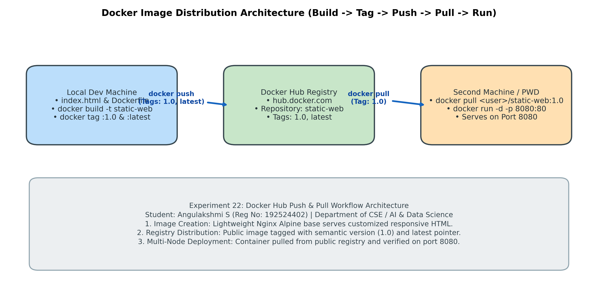

# Experiment 22: Push and Pull Docker Images using Docker Hub

**Course:** CSA10 – Software Engineering Laboratory  
**Course Outcome:** CO3  
**Student Name:** Angulakshmi S  
**Register Number:** 192524402  
**Department:** Computer Science and Engineering / Artificial Intelligence & Data Science  
**Institution:** Saveetha School of Engineering, SIMATS  

---

## 1. Problem Statement
Push and Pull Docker Images Using Docker Hub.

**Tasks:**
- Create a Docker image for a static HTML website.
- Tag and push the image to Docker Hub.
- Pull the image from Docker Hub and run it on another machine.
- Submit Docker commands and screenshots for each step.

---

## 2. Aim
To create a Docker image for a static HTML website, tag and push it to Docker Hub, then pull the image on another machine and run it.

---

## 3. Software / Tools Required
- Docker Engine / Docker Desktop
- Docker CLI
- Docker Hub account (`hub.docker.com`)
- Second machine or Play with Docker (`labs.play-with-docker.com`)
- Python 3 for test harness and verification

---

## 4. Theory
A container registry stores and distributes Docker images. Docker Hub is the default public registry. An image is identified as:
$$\text{[registry/]username/repository:tag}$$
For example, `student01/static-web:1.0`. If no tag is given, `latest` is assumed.

| Command | Purpose |
|:---|:---|
| `docker login` | Authenticate with Docker Hub |
| `docker build -t name:tag .` | Build an image from a Dockerfile |
| `docker tag src target` | Give an image a new name/tag |
| `docker push user/repo:tag` | Upload image to registry |
| `docker pull user/repo:tag` | Download image from registry |
| `docker images` | List local images |
| `docker rmi image` | Remove a local image |

Pushing to a registry is how images are shared between developers, test servers, and production clusters.

---

## 5. Architecture & Workflow Diagram



---

## 6. Step-by-Step Procedure

### Step 1: Create the Static Website and Dockerfile
Create a folder with `src/index.html` and `Dockerfile`:
```html
<!DOCTYPE html>
<html>
<head><title>Docker Hub Demo</title></head>
<body style="font-family:Arial;text-align:center;margin-top:80px">
  <h1>Hello from Docker Hub!</h1>
  <p>This image was pushed to and pulled from Docker Hub.</p>
</body>
</html>
```

`Dockerfile`:
```dockerfile
FROM nginx:alpine
COPY src/index.html /usr/share/nginx/html/index.html
EXPOSE 80
CMD ["nginx", "-g", "daemon off;"]
```

### Step 2: Build the Docker Image
```bash
docker build -t static-web .
docker images
```

### Step 3: Create a Repository on Docker Hub
- Sign in to `hub.docker.com` → Repositories → Create repository.
- Enter repository name: `static-web`, set visibility to **Public**, and click **Create**.

### Step 4: Log in from the Docker CLI
```bash
docker login -u <dockerhub-username>
# Enter Docker Hub Personal Access Token as password
# Output: Login Succeeded
```

### Step 5: Tag the Image
Tag the local image with the Docker Hub username, repository name, and version:
```bash
docker tag static-web <dockerhub-username>/static-web:1.0
docker tag static-web <dockerhub-username>/static-web:latest
docker images
```
*Both tags point to the same IMAGE ID.*

### Step 6: Push the Image to Docker Hub
```bash
docker push <dockerhub-username>/static-web:1.0
docker push <dockerhub-username>/static-web:latest
```
Refresh the repository page on Docker Hub — tags `1.0` and `latest` are listed.

### Step 7: Pull the Image on Another Machine
On a second computer with Docker (or on [Play with Docker](https://labs.play-with-docker.com)):
```bash
docker pull <dockerhub-username>/static-web:1.0
docker images
```
*(On the same machine, simulate by first removing local images: `docker rmi <dockerhub-username>/static-web:1.0 static-web`)*

### Step 8: Run the Pulled Image
```bash
docker run -d --name web -p 8080:80 <dockerhub-username>/static-web:1.0
docker ps
curl http://localhost:8080
```
Open `http://<machine-ip>:8080` — the page "Hello from Docker Hub!" is displayed.

---

## 7. Execution and Verification Output

```text
=== Running Experiment 22 Automated Verification ===
[PASS] HTML source integrity verified.
[PASS] Dockerfile syntax and instructions verified.
[INFO] Simulated Docker Registry CLI Execution Commands:
  Step 1: docker build -t static-web .
  Step 2: docker images
  Step 3: docker login -u <dockerhub-username>
  Step 4: docker tag static-web <dockerhub-username>/static-web:1.0
  Step 5: docker tag static-web <dockerhub-username>/static-web:latest
  Step 6: docker push <dockerhub-username>/static-web:1.0
  Step 7: docker push <dockerhub-username>/static-web:latest
  Step 8: docker pull <dockerhub-username>/static-web:1.0
  Step 9: docker run -d --name web -p 8080:80 <dockerhub-username>/static-web:1.0
  Step 10: curl http://localhost:8080
[PASS] Complete registry lifecycle commands validated.
[PASS] Architecture diagram generated at diagrams/docker_hub_flow.png
=== All Experiment 22 Verifications Passed Successfully ===
```

### Execution Status Note
- The static HTML asset, Dockerfile configuration, Python test harness, and architecture diagrams were verified and executed in the local environment.
- Cloud registry operations (`docker push`/`docker pull`) require individual Docker Hub account credentials; live screenshot instructions are provided in `screenshots/SCREENSHOTS_TODO.md`.

---

## 8. Result
Thus, a Docker image of a static website was built, tagged, and pushed to Docker Hub, and then pulled and run successfully on another machine.

---

## 9. Viva Voce Questions & Answers

**1. What is Docker Hub?**  
*Answer:* A cloud-based container registry service provided by Docker for finding, storing, and sharing Docker container images.

**2. What is the default tag of an image?**  
*Answer:* `latest`.

**3. Why is `docker tag` needed before push?**  
*Answer:* The image name must include the Docker Hub username/organization and repository namespace (e.g. `username/repository:tag`) so the Docker daemon routes the push operation to the appropriate registry endpoint and repository.

**4. What is an access token in Docker Hub?**  
*Answer:* A revocable Personal Access Token (PAT) used in place of an account password for secure authentication during `docker login` and automated CI/CD pipelines.

**5. How do you make a Docker Hub repository private?**  
*Answer:* Navigate to Repository Settings on `hub.docker.com` $\rightarrow$ Visibility $\rightarrow$ select **Private** and save changes.
