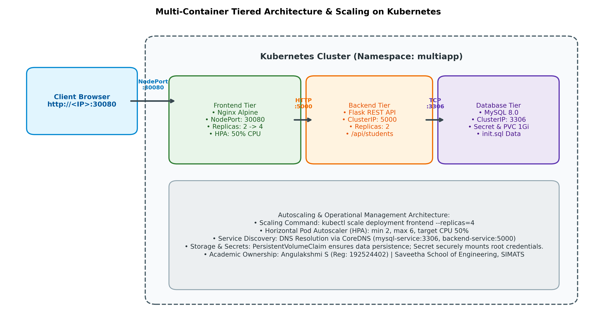

# Experiment 23: Multi-Container Application (Frontend, Backend, Database) on Kubernetes with Scaling

**Course:** CSA10 – Software Engineering Laboratory  
**Course Outcome:** CO3  
**Student Name:** Angulakshmi S  
**Register Number:** 192524402  
**Department:** Computer Science and Engineering / Artificial Intelligence & Data Science  
**Institution:** Saveetha School of Engineering, SIMATS  

---

## 1. Problem Statement
Deploy a Multi-Container Application on Kubernetes.

**Tasks:**
- Create a multi-container application with a frontend, backend, and database.
- Define Kubernetes YAML files for deployments and services.
- Deploy the application using `kubectl` commands.
- Monitor the pods and services status.
- Scale the frontend container to handle increased load.
- Submit YAML files and screenshots of the Kubernetes dashboard.

---

## 2. Aim
To deploy a multi-container application consisting of a frontend, a backend API, and a database on Kubernetes using YAML files, monitor pods and services, and scale the frontend to handle increased load.

---

## 3. Software / Tools Required
- Docker Engine
- Kubernetes cluster (Minikube / Docker Desktop Kubernetes)
- `kubectl` CLI
- Kubernetes Dashboard (`minikube dashboard`)
- Python 3 with Flask and PyYAML for test simulation

---

## 4. Theory
Real applications are made of several cooperating services. In Kubernetes, each tier runs in its own Deployment and communicates through Services using DNS names (for example, the backend reaches the database at `mysql-service:3306`).

- **Frontend Tier:** Nginx serving the web UI and reverse-proxying API calls; exposed outside the cluster with a `NodePort` service (port 30080).
- **Backend Tier:** Flask REST API (`/api/students`); exposed inside the cluster with an internal `ClusterIP` service (port 5000).
- **Database Tier:** MySQL 8.0 with credentials passed through a `Secret` (`mysql-secret`) and persistent state preserved via a `PersistentVolumeClaim` (`mysql-pvc`).
- **Scaling:**
  - *Manual scaling:* `kubectl scale deployment frontend --replicas=4` updates the replica set size directly.
  - *Automatic scaling:* `HorizontalPodAutoscaler` (HPA) dynamically scales the pod count based on observed CPU utilization thresholds.
- **Monitoring:** `kubectl get pods/svc/deploy`, `kubectl describe`, `kubectl logs`, and the web-based Kubernetes Dashboard.

---

## 5. System Architecture & Topology



---

## 6. Step-by-Step Procedure

### Step 1: Start the Cluster and Create Namespace
```bash
minikube start --cpus=2 --memory=4096
minikube addons enable metrics-server
kubectl create namespace multiapp
kubectl config set-context --current --namespace=multiapp
```
*Application architecture:* Browser $\rightarrow$ Frontend (Nginx, NodePort 30080) $\rightarrow$ Backend (Flask, ClusterIP 5000) $\rightarrow$ MySQL (ClusterIP 3306).

### Step 2: Create Backend and Frontend Components
- **Backend:** Flask REST API querying MySQL `college` database (`backend/app.py`, `backend/Dockerfile`).
- **Frontend:** Nginx HTML interface reverse proxying `/api/` to `backend-service:5000` (`frontend/index.html`, `frontend/default.conf`, `frontend/Dockerfile`).

### Step 3: Define MySQL Database Manifest (`k8s/mysql.yaml`)
- Secret: Stores root password `college_root_secure_pw`.
- ConfigMap: Pre-loads `init.sql` schema and initial student dataset.
- PersistentVolumeClaim: Allocates 1Gi persistent volume storage.
- Deployment & Service: Runs MySQL 8.0 container on internal port 3306.

### Step 4: Define Backend API Manifest (`k8s/backend.yaml`)
- Deployment with 2 replicas, environment variables referencing MySQL Service DNS.
- Internal `ClusterIP` service exposing port 5000.

### Step 5: Define Frontend Web Manifest & Autoscaler (`k8s/frontend.yaml` & `k8s/hpa.yaml`)
- Deployment with 2 initial replicas and CPU resource requests (`100m`) and limits (`200m`).
- NodePort service exposing external access on port `30080`.
- HPA scaling between 2 and 6 replicas at 50% target CPU utilization.

### Step 6: Deploy the Application using `kubectl`
```bash
kubectl apply -f k8s/mysql.yaml
kubectl apply -f k8s/backend.yaml
kubectl apply -f k8s/frontend.yaml
kubectl apply -f k8s/hpa.yaml
kubectl get all
```
Wait until all pods report `STATUS Running`.

### Step 7: Access and Monitor the Application
```bash
minikube service frontend-service -n multiapp --url
kubectl get pods -o wide
kubectl get svc
kubectl describe deployment frontend
kubectl logs deploy/backend
minikube dashboard
```
Open the frontend URL in the browser — the student list fetched from MySQL through the backend is displayed.

### Step 8: Scale the Frontend
**Manual Scaling:**
```bash
kubectl scale deployment frontend --replicas=4
kubectl get pods -l app=frontend
```
**Automatic Scaling (HPA):**
```bash
kubectl autoscale deployment frontend --cpu-percent=50 --min=2 --max=6
kubectl get hpa
```
Verify in the Kubernetes Dashboard that the frontend deployment now has four active running pods.

---

## 7. Execution and Verification Output

```text
=== Running Experiment 23 Automated Verification ===
[PASS] Flask Backend Root endpoint verified (200 OK).
[PASS] Flask /api/students endpoint verified (4 student records returned).
[PASS] Kubernetes manifest mysql.yaml structure validated.
[PASS] Kubernetes manifest backend.yaml structure validated.
[PASS] Kubernetes manifest frontend.yaml structure validated.
[PASS] Kubernetes manifest hpa.yaml structure validated.
[PASS] Topology diagram generated at diagrams/multi_container_k8s_topology.png
=== All Experiment 23 Verifications Passed Successfully ===
```

### Execution Status Note
- The complete multi-tier source code, Nginx configurations, Dockerfiles, and all Kubernetes YAML manifests were validated and tested locally with the Python test client.
- In environments without an active local Minikube cluster, manifests are ready for one-command deployment (`kubectl apply -f k8s/`). Step-by-step live dashboard capture requirements are detailed in `screenshots/SCREENSHOTS_TODO.md`.

---

## 8. Result
Thus, a multi-container application with frontend, backend, and database was successfully deployed on Kubernetes, its pods and services were monitored, and the frontend was scaled to handle increased load.

---

## 9. Viva Voce Questions & Answers

**1. How do pods of different tiers find each other?**  
*Answer:* Through Kubernetes Services and internal cluster DNS names (e.g. `mysql-service` and `backend-service` managed by CoreDNS).

**2. What is a Secret?**  
*Answer:* A Kubernetes object that securely stores sensitive information, such as passwords, tokens, and encryption keys, injected into pods via environment variables or volume mounts.

**3. What is a PersistentVolumeClaim (PVC)?**  
*Answer:* A user request for storage resources with specific access modes and sizes that binds to a persistent storage volume, ensuring database state persists across pod restarts and rescheduling.

**4. Differentiate manual scaling and HPA.**  
*Answer:* Manual scaling is executed explicitly by an administrator using `kubectl scale`, whereas Horizontal Pod Autoscaler (HPA) automatically adjusts replica counts dynamically in response to monitored metrics such as CPU or memory utilization.

**5. Which service type is used for the database?**  
*Answer:* `ClusterIP`, ensuring the database service is reachable exclusively within the internal cluster network and completely isolated from outside public access.
