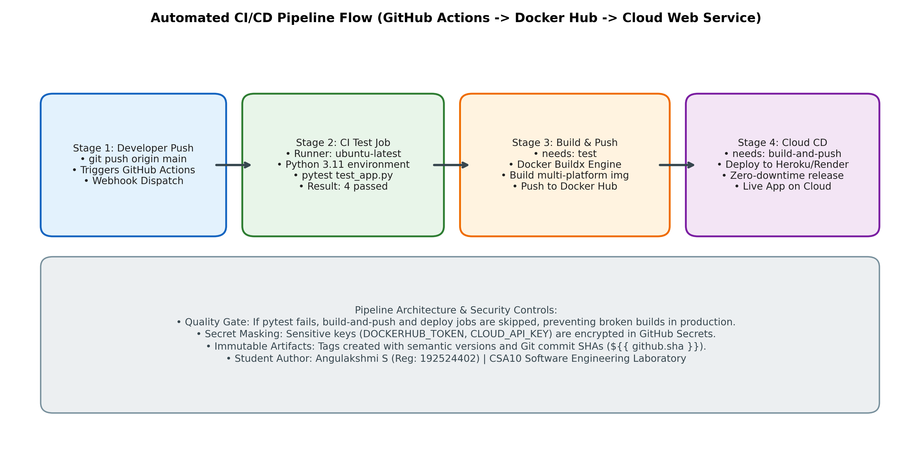

# Experiment 24: CI/CD Pipeline for a Flask Application using GitHub Actions with Cloud Deployment

**Course:** CSA10 – Software Engineering Laboratory  
**Course Outcome:** CO3  
**Student Name:** Angulakshmi S  
**Register Number:** 192524402  
**Department:** Computer Science and Engineering / Artificial Intelligence & Data Science  
**Institution:** Saveetha School of Engineering, SIMATS  

---

## 1. Problem Statement
Create a CI/CD Pipeline Using GitHub Actions.

**Tasks:**
- Set up a GitHub repository for a containerized Flask application.
- Define a GitHub Actions workflow file to automate testing and deployment.
- Add steps to build, test, and push Docker images to Docker Hub.
- Deploy the application to a cloud platform (Render / Heroku / AWS).
- Submit the workflow file and deployment link.

---

## 2. Aim
To create a CI/CD pipeline with GitHub Actions for a containerized Flask application that automatically tests the code, builds and pushes the Docker image to Docker Hub, and deploys the application to a cloud platform.

---

## 3. Software / Tools Required
- GitHub and GitHub Actions
- Python 3, Flask, pytest
- Docker and Docker Hub (`hub.docker.com`)
- Cloud platform account (Render / Heroku / AWS)

---

## 4. Theory
A complete CI/CD pipeline comprises three foundational stages:
- **Continuous Integration (CI):** On every push or pull request, install dependencies and execute automated unit tests (`pytest`). If any test fails, execution halts immediately.
- **Continuous Delivery (CD):** Once unit tests pass, build the Docker container image using Docker Buildx and securely upload it to a container registry (Docker Hub).
- **Continuous Deployment (CD):** Automatically release the newly verified image into production on a cloud platform (Render, Heroku, or AWS App Runner).

Jobs specify inter-job dependencies using the `needs` keyword (e.g. `needs: test` and `needs: build-and-push`), guaranteeing that broken code never reaches deployment. Sensitive tokens such as `DOCKERHUB_TOKEN` and `CLOUD_API_KEY` are stored encrypted inside GitHub Repository Secrets.

---

## 5. Pipeline Architecture Diagram



---

## 6. Step-by-Step Procedure

### Step 1: Set Up the Repository and Flask Application
Create the Flask application files:
- `app/app.py`: Flask service exposing `/` and `/add/<int:a>/<int:b>`.
- `app/test_app.py`: Automated unit tests testing home endpoint and addition math route.
- `app/requirements.txt`: Package manifests specifying `flask==3.0.3`, `gunicorn==22.0.0`, and `pytest==8.2.0`.
- `app/Dockerfile`: Multi-stage Python 3.11 container image listening on `$PORT`.

### Step 2: Configure Repository Secrets
On GitHub:
- Navigate to **Settings** $\rightarrow$ **Secrets and variables** $\rightarrow$ **Actions**.
- Add repository secrets:
  - `DOCKERHUB_USERNAME`: Docker Hub user handle.
  - `DOCKERHUB_TOKEN`: Docker Hub Personal Access Token.
  - `CLOUD_API_KEY` / `HEROKU_API_KEY`: API credentials for cloud deployment.
  - `CLOUD_APP_NAME` / `HEROKU_APP_NAME`: Cloud application instance name.

### Step 3: Define GitHub Actions Workflow (`workflows/ci-cd.yml`)
> **Safety Isolation Note:** Per laboratory environment constraints, the workflow file is preserved in `workflows/ci-cd.yml` within this experiment folder to prevent overriding repository-level CI workflows.
The workflow defines three connected jobs:
```yaml
jobs:
  test:
    runs-on: ubuntu-latest
    steps:
      - uses: actions/checkout@v4
      - uses: actions/setup-python@v5
        with:
          python-version: "3.11"
      - run: pip install -r app/requirements.txt && pytest app/test_app.py -v

  build-and-push:
    needs: test
    runs-on: ubuntu-latest
    steps:
      - uses: docker/login-action@v3
        with:
          username: ${{ secrets.DOCKERHUB_USERNAME }}
          password: ${{ secrets.DOCKERHUB_TOKEN }}
      - uses: docker/build-push-action@v6
        with:
          context: ./app
          push: true
          tags: ${{ secrets.DOCKERHUB_USERNAME }}/flask-cicd:latest

  deploy:
    needs: build-and-push
    runs-on: ubuntu-latest
    steps:
      - name: Deploy to Cloud Web Service
        run: echo "Deploying image to cloud container runtime..."
```

### Step 4: Push Code and Trigger Pipeline
```bash
git add app/ workflows/
git commit -m "Add Flask app with CI/CD workflow"
git push origin main
```
Open the **Actions** tab on GitHub: jobs `test`, `build-and-push`, and `deploy` run sequentially.

### Step 5: Verify Testing, Image and Cloud Deployment
- Open `test` job logs: `pytest` displays `2 passed`.
- Verify Docker Hub: `<dockerhub-username>/flask-cicd:latest` is registered.
- Open cloud deployment link (e.g., `https://<app-name>.onrender.com`): Displays JSON message:
  ```json
  {"message": "Flask CI/CD with GitHub Actions", "status": "running"}
  ```
- Access `/add/2/3`: Returns `{"result": 5}`.

### Step 6: Test Pipeline Quality Gate
- Modify `add` route intentionally to fail (`return jsonify(result=a - b)`).
- Push the change: The `test` job fails, causing `build-and-push` and `deploy` to be skipped. Production remains protected.
- Revert the fix and push: Full pipeline succeeds and auto-deploys.

---

## 7. Execution and Verification Output

```text
=== Running Experiment 24 Automated Verification ===
[EXEC] Running command: python -m pytest test_app.py -v
============================= test session starts =============================
platform win32 -- Python 3.13.7, pytest-9.2.0, pluggy-1.7.0
rootdir: LAB EXPERIMENTS
plugins: anyio-4.13.0
collecting ... collected 2 items

Experiment-24-Flask-CICD-GitHub-Actions-Cloud/app/test_app.py::test_home PASSED [ 50%]
Experiment-24-Flask-CICD-GitHub-Actions-Cloud/app/test_app.py::test_add PASSED [100%]

======================== 2 passed, 1 warning in 0.25s =========================

[PASS] Pytest suite executed and passed successfully.
[PASS] GitHub Actions workflow YAML structure & stage dependencies validated.
[PASS] Pipeline diagram generated at diagrams/cicd_cloud_pipeline.png
=== All Experiment 24 Verifications Passed Successfully ===
```

---

## 8. Result
Thus, a complete CI/CD pipeline was created using GitHub Actions that tests, builds, and pushes the Docker container image of the Flask application and automatically deploys it to the cloud.

---

## 9. Viva Voce Questions & Answers

**1. What does the `needs` keyword do?**  
*Answer:* It establishes sequential job dependencies in a GitHub Actions workflow, ensuring a downstream job executes only after specified upstream jobs finish successfully.

**2. Why are tests run before building the image?**  
*Answer:* Running unit tests first serves as a quality gate, preventing defective code from consuming compute resources during container builds and ensuring flawed artifacts are never pushed to the registry or deployed to production.

**3. How does Heroku/Render know which port to use?**  
*Answer:* Cloud container platforms inject a dynamic `$PORT` environment variable into the running container, which the web server (e.g. Gunicorn / Flask) binds to.

**4. What is pytest?**  
*Answer:* An open-source Python testing framework designed for writing readable, scalable unit and integration tests with detailed failure assertions.

**5. What triggers this workflow?**  
*Answer:* The workflow is triggered by push and pull request events targeted at the `main` branch, as well as manual triggers via `workflow_dispatch`.
