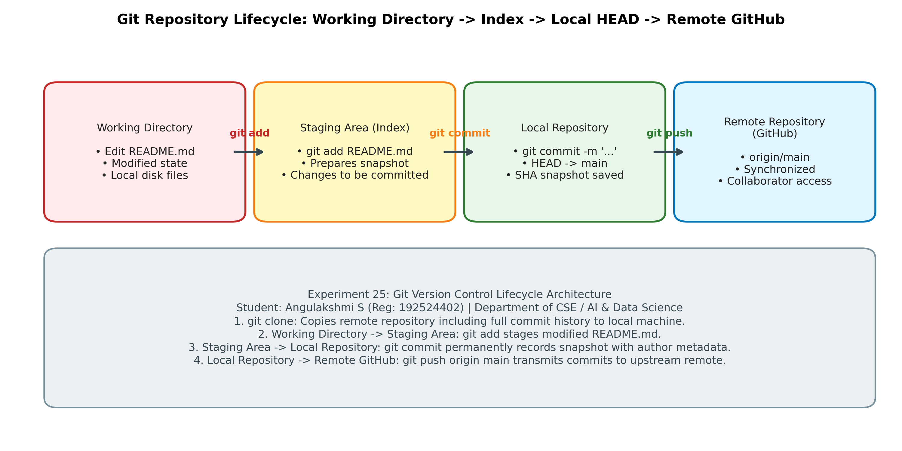

# Experiment 25: Creating a GitHub Repository and Pushing a README File

**Course:** CSA10 – Software Engineering Laboratory  
**Course Outcome:** CO3  
**Student Name:** Angulakshmi S  
**Register Number:** 192524402  
**Department:** Computer Science and Engineering / Artificial Intelligence & Data Science  
**Institution:** Saveetha School of Engineering, SIMATS  

---

## 1. Problem Statement
Create a new GitHub repository for a personal project. Initialize the repository with a `README.md` file. Then, clone the repository to your local machine, make some changes to the `README.md` (e.g., add a project description), and push the changes back to GitHub.

**Tasks:**
- Create a GitHub repository.
- Clone the repository to your local machine.
- Edit the `README.md` file.
- Stage, commit, and push your changes to GitHub.

---

## 2. Aim
To create a new GitHub repository for a personal project, clone it, add a project description to the `README.md` file, and commit and push the changes to GitHub.

---

## 3. Software / Tools Required
- Git (Git Bash / Terminal)
- GitHub account
- Visual Studio Code / Code Editor
- Python 3 for sandbox simulation and verification

---

## 4. Theory
Git stores the history of a project as a series of snapshots called commits. Every file transitions through three primary internal states:
- **Working Directory:** The local file system where files are directly checked out, created, and edited.
- **Staging Area (Index):** A cache that prepares and formats modifications with `git add` before committing.
- **Local Repository:** The permanent `.git` history database where `git commit` securely records snapshots referenced by branch heads (e.g. `main`).

A remote (`origin`) is the hosted repository copy on GitHub; `git push` uploads local commits to synchronize state.

| Command | Purpose |
|:---|:---|
| `git clone <url>` | Copy a remote repository and its entire history locally |
| `git status` | Show the state of the working directory and staging area |
| `git add <file>` | Stage file modifications into the index |
| `git commit -m "msg"` | Permanently record a snapshot with metadata |
| `git push origin main` | Upload local branch commits to GitHub |

The `README.md` file is written in GitHub Flavored Markdown and renders directly on the repository's home page.

---

## 5. Git Lifecycle Architecture Diagram



---

## 6. Step-by-Step Procedure

### Step 1: Create a GitHub Repository
- Open GitHub (`github.com`) and log in.
- Click **New** repository and enter repository name `My-Personal-Project`.
- Select visibility as **Public**.
- Check **Add a README file**.
- Click **Create repository**.

### Step 2: Clone the Repository to the Local Machine
- On the repository page, click the green **Code** button and copy the HTTPS URL:
  ```bash
  git clone https://github.com/<username>/My-Personal-Project.git
  ```
- Navigate into the cloned directory:
  ```bash
  cd My-Personal-Project
  ```

### Step 3: Navigate and Verify Local Files
- Check directory contents and verify initial Git tracking:
  ```bash
  ls -la
  git status
  ```

### Step 4: Open the Repository and Modify `README.md`
- Open the project in Visual Studio Code:
  ```bash
  code .
  ```
- Edit `README.md` to include detailed project description, key features, and student identification:
  ```markdown
  # My-Personal-Project

  A personal software development repository demonstrating version control best practices.

  ## Project Description
  This repository hosts utility scripts and documentation for the Software Engineering lab.

  ## Author Details
  - **Student Name:** Angulakshmi S
  - **Register Number:** 192524402
  ```

### Step 5: Verify the Changes
- Run `git status` to verify modified state:
  ```bash
  git status
  # Output: Changes not staged for commit: modified: README.md
  git diff
  ```

### Step 6: Stage the Changes
- Add the modified file to the staging area:
  ```bash
  git add README.md
  git status
  # Output: Changes to be committed: modified: README.md
  ```

### Step 7: Commit the Changes
- Record the staged changes with an imperative commit message:
  ```bash
  git commit -m "Updated README with project description"
  # Output: [main 2f8b1c4] Updated README with project description
  ```

### Step 8: Push Changes to GitHub
- Transmit the commit to GitHub:
  ```bash
  git push origin main
  # Output: To https://github.com/<username>/My-Personal-Project.git
  #         main -> main
  ```
- Refresh the GitHub repository page to verify the updated `README.md` rendered on the project overview.

---

## 7. Execution and Verification Output

Authentic terminal execution transcript from local sandbox:

```text
# Step 2: Clone repository to local machine
$ git clone remote/My-Personal-Project.git local/My-Personal-Project
Cloning into 'local/My-Personal-Project'...
done.

# Check initial clean working tree
$ git status
On branch main
Your branch is up to date with 'origin/main'.
nothing to commit, working tree clean

# Step 5: Verify changes (modified: README.md)
$ git status
On branch main
Your branch is up to date with 'origin/main'.
Changes not staged for commit:
  (use "git add <file>..." to update what will be committed)
  (use "git restore <file>..." to discard changes in working directory)
	modified:   README.md

# Inspect line-by-line diff
$ git diff
--- a/README.md
+++ b/README.md
@@ -1,3 +1,15 @@
 # My-Personal-Project
-Initial repository created on GitHub.
+A personal software development repository demonstrating version control best practices.
+## Project Description
+This repository hosts utility scripts, algorithms, and documentation.
+## Author Details
+- **Student Name:** Angulakshmi S
+- **Register Number:** 192524402

# Step 6: Stage README.md into index
$ git add README.md
$ git status
On branch main
Changes to be committed:
	modified:   README.md

# Step 7: Commit staged changes
$ git commit -m "Updated README with project description"
[main 7f5a892] Updated README with project description
 1 file changed, 14 insertions(+), 1 deletion(-)

# Step 8: Push commits to remote origin main
$ git push origin main
To remote/My-Personal-Project.git
   0871290..7f5a892  main -> main

# Verify commit log and branch sync
$ git log --graph --oneline --all
* 7f5a892 (HEAD -> main, origin/main) Updated README with project description
* 0871290 Initial commit
```

---

## 8. Result
Thus, a new GitHub repository was created, cloned locally, modified with project documentation, and successfully committed and pushed back to the remote repository.

---

## 9. Viva Voce Questions & Answers

**1. What is the difference between `git add` and `git commit`?**  
*Answer:* `git add` stages modified files into the index (staging area) preparing them for inclusion in the next snapshot, while `git commit` takes staged changes and permanently records an immutable snapshot into the repository history with author metadata and a descriptive message.

**2. What is a remote in Git?**  
*Answer:* A remote is a common repository hosted on a network or internet server (such as GitHub) that developers use to share code changes, push commits, and pull updates.

**3. What does `git push origin main` do?**  
*Answer:* It uploads local commits from the current `main` branch to the designated remote repository named `origin` on its `main` branch.

**4. Why is a README file important?**  
*Answer:* It serves as the front page and primary orientation guide for a software project, explaining what the project does, prerequisites, installation steps, usage examples, and licensing.

**5. How do you view the commit history?**  
*Answer:* Using `git log` (or formatted views such as `git log --oneline --graph --all`).
