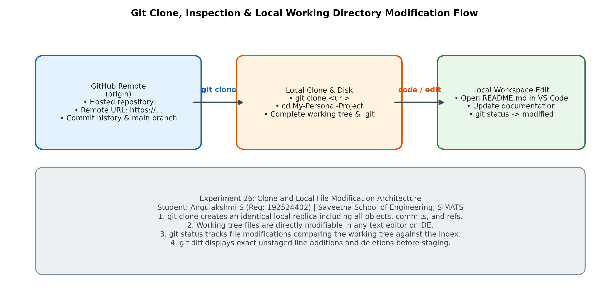

# Experiment 26: Cloning a GitHub Repository and Editing Files Locally

**Course:** CSA10 – Software Engineering Laboratory  
**Course Outcome:** CO3  
**Student Name:** Angulakshmi S  
**Register Number:** 192524402  
**Department:** Computer Science and Engineering / Artificial Intelligence & Data Science  
**Institution:** Saveetha School of Engineering, SIMATS  

---

## 1. Problem Statement
Clone an existing GitHub repository to your local machine, open the project in an editor, make modifications to a project file (such as `README.md`), and inspect the working directory status.

**Tasks:**
- Select and clone a GitHub repository.
- Navigate to the local repository directory.
- Open the repository and modify a file locally.
- Verify file modifications using `git status` and `git diff`.
- Save the updated file.

---

## 2. Aim
To clone an existing GitHub repository to the local machine, open a file in a code editor, make modifications locally, and verify the working directory status using Git commands.

---

## 3. Software / Tools Required
- Git (Git Bash / Terminal)
- GitHub account
- Visual Studio Code / Code Editor
- Python 3 for sandbox simulation and verification

---

## 4. Theory
`git clone` downloads an entire copy of a remote Git repository onto the local disk. It does not just download the latest files; it retrieves every commit, branch, and tag in the project's historical timeline and creates a local tracking branch linked to `origin/main`.

Once cloned:
- Files in the project reside in the **Working Directory**.
- When an existing file is modified, Git detects the file differences compared to the last commit snapshot recorded at `HEAD`.
- `git status` identifies the file under `Changes not staged for commit:` with status `modified: <filename>`.
- `git diff` displays the exact line-by-line insertions (`+`) and deletions (`-`) before they are staged into the index.

---

## 5. Architecture & Workflow Diagram



---

## 6. Step-by-Step Procedure

### Step 1: Select a GitHub Repository
- Open GitHub (`github.com`) and navigate to your project repository (e.g., `My-Personal-Project`).
- Verify repository files, commits, and initial `README.md`.

### Step 2: Clone the Repository to the Local Machine
- Click the green **Code** button and copy the HTTPS repository URL.
- Open Git Bash / Terminal and run:
  ```bash
  git clone https://github.com/<username>/My-Personal-Project.git
  ```
- Wait until cloning finishes and verifies all objects are unpacked.

### Step 3: Navigate to the Repository Directory
- Move into the repository directory:
  ```bash
  cd My-Personal-Project
  ```
- Verify tracked remote and files:
  ```bash
  ls -la
  git remote -v
  ```

### Step 4: Open the Repository and Modify the File
- Open the repository in Visual Studio Code:
  ```bash
  code .
  ```
- Locate `README.md` and make edits, such as adding project modules, setup instructions, or documentation updates.
- Save the modified file (`Ctrl + S`).

### Step 5: Verify the Changes
- Return to Git Bash / Terminal and run:
  ```bash
  git status
  ```
- Observe that Git reports:
  ```text
  Changes not staged for commit:
    (use "git add <file>..." to update what will be committed)
    modified:   README.md
  ```
- Inspect line changes:
  ```bash
  git diff
  ```

### Step 6: Save and Maintain Updated File
- Ensure that the file changes remain saved in the local working directory ready for subsequent staging and committing.

---

## 7. Execution and Verification Output

Authentic terminal execution transcript from local sandbox:

```text
# Step 2: Clone repository to local system
$ git clone remote/My-Personal-Project.git workspace/My-Personal-Project
Cloning into 'workspace/My-Personal-Project'...
done.

# Step 3: Verify clean working directory
$ git status
On branch main
Your branch is up to date with 'origin/main'.
nothing to commit, working tree clean

# Verify origin remote fetch and push URLs
$ git remote -v
origin	remote/My-Personal-Project.git (fetch)
origin	remote/My-Personal-Project.git (push)

# Step 5: Verify changes with git status (modified: README.md)
$ git status
On branch main
Your branch is up to date with 'origin/main'.

Changes not staged for commit:
  (use "git add <file>..." to update what will be committed)
  (use "git restore <file>..." to discard changes in working directory)
	modified:   README.md

no changes added to commit (use "git add" to track)

# Inspect working tree diff against HEAD
$ git diff
--- a/README.md
+++ b/README.md
@@ -1,3 +1,15 @@
 # My-Personal-Project
-A personal software development repository.
+A personal software development repository demonstrating version control best practices using Git and GitHub.
+
+## Project Description
+This repository hosts utility scripts, algorithms, and documentation developed as part of the Software Engineering curriculum.
+
+## Local Modifications & New Modules
+- Added setup guide for virtual environments (python -m venv .venv).
+- Added code formatting standards using PEP 8 guidelines.
+- Configured Git pre-commit hooks for automated linting.
+
+## Contributors
+- **Angulakshmi S** (Register Number: 192524402) - CSE / AI & Data Science
+- Saveetha School of Engineering, SIMATS
```

---

## 8. Result
Thus, an existing GitHub repository was successfully cloned to the local machine, and a file was opened, modified, and verified using Git inspection commands.

---

## 9. Viva Voce Questions & Answers

**1. What does `git clone` copy?**  
*Answer:* It copies all project files, branches, tags, and the entire commit history database from the remote repository to the local workstation.

**2. What is `git remote -v`?**  
*Answer:* A command that displays the names and URLs of all configured remote repositories for fetching and pushing.

**3. Which command shows the changes made to a file?**  
*Answer:* `git diff`, which displays differences between the working directory and the staging area or `HEAD`.

**4. Differentiate HTTPS and SSH cloning.**  
*Answer:* HTTPS authentication uses username and personal access tokens over SSL (port 443), whereas SSH uses asymmetric public/private cryptographic key pairs without requiring password prompts (port 22).

**5. Can you clone a private repository?**  
*Answer:* Yes, provided the user has collaborator permissions and supplies valid credentials or SSH authorization.
