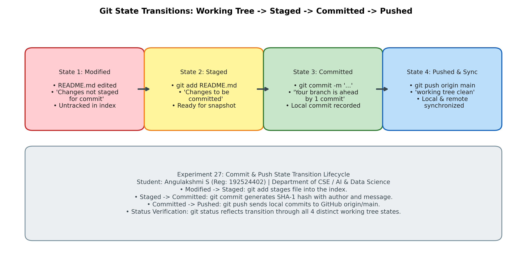

# Experiment 27: Committing and Pushing Changes to GitHub

**Course:** CSA10 – Software Engineering Laboratory  
**Course Outcome:** CO4  
**Student Name:** Angulakshmi S  
**Register Number:** 192524402  
**Department:** Computer Science and Engineering / Artificial Intelligence & Data Science  
**Institution:** Saveetha School of Engineering, SIMATS  

---

## 1. Problem Statement
After modifying a file in a cloned repository, commit the changes locally and push them to GitHub.

**Tasks:**
- Clone a repository (from Experiment 25).
- Modify a file (e.g., `README.md`).
- Stage the changes with `git add`.
- Commit the changes with `git commit -m "Updated README"`.
- Push the changes to GitHub using `git push`.

---

## 2. Aim
To modify a file in a cloned repository, stage and commit the changes with a meaningful message, and push them to the remote GitHub repository.

---

## 3. Software / Tools Required
- Git (Git Bash / Terminal)
- GitHub account
- Visual Studio Code / Code Editor
- Python 3 for sandbox simulation and verification

---

## 4. Theory
A Git commit represents an immutable snapshot of staged modifications, bundled with author metadata, timestamp, and a commit message. Effective commit messages are written in the imperative mood (e.g., "Updated README with project objectives") and describe what was changed.

When navigating through file modifications, Git communicates state through distinct status messages:

| Status Message | Meaning |
|:---|:---|
| `Changes not staged for commit` | File modified in working directory but not yet staged |
| `Changes to be committed` | File added to index, ready for the next commit |
| `Your branch is ahead of 'origin/main' by 1 commit` | Changes committed to local history, not yet pushed |
| `nothing to commit, working tree clean` | Local working directory is fully synchronized with remote |

`git push` transfers these local commits to the remote repository on GitHub so that collaborators can access them.

---

## 5. Lifecycle Architecture Diagram



---

## 6. Step-by-Step Procedure

### Step 1: Clone the Repository
- Open Git Bash and clone the GitHub repository:
  ```bash
  git clone https://github.com/<username>/My-Personal-Project.git
  ```

### Step 2: Navigate to the Repository
- Move into the repository directory and verify file structure:
  ```bash
  cd My-Personal-Project
  ls
  ```

### Step 3: Open the Repository and Modify the File
- Open the project in Visual Studio Code:
  ```bash
  code .
  ```
- Edit `README.md` to update project goals, setup instructions, and author details.
- Save the file (`Ctrl + S`).

### Step 4: Verify the Changes
- Check repository status in terminal:
  ```bash
  git status
  ```
- Observe the file listed under `Changes not staged for commit:`:
  ```text
  modified:   README.md
  ```

### Step 5: Stage the Changes
- Stage the modified file into the Git index:
  ```bash
  git add README.md
  ```
- Confirm staging:
  ```bash
  git status
  ```
- The file is now displayed in green under `Changes to be committed:`.

### Step 6: Commit the Changes
- Record the staged snapshot:
  ```bash
  git commit -m "Updated README"
  ```
- Running `git status` now displays:
  ```text
  Your branch is ahead of 'origin/main' by 1 commit.
  ```

### Step 7: Push the Changes to GitHub
- Send the committed changes to GitHub:
  ```bash
  git push origin main
  ```

### Step 8: Verify the Push on GitHub
- Check local status:
  ```bash
  git status
  # nothing to commit, working tree clean
  ```
- Refresh the GitHub repository in the web browser — the latest commit "Updated README" and its associated SHA hash are displayed.

---

## 7. Execution and Verification Output

Authentic terminal execution transcript from local sandbox:

```text
# Step 1: Clone repository locally
$ git clone remote/My-Personal-Project.git local/My-Personal-Project
Cloning into 'local/My-Personal-Project'...
done.

# Step 2: Navigate and check clean status
$ git status
On branch main
Your branch is up to date with 'origin/main'.
nothing to commit, working tree clean

# Step 4: Verify modified state (Changes not staged for commit)
$ git status
On branch main
Your branch is up to date with 'origin/main'.

Changes not staged for commit:
  (use "git add <file>..." to update what will be committed)
  (use "git restore <file>..." to discard changes in working directory)
	modified:   README.md

no changes added to commit (use "git add" to track)

# Step 5: Stage changes into index (git add README.md)
$ git add README.md
$ git status
On branch main
Your branch is up to date with 'origin/main'.

Changes to be committed:
  (use "git restore --staged <file>..." to unstage)
	modified:   README.md

# Step 6: Commit changes (git commit -m 'Updated README')
$ git commit -m Updated README
[main 6281fc8] Updated README
 1 file changed, 14 insertions(+), 1 deletion(-)

$ git status
On branch main
Your branch is ahead of 'origin/main' by 1 commit.
  (use "git push" to publish your local commits)

nothing to commit, working tree clean

# Step 7: Push changes to remote (git push origin main)
$ git push origin main
To remote/My-Personal-Project.git
   0871290..6281fc8  main -> main

# Step 8: Verify working tree clean and synchronized
$ git status
On branch main
Your branch is up to date with 'origin/main'.

nothing to commit, working tree clean

# Verify complete commit history graph
$ git log --graph --oneline --all
* 6281fc8 (HEAD -> main, origin/main) Updated README
* 0871290 Initial commit
```

---

## 8. Result
Thus, the modified file in the cloned repository was successfully staged, committed with a meaningful message, and pushed to the remote GitHub repository.

---

## 9. Viva Voce Questions & Answers

**1. What does the `git add` command do?**  
*Answer:* It adds file modifications from the working directory into the staging area (index), preparing them to be recorded in the next commit snapshot.

**2. What information does a commit store?**  
*Answer:* A commit stores a cryptographic SHA-1/SHA-256 tree hash of staged files, author name and email, committer metadata, commit timestamp, parent commit reference(s), and the commit message.

**3. What does "branch is ahead of 'origin/main' by 1 commit" mean?**  
*Answer:* It means that one new commit has been recorded in the local repository branch that does not yet exist on the remote repository on GitHub.

**4. How do you check if changes are staged?**  
*Answer:* By executing `git status` (staged changes appear in green under "Changes to be committed") or `git diff --staged`.

**5. What happens if `git push` fails because the remote has changes?**  
*Answer:* Git rejects the push with a non-fast-forward error; the developer must run `git pull` (or `git pull --rebase`) to fetch and integrate upstream changes before pushing again.
