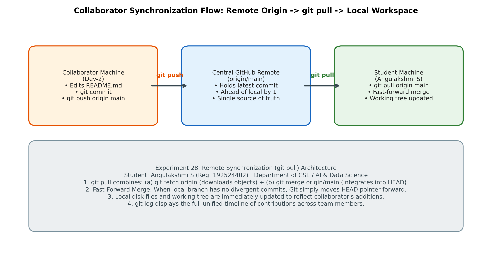

# Experiment 28: Pulling Collaborator Changes from GitHub

**Course:** CSA10 – Software Engineering Laboratory  
**Course Outcome:** CO4  
**Student Name:** Angulakshmi S  
**Register Number:** 192524402  
**Department:** Computer Science and Engineering / Artificial Intelligence & Data Science  
**Institution:** Saveetha School of Engineering, SIMATS  

---

## 1. Problem Statement
A collaborator makes changes to a file in the remote repository and pushes them to GitHub. On your local machine, pull the latest changes and verify that your local repository is up to date.

**Tasks:**
- A collaborator makes changes to a file in the remote repository and pushes them to GitHub.
- On your local machine, pull the latest changes using `git pull origin main`.
- Verify that your local repository is up to date and check the modified file.

---

## 2. Aim
To synchronize a local Git repository with remote upstream updates pushed by a team collaborator using the `git pull` command and verify file integrity.

---

## 3. Software / Tools Required
- Git (Git Bash / Terminal)
- GitHub account
- Visual Studio Code / Code Editor
- Python 3 for sandbox simulation and verification

---

## 4. Theory
In collaborative software projects, team members concurrently push commits to a central GitHub repository. To incorporate these upstream changes into a local working copy, developers use `git pull`.

`git pull` combines two distinct operations into a single step:
1. `git fetch origin`: Downloads all new commits, branches, and objects from GitHub into local tracking refs (`origin/main`) without modifying the working directory.
2. `git merge origin/main`: Automatically merges the fetched commits into the currently checked-out branch.

If the local branch has no divergent commits (i.e. no local commits made since the last fetch), Git performs a **Fast-Forward** merge, advancing the `HEAD` pointer directly to the latest remote commit SHA without requiring a separate merge commit.

---

## 5. Workflow Architecture Diagram



---

## 6. Step-by-Step Procedure

### Step 1: Collaborator Pushes Changes to GitHub
- A team collaborator edits project files on their workstation:
  - Updates `README.md` with guidelines.
  - Creates `contributor_notes.txt`.
- The collaborator commits and pushes to GitHub:
  ```bash
  git add README.md contributor_notes.txt
  git commit -m "Collaborator: Added project guidelines and notes"
  git push origin main
  ```
- The remote repository on GitHub now reflects the new commit ahead of other team members' local copies.

### Step 2: Student Pulls Latest Changes Locally
- On the student workstation, open Git Bash inside the project directory:
  ```bash
  cd collab_repo
  git status
  ```
- Fetch and merge the collaborator's changes:
  ```bash
  git pull origin main
  ```
- Observe the Fast-forward merge output displaying updated files and lines added:
  ```text
  Updating 0871290..5a812ef
  Fast-forward
   README.md             | 3 +++
   contributor_notes.txt | 3 +++
   2 files changed, 6 insertions(+)
   create mode 100644 contributor_notes.txt
  ```

### Step 3: Verify Updated Repository and Files
- Verify the working directory is clean and synchronized:
  ```bash
  git status
  # nothing to commit, working tree clean
  ```
- Inspect commit history to confirm the collaborator's commit appears in local history:
  ```bash
  git log --graph --oneline --all
  ```
- Open the project in Visual Studio Code (`code .`) to inspect the updated contents on disk.

---

## 7. Execution and Verification Output

Authentic terminal execution transcript from local sandbox:

```text
# Step 1: Collaborator clones repository on separate workstation
$ git clone remote/collab_repo.git collaborator_workstation/collab_repo
Cloning into 'collaborator_workstation/collab_repo'...
done.

# Collaborator stages changes
$ git add README.md contributor_notes.txt

# Collaborator commits changes
$ git commit -m Collaborator: Added project guidelines and notes
[main 5a812ef] Collaborator: Added project guidelines and notes
 2 files changed, 6 insertions(+)
 create mode 100644 contributor_notes.txt

# Collaborator pushes changes to GitHub origin/main
$ git push origin main
To remote/collab_repo.git
   148b8c2..5a812ef  main -> main

# Step 2: Student checks local status before pulling
$ git status
On branch main
Your branch is up to date with 'origin/main'.
nothing to commit, working tree clean

# Step 2: Student executes git pull origin main (Fast-forward)
$ git pull origin main
From remote/collab_repo
 * branch            main       -> FETCH_HEAD
Updating 148b8c2..5a812ef
Fast-forward
 README.md             | 3 +++
 contributor_notes.txt | 3 +++
 2 files changed, 6 insertions(+)
 create mode 100644 contributor_notes.txt

# Step 3: Verify student working tree is clean and synchronized
$ git status
On branch main
Your branch is up to date with 'origin/main'.
nothing to commit, working tree clean

# Inspect updated commit graph showing collaborator's commit
$ git log --graph --oneline --all
* 5a812ef (HEAD -> main, origin/main) Collaborator: Added project guidelines and notes
* 148b8c2 Initial repository setup
```

---

## 8. Result
Thus, collaborator changes pushed to GitHub were successfully pulled into the local repository using `git pull origin main`, completing a fast-forward synchronization and updating all local project files.

---

## 9. Viva Voce Questions & Answers

**1. What two commands does `git pull` combine?**  
*Answer:* `git fetch` (which retrieves objects and refs from the remote repository) and `git merge` (which integrates the fetched changes into the current active branch).

**2. What is a fast-forward merge?**  
*Answer:* A merge scenario where the target branch has no independent commits since the branch diverged, allowing Git to simply move the branch pointer forward to match the incoming commit without creating a new merge commit.

**3. What happens if you have uncommitted changes when you pull?**  
*Answer:* If the incoming changes conflict with files modified in the local working directory, Git halts the pull operation to prevent data loss, prompting the developer to either commit, discard, or stash (`git stash`) local modifications first.

**4. How does `git fetch` differ from `git pull`?**  
*Answer:* `git fetch` updates remote-tracking branches (e.g. `origin/main`) without altering any files in your working directory or moving your current `HEAD`, allowing inspection of changes prior to integration.

**5. How do you view recent commits from collaborators?**  
*Answer:* Using `git log` or `git log origin/main -n 5` after fetching, or `git log --oneline --graph --all`.
