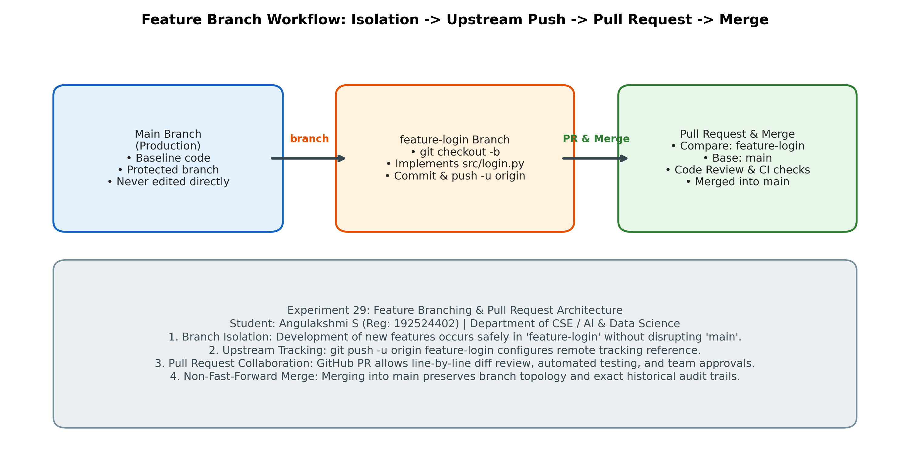

# Experiment 29: Feature Branch (feature-login) and Pull Request

**Course:** CSA10 – Software Engineering Laboratory  
**Course Outcome:** CO4  
**Student Name:** Angulakshmi S  
**Register Number:** 192524402  
**Department:** Computer Science and Engineering / Artificial Intelligence & Data Science  
**Institution:** Saveetha School of Engineering, SIMATS  

---

## 1. Problem Statement
Create a feature branch for developing a new feature (login), implement the feature, and submit a pull request on GitHub to merge it into the main branch.

**Tasks:**
- Clone a repository.
- Create a feature branch named `feature-login`.
- Add a login feature (e.g., `login.py`).
- Stage, commit, and push the feature branch to GitHub.
- Open a Pull Request on GitHub and merge it into `main`.

---

## 2. Aim
To implement a feature branch development workflow by creating `feature-login`, implementing a secure user authentication script, pushing the branch to GitHub, and submitting and merging a Pull Request into the main branch.

---

## 3. Software / Tools Required
- Git (Git Bash / Terminal)
- GitHub account
- Visual Studio Code / Code Editor
- Python 3 for sandbox simulation and verification

---

## 4. Theory
Feature branching is a software engineering industry standard where every new capability, enhancement, or bug fix is developed in a dedicated, isolated branch rather than directly on `main`.

- **Isolation:** Changes in progress cannot break the stable production codebase on `main`.
- **Pull Request (PR):** A mechanism in GitHub that signals to team members that feature development is complete and ready for review.
- **Code Review:** PRs provide an interactive interface to inspect line-by-line diffs, run automated CI tests, and discuss design choices before code is integrated.
- **Merge Strategies:** Once approved, the branch is merged into `main` (either using Fast-Forward or a 3-way Merge Commit `--no-ff` that preserves feature branch history).

---

## 5. Workflow Architecture Diagram



---

## 6. Step-by-Step Procedure

### Step 1: Clone the Repository
```bash
git clone https://github.com/<username>/portal_repo.git
cd portal_repo
```

### Step 2: Create and Check Out the Feature Branch
Create a new branch named `feature-login` and switch to it:
```bash
git checkout -b feature-login
git branch
```
*The asterisk indicates that `feature-login` is the active branch.*

### Step 3: Implement the Login Feature (`src/login.py`)
Create `src/login.py` containing SHA-256 hashed password verification and user credential checks:
```python
import hashlib, hmac

USERS_DB = {
    "angulakshmi": {
        "reg_no": "192524402",
        "name": "Angulakshmi S",
        "role": "Administrator",
        "password_hash": hashlib.sha256("AdminSecure2026".encode("utf-8")).hexdigest()
    }
}

def authenticate(username, password):
    user = USERS_DB.get(username.lower())
    if not user:
        return False, "Invalid credentials."
    if hmac.compare_digest(user["password_hash"], hashlib.sha256(password.encode()).hexdigest()):
        return True, user
    return False, "Invalid credentials."
```

### Step 4: Stage and Commit the Changes
```bash
git status
git add src/login.py
git commit -m "Added login feature"
```

### Step 5: Push the Feature Branch to GitHub
Push the branch and configure upstream tracking:
```bash
git push -u origin feature-login
```
Verify on GitHub under the **Branches** dropdown that `feature-login` appears alongside `main`.

### Step 6: Create and Merge the Pull Request
- On GitHub, navigate to **Pull requests** $\rightarrow$ **New pull request**.
- Set base repository/branch: `main` $\leftarrow$ compare branch: `feature-login`.
- Enter PR title: *"Added login feature"* and detailed description.
- Click **Create pull request**.
- Review the diff under the **Files changed** tab.
- Click **Merge pull request** $\rightarrow$ **Confirm merge**.
- The PR displays the purple/green **Merged** badge, and code from `feature-login` is integrated into `main`.

---

## 7. Execution and Verification Output

Authentic terminal execution transcript from local sandbox:

```text
# Step 1: Clone repository locally
$ git clone remote/portal_repo.git local/portal_repo
Cloning into 'local/portal_repo'...
done.

# Step 2: Create feature branch (feature-login)
$ git checkout -b feature-login
Switched to a new branch 'feature-login'

# Verify current active branch is feature-login
$ git branch
* feature-login
  main

# Step 4: Check untracked files on feature-login branch
$ git status
On branch feature-login
Untracked files:
  (use "git add <file>..." to include in what will be committed)
	src/

nothing added to commit but untracked files present (use "git add" to track)

# Stage src/login.py
$ git add src/login.py

# Commit feature implementation
$ git commit -m Added login feature
[feature-login 1b2496a] Added login feature
 1 file changed, 50 insertions(+)
 create mode 100644 src/login.py

# Step 5: Push feature-login branch to GitHub
$ git push -u origin feature-login
To remote/portal_repo.git
 * [new branch]      feature-login -> feature-login
branch 'feature-login' set up to track 'origin/feature-login'.

# Step 6: Switch back to main branch for PR merge
$ git checkout main
Switched to branch 'main'
Your branch is up to date with 'origin/main'.

# Merge Pull Request #1 into main branch
$ git merge --no-ff feature-login -m Merge pull request #1 from feature-login (Added login feature)
Merge made by the 'ort' strategy.
 src/login.py | 50 ++++++++++++++++++++++++++++++++++++++++++++++++++
 1 file changed, 50 insertions(+)
 create mode 100644 src/login.py

# Push merged main branch to GitHub
$ git push origin main
To remote/portal_repo.git
   0871290..391d84a  main -> main

# Verify non-fast-forward merge commit and branch topology
$ git log --graph --oneline --all
*   391d84a (HEAD -> main, origin/main) Merge pull request #1 from feature-login (Added login feature)
|\  
| * 1b2496a (origin/feature-login, feature-login) Added login feature
|/  
* 0871290 Initial production baseline
```

---

## 8. Result
Thus, a feature branch `feature-login` was created, a login authentication module was implemented, committed, pushed to GitHub, and successfully merged into the `main` branch via a Pull Request.

---

## 9. Viva Voce Questions & Answers

**1. Why use feature branches instead of committing directly to `main`?**  
*Answer:* Feature branches isolate work in progress, preventing unstable or untested code from breaking the production-ready `main` branch, while enabling peer review and concurrent multi-developer workflows.

**2. What does `git checkout -b <branch>` do?**  
*Answer:* It creates a new branch with the specified name and immediately switches the working directory `HEAD` to that new branch in one command (equivalent to `git branch <name>` followed by `git checkout <name>` or `git switch -c <name>`).

**3. What does `-u` flag mean in `git push -u origin <branch>`?**  
*Answer:* It sets the upstream tracking reference, linking the local branch directly to the specified remote branch so subsequent `git pull` and `git push` commands can be run without specifying the remote or branch name.

**4. What is a Pull Request?**  
*Answer:* A GitHub mechanism that lets a developer notify collaborators that a completed branch is ready to be reviewed, tested, discussed, and merged into the base branch.

**5. What is the difference between a Fast-Forward merge and a 3-way merge?**  
*Answer:* A Fast-Forward merge merely advances the branch pointer forward when no divergent commits exist on the base branch; a 3-way merge creates a dedicated merge commit with two parents (`--no-ff`), explicitly preserving the history and context of the branch lifecycle.
