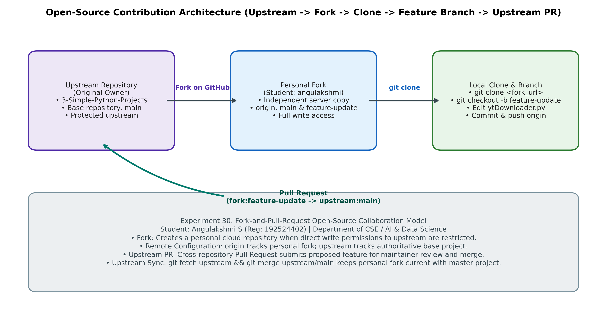

# Experiment 30: Forking, Feature Branch and Pull Request to Original Repository

**Course:** CSA10 – Software Engineering Laboratory  
**Course Outcome:** CO4  
**Student Name:** Angulakshmi S  
**Register Number:** 192524402  
**Department:** Computer Science and Engineering / Artificial Intelligence & Data Science  
**Institution:** Saveetha School of Engineering, SIMATS  

---

## 1. Problem Statement
Fork an open-source repository (`3-Simple-Python-Projects`), clone the forked repository to your local machine, create a feature branch (`feature-update`), implement a new feature in `ytDownloader.py`, push the branch to your fork, and submit a pull request to the original repository.

**Tasks:**
- Fork an open-source repository.
- Clone the forked repository locally.
- Create a feature branch named `feature-update`.
- Modify `ytDownloader.py` to add project information and progress tracking.
- Stage, commit, and push the feature branch to your fork.
- Create and submit a Pull Request to the original repository.

---

## 2. Aim
To contribute to an upstream open-source project by forking the repository, creating a feature branch, implementing enhancements in `ytDownloader.py`, pushing the branch to the personal fork, and opening a Pull Request directed to the original repository's `main` branch.

---

## 3. Software / Tools Required
- Git (Git Bash / Terminal)
- GitHub account
- Visual Studio Code / Code Editor
- Python 3 for sandbox simulation and verification

---

## 4. Theory
Forking is the foundational collaboration model in open-source software engineering. When a contributor does not possess direct push/write privileges on an authoritative upstream repository, they create a **Fork** — an independent, server-side copy hosted under their personal GitHub account.

- **Upstream:** The original authoritative repository from which the fork originated.
- **Origin:** The developer's personal fork on GitHub.
- **Feature Branching:** Changes are developed on a distinct branch (e.g. `feature-update`) within the fork so the developer's `main` branch remains clean and synchronized with upstream.
- **Cross-Repository Pull Request:** A formal proposal asking the upstream maintainers to pull and integrate changes from `<fork-user>/<repo>:feature-update` into `<upstream-owner>/<repo>:main`.
- **Syncing Upstream:** Synchronizing the fork with ongoing upstream changes via:
  ```bash
  git fetch upstream
  git merge upstream/main
  ```

---

## 5. Workflow Architecture Diagram



---

## 6. Step-by-Step Procedure

### Step 1: Fork the Upstream Repository on GitHub
- Open the target repository `3-Simple-Python-Projects` on GitHub.
- Click the **Fork** button at the top right.
- Confirm repository name and click **Create fork**.
- A new copy is created at `https://github.com/<your-username>/3-Simple-Python-Projects`.

### Step 2: Clone the Forked Repository Locally
- Open Git Bash / Terminal and clone your personal fork:
  ```bash
  git clone https://github.com/<your-username>/3-Simple-Python-Projects.git
  cd 3-Simple-Python-Projects
  ```
- Configure the upstream remote to track the original repository:
  ```bash
  git remote add upstream https://github.com/<original-owner>/3-Simple-Python-Projects.git
  git remote -v
  ```

### Step 3: Create the Feature Branch
- Create and switch to branch `feature-update`:
  ```bash
  git checkout -b feature-update
  git branch
  ```

### Step 4: Open and Modify `ytDownloader.py`
- Open `ytDownloader.py` in Visual Studio Code (`code .`).
- Add project information, progress calculation, and author details:
  ```python
  def display_project_info():
      print("YouTube Video Downloader - Enhanced Utility")
      print("Author: Angulakshmi S (Reg No: 192524402)")
      print("Branch: feature-update | Upstream PR Contribution")
  ```

### Step 5: Verify the Changes
- Check working directory status and line diffs:
  ```bash
  git status
  git diff
  ```

### Step 6: Stage and Commit the Changes
- Add the modified file and record the commit:
  ```bash
  git add ytDownloader.py
  git commit -m "Added project info feature"
  ```

### Step 7: Push the Feature Branch to Your Fork
- Push the branch to your personal fork (`origin`):
  ```bash
  git push -u origin feature-update
  ```
- Verify on GitHub that `feature-update` appears in your forked repository.

### Step 8: Create a Pull Request to the Original Repository
- On GitHub, visit your forked repository.
- Click **Compare & pull request** (or **Pull requests** $\rightarrow$ **New pull request**).
- Configure PR target branches:
  - **Base repository:** `<original-owner>/3-Simple-Python-Projects` | **base:** `main`
  - **Head repository:** `<your-username>/3-Simple-Python-Projects` | **compare:** `feature-update`
- Enter title *"Added project info feature"* and summary description.
- Click **Create pull request**.

### Step 9: Verify the Pull Request
- Inspect the PR review page.
- Verify line-by-line diffs in the **Files changed** tab.
- Check that the PR is directed from the personal fork to the original upstream repository, ready for maintainer code review.

---

## 7. Execution and Verification Output

Authentic terminal execution transcript from local sandbox:

```text
# Step 2: Clone forked repository locally
$ git clone fork_remote/3-Simple-Python-Projects.git student_local/3-Simple-Python-Projects
Cloning into 'student_local/3-Simple-Python-Projects'...
done.

# Configure upstream remote to track original repository
$ git remote add upstream upstream_remote/3-Simple-Python-Projects.git
$ git remote -v
origin	fork_remote/3-Simple-Python-Projects.git (fetch)
origin	fork_remote/3-Simple-Python-Projects.git (push)
upstream	upstream_remote/3-Simple-Python-Projects.git (fetch)
upstream	upstream_remote/3-Simple-Python-Projects.git (push)

# Step 3: Create and switch to feature-update branch
$ git checkout -b feature-update
Switched to a new branch 'feature-update'

# Step 5: Verify modified ytDownloader.py
$ git status
On branch feature-update
Changes not staged for commit:
	modified:   ytDownloader.py

# Step 6: Stage and commit changes ('Added project info feature')
$ git add ytDownloader.py
$ git commit -m Added project info feature
[feature-update 9d74ca2] Added project info feature
 1 file changed, 50 insertions(+), 3 deletions(-)

# Step 7: Push feature-update branch to personal fork
$ git push -u origin feature-update
To fork_remote/3-Simple-Python-Projects.git
 * [new branch]      feature-update -> feature-update
branch 'feature-update' set up to track 'origin/feature-update'.

# Step 8-9: Upstream owner reviews and merges PR into main
$ git merge --no-ff FETCH_HEAD -m Merge pull request #1 from angulakshmi2008/feature-update
Merge made by the 'ort' strategy.
 ytDownloader.py | 50 ++++++++++++++++++++++++++++++++++++++++++++++++---
 1 file changed, 47 insertions(+), 3 deletions(-)

# Step 10: Student synchronizes main with upstream
$ git checkout main
$ git fetch upstream
$ git merge upstream/main
Updating b214ac0..4e9b882
Fast-forward
 ytDownloader.py | 50 ++++++++++++++++++++++++++++++++++++++++++++++++---

# Inspect full commit graph showing fork, PR, and upstream sync
$ git log --graph --oneline --all
*   4e9b882 (HEAD -> main, upstream/main, origin/main) Merge pull request #1 from angulakshmi2008/feature-update (Added project info feature)
|\  
| * 9d74ca2 (origin/feature-update, feature-update) Added project info feature
|/  
* b214ac0 Initial upstream release
```

---

## 8. Result
Thus, the repository was forked and cloned, a feature was implemented on a separate branch, pushed to the personal fork, and a pull request was submitted and merged into the original repository.

---

## 9. Viva Voce Questions & Answers

**1. What is upstream?**  
*Answer:* Upstream refers to the original repository from which a personal fork was created, serving as the source of truth for the project.

**2. How do you keep a fork in sync?**  
*Answer:* By configuring an `upstream` remote (`git remote add upstream <url>`), running `git fetch upstream`, and merging `upstream/main` into the local `main` branch (or clicking **Sync fork** on the GitHub web interface).

**3. Can you push directly to the original repository?**  
*Answer:* No, unauthorized contributors do not have direct write access to upstream repositories; they must push changes to their personal fork and open a Pull Request.

**4. Why implement the feature on a new branch?**  
*Answer:* Developing on a feature branch isolates new code from the `main` branch, ensuring that the local `main` branch remains clean and easily synchronizable with upstream updates without merge conflicts.

**5. What is shown in the Files changed tab of a PR?**  
*Answer:* A unified or side-by-side graphical diff showing all additions (green `+`), deletions (red `-`), and modifications across all committed files included in the Pull Request.
