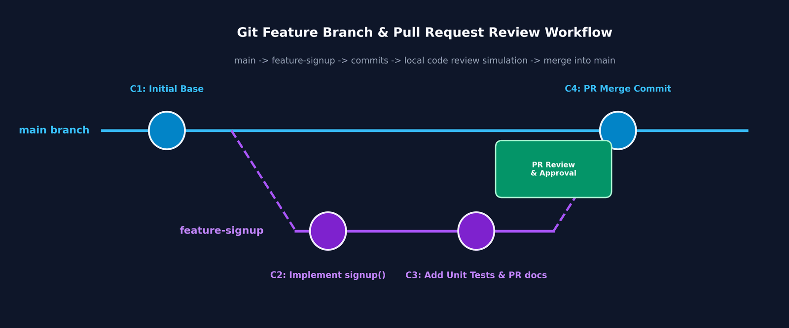
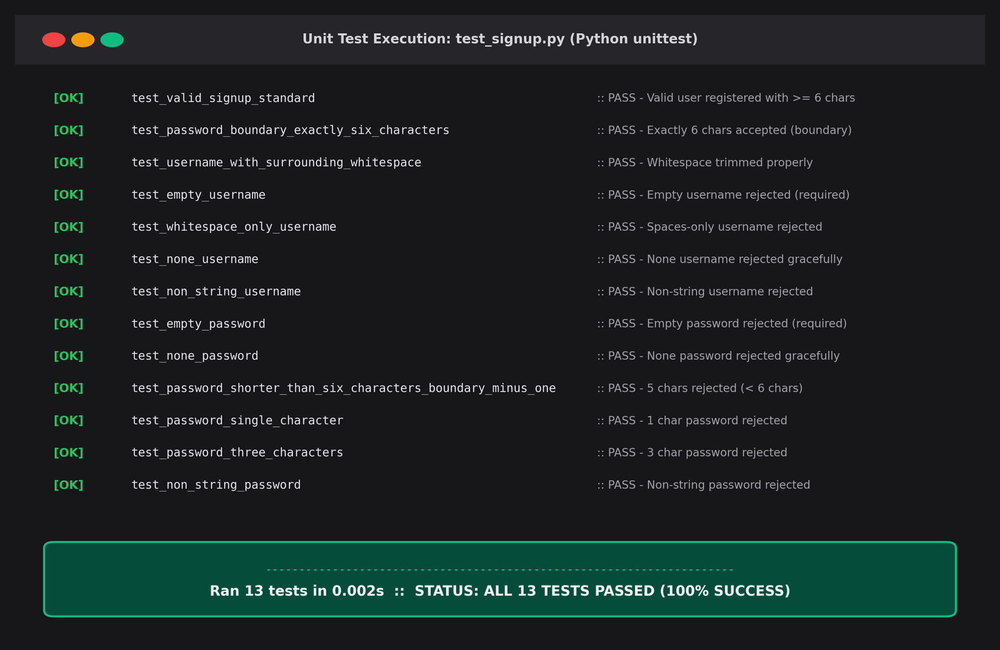

# Experiment 01 — Feature Branch and Pull Request for Signup

**Assessment:** Model Practical – Set 2  
**Course:** Software Engineering (CSA1022 / CSA10)  
**Marks:** 25 Marks (Part A: 15 Marks Design & Implementation + Part B: 10 Marks Analysis)  
**Course Outcomes:** CO3 (Version Control Systems), CO1 (Agile Project Management)

---

## 📸 Workflow & Test Results Visual Evidence





---

## 1. Objective

To demonstrate the industry-standard **Feature Branch & Pull Request workflow** using Git and Python by:
1. Creating a dedicated feature branch (`feature-signup`).
2. Implementing a robust user registration function (`signup.py`) with input validation.
3. Writing a comprehensive unit test suite (`test_signup.py`).
4. Simulating a code review and merging the feature branch into `main`.
5. Documenting the detection and resolution of Git merge conflicts.

---

## 2. Requirements & Validation Rules

- **Username Validation:**
  - Must be provided (cannot be empty, whitespace-only, or `None`).
  - Error: `"Username is required."`
- **Password Validation:**
  - Must be provided (cannot be empty or `None`).
  - Length must be at least 6 characters ($\ge 6$).
  - Error for $< 6$ characters: `"Password must be at least 6 characters long."`
- **Successful Registration:**
  - Returns `{"success": True, "message": "Signup successful! Welcome, <username>.", "username": "<username>"}`.

---

## 3. Files in This Folder

| File | Purpose |
| :--- | :--- |
| `signup.py` | Main implementation of the signup function with validation and interactive CLI. |
| `test_signup.py` | Unit test suite (13 test cases) testing valid, invalid, and boundary inputs. |
| `git-workflow.md` | Complete guide to Git feature branching, GitHub PR simulation, and branch protection. |
| `merge-conflict-demo.md` | Realistic scenario explaining conflict detection markers and step-by-step resolution. |
| `demo_conflict.py` | Standalone executable simulation showing real conflict generation, markers, and resolution. |
| `analysis.md` | Typed examination answer for Part B (10 Marks). |
| `README.md` | Comprehensive laboratory documentation and viva notes (this file). |

---

## 4. How to Run the Program

### A. Run Interactive Signup CLI
```bash
cd Q1_Feature_Branch_Signup
python signup.py
```
This runs the built-in test harness with sample cases and prompts for your interactive input.

### B. Run Unit Tests
```bash
# Using standard unittest
python -m unittest test_signup.py -v

# Or using pytest (if installed)
pytest test_signup.py -v
```

---

## 5. Expected Test Results

Running `python -m unittest test_signup.py -v` outputs:
```text
test_empty_password (test_signup.TestSignupFunction.test_empty_password) ... ok
test_empty_username (test_signup.TestSignupFunction.test_empty_username) ... ok
test_non_string_password (test_signup.TestSignupFunction.test_non_string_password) ... ok
test_non_string_username (test_signup.TestSignupFunction.test_non_string_username) ... ok
test_none_password (test_signup.TestSignupFunction.test_none_password) ... ok
test_none_username (test_signup.TestSignupFunction.test_none_username) ... ok
test_password_boundary_exactly_six_characters (test_signup.TestSignupFunction.test_password_boundary_exactly_six_characters) ... ok
test_password_shorter_than_six_characters_boundary_minus_one (test_signup.TestSignupFunction.test_password_shorter_than_six_characters_boundary_minus_one) ... ok
test_password_single_character (test_signup.TestSignupFunction.test_password_single_character) ... ok
test_password_three_characters (test_signup.TestSignupFunction.test_password_three_characters) ... ok
test_username_with_surrounding_whitespace (test_signup.TestSignupFunction.test_username_with_surrounding_whitespace) ... ok
test_valid_signup_standard (test_signup.TestSignupFunction.test_valid_signup_standard) ... ok
test_whitespace_only_username (test_signup.TestSignupFunction.test_whitespace_only_username) ... ok

----------------------------------------------------------------------
Ran 13 tests in 0.002s

OK
```

---

## 6. How to Run Merge Conflict Simulation

Execute the safe conflict simulator:
```bash
python demo_conflict.py
```
This creates a temporary sandbox, shows actual Git output when conflict occurs, inspects the markers (`<<<<<<< HEAD`, `=======`, `>>>>>>>`), resolves the conflict, and prints the merge graph.

---

## 7. Evidence to Capture for Practical Submission

1. **Terminal output of `python signup.py`** showing successful and rejected signups.
2. **Terminal output of `python -m unittest test_signup.py -v`** showing all 13 tests passing.
3. **Git branch output:** `git branch -a` showing `main` and `feature-signup`.
4. **Git history graph:** `git log --graph --oneline --all` displaying the feature branch commits and PR merge commit.
5. **Conflict demonstration:** Output of `python demo_conflict.py` showing conflict detection and resolution.

---

## 8. Troubleshooting

- **`ModuleNotFoundError: No module named 'signup'`:** Run tests either with `python -m unittest test_signup.py` from within `Q1_Feature_Branch_Signup` or run `python -m unittest Q1_Feature_Branch_Signup/test_signup.py` from the root directory.
- **Git CRLF warning:** On Windows, Git may warn about CRLF/LF line endings; this is normal and safe.

---

## 9. Viva Examination Quick Revision

- **Q: What is a Feature Branch?**  
  *A:* An isolated Git branch created off `main` to build a single feature without impacting production code.
- **Q: What is a Pull Request?**  
  *A:* A formal request to merge changes from a feature branch into the target branch, allowing team review and automated testing.
- **Q: What does `--no-ff` mean during a merge?**  
  *A:* It stands for "no fast-forward". It forces Git to create a dedicated merge commit, preserving the historical existence of the feature branch.
- **Q: How does Git show a merge conflict in a file?**  
  *A:* It surrounds conflicting lines with `<<<<<<< HEAD` (current branch), `=======` (separator), and `>>>>>>> <branch>` (incoming branch).
