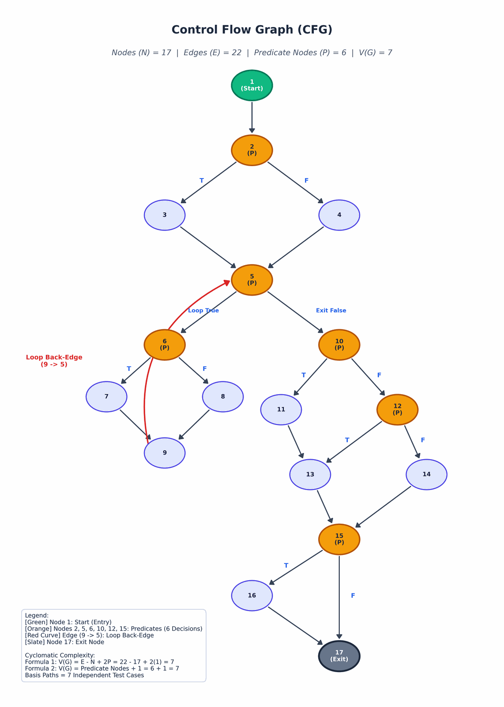

# Experiment 02 — Cyclomatic Complexity of a Flow Graph

**Assessment:** Model Practical – Set 2  
**Course:** Software Engineering (CSA1022 / CSA10)  
**Marks:** 25 Marks (Part A: 15 Marks Design & Implementation + Part B: 10 Marks Analysis)  
**Course Outcomes:** CO4 (Software Testing Strategies & Metrics), CO1 (Agile Project Management)

---

## 📸 Control Flow Graph (CFG) Diagram



---

## 1. Objective

To calculate, mathematically verify, and analyze the **Cyclomatic Complexity** of a program using two independent formulas, construct an exact and valid **Control Flow Graph (CFG)** ($N=17, E=22$, 6 predicate nodes), and determine the required basis path testing effort and risk level.

---

## 2. Given Parameters

- **Edges ($E$):** $22$
- **Nodes ($N$):** $17$
- **Predicate Nodes:** $6$
- **Connected Components ($P$):** $1$ (Single connected program)

---

## 3. Formulas and Step-by-Step Derivations

### Formula 1 (Edges and Nodes Formula):
$$V(G) = E - N + 2P$$
$$V(G) = 22 - 17 + 2(1) = 5 + 2 = \mathbf{7}$$

### Formula 2 (Predicate-Node Formula):
$$V(G) = \text{Predicate Nodes} + 1$$
$$V(G) = 6 + 1 = \mathbf{7}$$

**Result:** Both formulas agree identically: $V(G) = 7$.

---

## 4. Files in This Folder

| File | Purpose |
| :--- | :--- |
| `verify_graph.py` | Python script that verifies the mathematical graph structure and renders `flow_graph.png`. |
| `flow_graph.png` | High-resolution exported image of the Control Flow Graph with 17 nodes and 22 edges. |
| `flow_graph.drawio` | Editable XML diagram file for Draw.io / diagrams.net. |
| `flow_graph.mmd` | Mermaid diagram markdown source code for interactive viewers. |
| `calculations.md` | Full mathematical derivation, basis path trace table, and explanation. |
| `analysis.md` | Typed examination answer for Part B (10 Marks). |
| `README.md` | Complete documentation and viva revision guide (this file). |

---

## 5. How to Run the Graph Verification & Render Diagrams

From this folder:
```bash
cd Q2_Cyclomatic_Complexity
python verify_graph.py
```

### Expected Output:
```text
=================================================================
 CONTROL FLOW GRAPH MATHEMATICAL VERIFICATION REPORT
=================================================================
Total Nodes (N)            : 17 (Expected: 17)
Total Edges (E)            : 22 (Expected: 22)
Predicate Nodes count      : 6 (Expected: 6)
Predicate Nodes list       : [2, 5, 6, 10, 12, 15]
Connected Components (P)   : 1
-----------------------------------------------------------------
Formula 1: V(G) = E - N + 2P  = 22 - 17 + 2(1) = 7
Formula 2: V(G) = Pred + 1    = 6 + 1 = 7
-----------------------------------------------------------------
[PASS] MATHEMATICAL VERIFICATION CONFIRMED: V(G) = 7 BY BOTH METHODS
=================================================================

Linearly Independent Basis Paths (Total: 7):
  Path 1 (Baseline: Skip loop, then 10, skip 16): 1 -> 2 -> 3 -> 5 -> 10 -> 11 -> 13 -> 15 -> 17
  Path 2 (Flip P1 false):                       1 -> 2 -> 4 -> 5 -> 10 -> 11 -> 13 -> 15 -> 17
  Path 3 (Flip P2 true, P3 true inside loop):     1 -> 2 -> 3 -> 5 -> 6 -> 7 -> 9 -> 5 -> 10 -> 11 -> 13 -> 15 -> 17
  Path 4 (Flip P3 false inside loop):             1 -> 2 -> 3 -> 5 -> 6 -> 8 -> 9 -> 5 -> 10 -> 11 -> 13 -> 15 -> 17
  Path 5 (Flip P4 false, P5 true):               1 -> 2 -> 3 -> 5 -> 10 -> 12 -> 13 -> 15 -> 17
  Path 6 (Flip P5 false):                        1 -> 2 -> 3 -> 5 -> 10 -> 12 -> 14 -> 15 -> 17
  Path 7 (Flip P6 true):                         1 -> 2 -> 3 -> 5 -> 10 -> 11 -> 13 -> 15 -> 16 -> 17
=================================================================
[+] Rendered Control Flow Graph image to: .../flow_graph.png
```

---

## 6. Evidence to Capture for Submission

1. **Terminal output of `python verify_graph.py`** confirming the node count (17), edge count (22), predicate count (6), and $V(G) = 7$.
2. **Diagram file:** `flow_graph.png` showing the directed execution flow and labeled decision branches.
3. **Formulas and Calculations document:** `calculations.md` with step-by-step substitution.
4. **Part B Analysis Document:** `analysis.md` interpreting the risk rating and required basis test cases.

---

## 7. Viva Examination Quick Revision

- **Q: What is Cyclomatic Complexity?**  
  *A:* A software testing metric developed by Thomas McCabe that measures the structural complexity of a program and sets an upper bound on the number of linearly independent paths.
- **Q: What is a Predicate Node?**  
  *A:* A decision node that has two outgoing edges (e.g., an `if` condition with True and False branches).
- **Q: How many test cases are required for a module with $V(G) = 7$?**  
  *A:* Exactly **7 basis path test cases** are required to guarantee 100% statement and branch coverage.
- **Q: What does $V(G) = 7$ indicate about testing effort and risk?**  
  *A:* Since $V(G) \le 10$, the program is categorized as **Low Risk**, well-structured, easy to maintain, and requires low testing effort.
