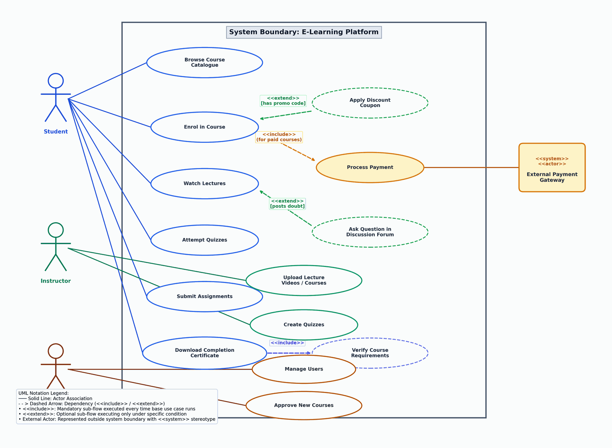

# Experiment 03 — E-Learning Platform: UML Use Case Diagram

**Assessment:** Model Practical – Set 2  
**Course:** Software Engineering (CSA1022 / CSA10)  
**Marks:** 25 Marks (Part A: 15 Marks Design & Implementation + Part B: 10 Marks Analysis)  
**Course Outcomes:** CO2 (Requirements Analysis & UML Modeling), CO1 (Agile Project Management)

---

## 📸 UML 2.5 Use Case Diagram



---

## 1. Objective

To design, model, and document a complete, syntactically and logically valid **UML Use Case Diagram** for an online E-Learning Platform adhering to UML 2.5 standards:
- Clear system boundary (`E-Learning Platform`).
- 4 identified actors: Student, Instructor, Administrator, and External Payment Gateway.
- Complete set of core and auxiliary use cases.
- Valid `<<include>>` and `<<extend>>` relationship modeling.

---

## 2. Requirements & Scenario Summary

An e-learning platform offers online courses:
- **Students:** Browse course catalogue (public), enrol in courses, watch lectures, attempt quizzes, submit assignments, download completion certificates.
- **Instructors:** Upload lecture videos / courses, create quizzes.
- **Administrators:** Manage users, approve new courses.
- **External Payment Gateway:** External actor processing credit card/online transactions for paid courses.

---

## 3. Files in This Folder

| File | Purpose |
| :--- | :--- |
| `generate_diagram.py` | Python script using `matplotlib` to render the high-resolution `use_case_diagram.png`. |
| `use_case_diagram.png` | Exported high-resolution UML diagram image with clean non-crossing layout. |
| `use_case_diagram.drawio` | Editable XML diagram file for Draw.io / diagrams.net. |
| `use_case_diagram.mmd` | Mermaid markdown source code for viewing in GitHub / Markdown previewers. |
| `actors_and_use_cases.md` | Comprehensive inventory of actors, use cases, pre/postconditions, and relationships. |
| `analysis.md` | Typed examination answer for Part B (10 Marks). |
| `README.md` | Complete documentation and viva revision guide (this file). |

---

## 4. How to Generate or View the Diagrams

### A. Re-render PNG Diagram
```bash
cd Q3_Elearning_Use_Case
python generate_diagram.py
```
This generates `use_case_diagram.png` (300 DPI, publication quality).

### B. Edit in Draw.io
1. Navigate to [Draw.io](https://app.diagrams.net/).
2. Select **"Open Existing Diagram"** and choose `use_case_diagram.drawio`.
3. Edit, reposition elements, or export as SVG/PDF.

---

## 5. Evidence to Capture for Submission

1. **Rendered UML diagram:** View `use_case_diagram.png` showing the system boundary, 4 actors, use cases, and labeled include/extend relationships.
2. **Actor & Use Case Documentation:** Open `actors_and_use_cases.md` explaining the responsibilities of each actor.
3. **Part B Analysis Document:** Open `analysis.md` answering the justification of `<<include>>`, `<<extend>>`, why the payment gateway is an external actor, and logged-in student access boundaries.

---

## 6. Viva Examination Quick Revision

- **Q: What is a System Boundary in a Use Case Diagram?**  
  *A:* A rectangular container representing the scope of the software system. Use cases lie inside the boundary, while actors reside outside.
- **Q: What is the difference between `<<include>>` and `<<extend>>`?**  
  *A:* `<<include>>` represents mandatory common behavior that executes every time the base usecase runs (Base $\rightarrow$ Included). `<<extend>>` represents optional behavior that executes only if a condition is met (Extension $\rightarrow$ Base).
- **Q: Why is the Payment Gateway drawn as an Actor rather than a Use Case?**  
  *A:* The Payment Gateway is an autonomous external system operated by a bank/third party outside our software boundary; it interacts with our system by providing transaction authorization services.
- **Q: Which student use case does not require logging in?**  
  *A:* `Browse Course Catalogue` is public so prospective learners can explore courses before registering.
