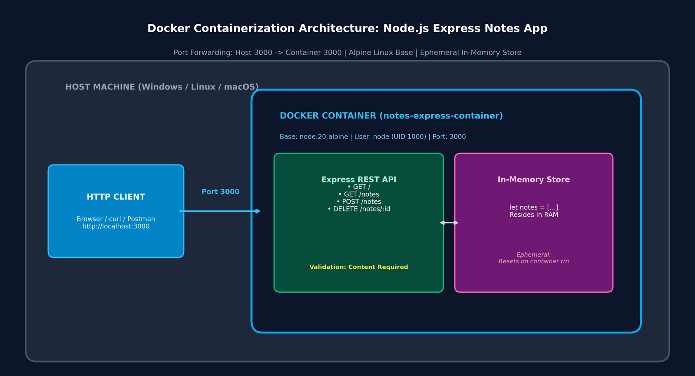
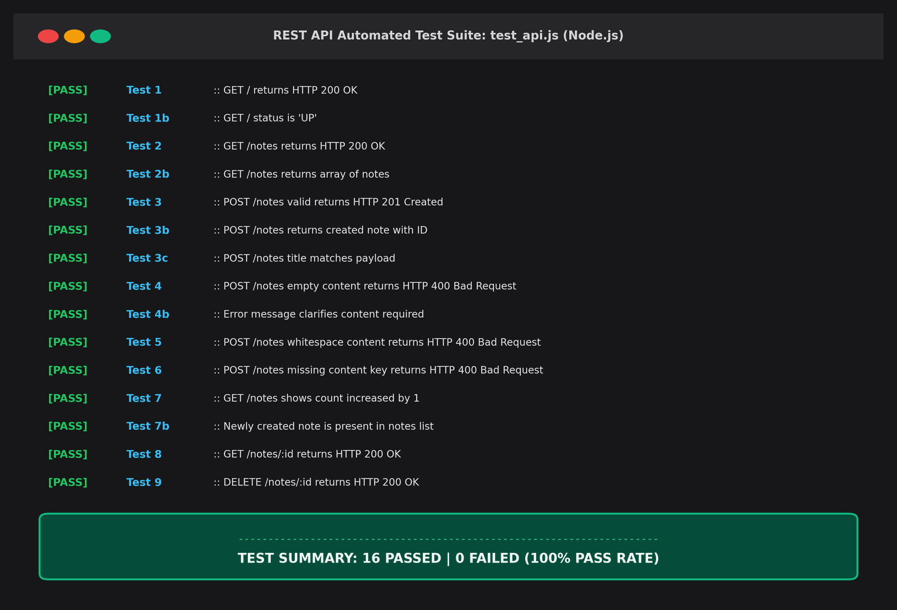

# Experiment 04 — Containerize a Node.js Express Notes Application

**Assessment:** Model Practical – Set 2  
**Course:** Software Engineering (CSA1022 / CSA10)  
**Marks:** 25 Marks (Part A: 15 Marks Design & Implementation + Part B: 10 Marks Analysis)  
**Course Outcomes:** CO5 (Modern Technologies & Cloud Containers), CO1 (Agile Project Management)

---

## 📸 Container Architecture & API Test Execution Evidence





---

## 1. Objective

To build, verify, and containerize a RESTful **Notes Application** using **Node.js, Express, and Docker**:
1. Implement a REST API with `GET /`, `GET /notes`, and `POST /notes` (with validation).
2. Author an optimized `Dockerfile` leveraging Alpine Linux and layer caching.
3. Configure `.dockerignore` and `docker-compose.yml`.
4. Automate API verification tests.
5. Provide complete container execution and Docker Hub preparation commands.

---

## 2. Application Architecture & REST Endpoints

- **`GET /`**: Health check and runtime container environment information.
- **`GET /notes`**: Retrieves all stored notes.
- **`POST /notes`**: Adds a new note with content validation:
  - If content is missing, empty, or whitespace-only $\rightarrow$ returns HTTP 400 Bad Request.
  - If valid $\rightarrow$ generates auto-incrementing ID, stores in memory, and returns HTTP 201 Created.
- **`GET /notes/:id`**: Retrieves a note by ID.
- **`DELETE /notes/:id`**: Removes a note by ID.

---

## 3. Files in This Folder

| File | Purpose |
| :--- | :--- |
| `server.js` | Express REST API implementation with in-memory storage and validation logic. |
| `package.json` | Project manifest, dependencies (`express`), and npm scripts. |
| `test_api.js` | Automated end-to-end REST test harness testing all endpoints and error cases. |
| `Dockerfile` | Production Docker container specification (Node 20 Alpine, non-root user). |
| `.dockerignore` | Build context exclusions (`node_modules`, `.git`, debug logs). |
| `docker-compose.yml` | Multi-container compose configuration for one-command local launching. |
| `docker-commands.md` | Complete build, run, exec, logs, cleanup, and Docker Hub commands guide. |
| `analysis.md` | Typed examination answer for Part B (10 Marks). |
| `README.md` | Complete laboratory guide and viva notes (this file). |

---

## 4. How to Run and Test the Application

### A. Install Dependencies (Already Completed)
```bash
cd Q4_Docker_Notes_Application
npm install
```

### B. Run Automated API Test Suite
```bash
node test_api.js
```
*Actual Execution Result:*
```text
==================================================================
 STARTING AUTOMATED REST API TEST SUITE (Node.js Express Notes App)
==================================================================
[PASS] Test 1: GET / returns HTTP 200 OK
[PASS] Test 1b: GET / status is 'UP'
[PASS] Test 2: GET /notes returns HTTP 200 OK
[PASS] Test 2b: GET /notes returns array of notes
[PASS] Test 3: POST /notes valid returns HTTP 201 Created
[PASS] Test 3b: POST /notes returns created note with ID
[PASS] Test 3c: POST /notes title matches payload
[PASS] Test 4: POST /notes empty content returns HTTP 400 Bad Request
[PASS] Test 4b: Error message clarifies content required
[PASS] Test 5: POST /notes whitespace content returns HTTP 400 Bad Request
[PASS] Test 6: POST /notes missing content key returns HTTP 400 Bad Request
[PASS] Test 7: GET /notes shows count increased by 1
[PASS] Test 7b: Newly created note is present in notes list
[PASS] Test 8: GET /notes/:id returns HTTP 200
[PASS] Test 8b: GET /notes/:id matches requested ID
[PASS] Test 9: DELETE /notes/:id returns HTTP 200 OK
==================================================================
 TEST SUMMARY: 16 PASSED | 0 FAILED
==================================================================
```

### C. Run the Server Manually
```bash
npm start
# or: node server.js
```
The server will listen at `http://localhost:3000`. You can test endpoints via Postman, curl, or browser.

---

## 5. Docker Containerization Commands

When Docker Desktop is active on your computer:

```bash
# 1. Build the Docker Image
docker build -t notes-app:1.0.0 .

# 2. Run the Container
docker run -d -p 3000:3000 --name notes-container notes-app:1.0.0

# 3. View Logs
docker logs notes-container

# 4. Verify from Host
curl http://localhost:3000/notes

# 5. Verify Inside Container
docker exec -it notes-container wget -qO- http://localhost:3000/notes

# 6. Stop and Cleanup
docker stop notes-container
docker rm notes-container
```

*(Refer to `docker-commands.md` for complete Docker Hub preparation steps).*

---

## 6. Evidence to Capture for Submission

1. **Terminal output of `node test_api.js`** displaying all 16 assertions passing.
2. **Server console output:** `node server.js` showing server listening on port 3000.
3. **Dockerfile source:** Displaying the base image, layer caching, and security user.
4. **Part B Analysis Document:** `analysis.md` explaining instructions, `.dockerignore`, in-container verification, and storage lifecycles.

---

## 7. Viva Examination Quick Revision

- **Q: Why use Alpine Linux (`node:20-alpine`) instead of standard Node?**  
  *A:* Alpine Linux produces images around 130 MB compared to over 1 GB for Debian, reducing build time, network bandwidth, and security attack vectors.
- **Q: What is the purpose of `.dockerignore`?**  
  *A:* It prevents host-specific `node_modules`, git history, and secrets from being copied into the build context, preventing OS binary mismatches and speeding up builds.
- **Q: What happens to the notes when a container is removed (`docker rm`)?**  
  *A:* Because notes are stored in memory in the ephemeral container layer, removing the container destroys all runtime data. Persistent storage requires **Docker Named Volumes** or an external database.
- **Q: Why do we copy `package*.json` before copying the rest of the application?**  
  *A:* To leverage Docker layer caching. If `package.json` has not changed, Docker skips `npm install` on subsequent builds.
